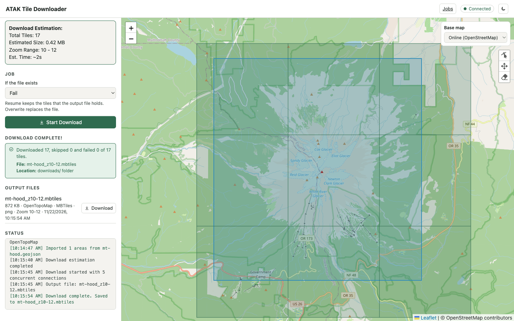

<h1 align="center">ATAK Map Downloader</h1>

<p align="center"><b>Get the whole AO you need into ATAK, fast.</b> Map tiles from 52 built-in sources to MBTiles, OSMDroid, or GeoPackage, from a CLI or a web UI.</p>

<p align="center">
  <a href="https://github.com/Crank-Git/ATAK-Map-Downloader/actions/workflows/ci.yml"></a>
  <a href="https://github.com/Crank-Git/ATAK-Map-Downloader/releases"></a>
  
  <a href="LICENSE"></a>
</p>

<p align="center">
  <a href="#documentation"><b>Docs</b></a> ·
  <a href="#install"><b>Install</b></a> ·
  <a href="#quick-start"><b>Quick start</b></a> ·
  <a href="https://github.com/Crank-Git/ATAK-Map-Downloader/releases"><b>Releases</b></a>
</p>

<p align="center">
  
</p>

## Why ATAK Map Downloader

I built ATAK Map Downloader because the apps download slowly and incorrectly. This lets
you get your entire AO, the one YOU need, without the waiting and the bugs.

`atak-dl` is one Go binary. It embeds the MOBAC XML source files of
[ATAK-Maps](https://github.com/joshuafuller/ATAK-Maps) v2.3.1, works out every Web
Mercator tile in your areas and zoom ranges, and downloads them concurrently into one
output file. An area can be a box, a polygon, or a buffered route, drawn in the web UI or
read from a GeoJSON, KML, or KMZ file.

Every source carries a policy class (`open`, `conditional`, or `restricted`) and a request
rate. The job never goes above that rate, and a `restricted` source won't start until you
accept its terms. A job that stops partway keeps every tile it stored, so `--resume` picks
up where it left off.

## Requirements

- Nothing for a release binary. It's a static build with the map sources inside.
- Go 1.26 or later, only to build from source. No C compiler: the SQLite driver is pure Go.

## Install

You can install from a release archive or run the Docker image.

### Release archive

Download the archive for your OS and architecture from
[Releases](https://github.com/Crank-Git/ATAK-Map-Downloader/releases). Windows archives are
`.zip`, the rest are `.tar.gz`. Each one holds `atak-dl`, `README.md`, and `LICENSE`.

```bash
curl -LO https://github.com/Crank-Git/ATAK-Map-Downloader/releases/download/v0.2.0/atak-map-downloader_0.2.0_linux_amd64.tar.gz
tar xzf atak-map-downloader_0.2.0_linux_amd64.tar.gz
./atak-dl --version
```

Verify the archive against `checksums.txt` from the same release.

### Docker image

```bash
docker run -p 5000:5000 ghcr.io/crank-git/atak-map-downloader:v0.2.0
```

The image runs `atak-dl serve --addr 0.0.0.0:5000 --data-dir /data`, with `/data` as a
volume. Arguments after the image name replace `serve --addr 0.0.0.0:5000 --data-dir /data`.
`0.0.0.0` isn't loopback, so the server requires a token: set `ATAKDL_TOKEN`, or read the
generated one from the logs. For a team server with a persistent volume, see
[docs/server.md](docs/server.md).

## Quick start

Start the web UI:

```bash
./atak-dl serve
```

Open http://localhost:5000, pick a map source, draw or import an area, set the zoom range,
and click Estimate Download, then Start Download. The Jobs page at
http://localhost:5000/jobs lists queued jobs and the job history, newest first. Each row
offers Cancel, Download, or Resume, as the job state allows, and selecting a row shows the
job record and its live event log.

Or do the same from the CLI. This downloads 7 OpenTopoMap tiles around Mt. Hood:

```bash
./atak-dl download --source "OpenTopoMap" --bbox=45.30,-121.80,45.45,-121.60 \
  --min-zoom=8 --max-zoom=10 --name mt-hood
```

```text
Done: 7 downloaded, 0 skipped, 0 failed in 3s -> downloads/mt-hood_z8-10.mbtiles
```

Output goes to `./downloads` unless you set `--data-dir` or `ATAKDL_DATA_DIR`. Copy a
`.mbtiles`, `.sqlite`, or `.gpkg` file to `atak/imagery/` on the device.

## Usage

```bash
# List the map sources, with policy class and origin
./atak-dl list-sources

# Estimate the job for an area before you download it
./atak-dl estimate --source="Google Satellite" --bbox=40.68,-74.05,40.88,-73.91

# Get the tile coordinates of a point
./atak-dl tile-info --lat=40.7589 --lon=-73.9851 --zoom=15

# Check a map source and print its URL template, tile type, and zoom range
./atak-dl validate-source --source="Google Satellite"

# Download a restricted source (you accept its terms)
./atak-dl download --source="Google Satellite" --bbox=40.7,-74.1,40.8,-74.0 --min-zoom=10 --max-zoom=12 --accept-terms

# Download the tiles within 300 m of the trail in a KML file
./atak-dl download --source="OpenTopoMap" --area=trail.kml --buffer=300 --min-zoom=12 --max-zoom=16

# Pull the latest ATAK-Maps release into the user source directory
./atak-dl sources sync
```

`download` writes MBTiles by default. `--format osmdroid` or `--format gpkg` picks another
output format, and `--data-package --package-name <name>` wraps the file in an ATAK data
package zip for Import Manager. If you press Ctrl-C, the stored tiles stay; run the same
command again with `--resume`.

Every flag, the progress line, and the exit codes are in [docs/cli.md](docs/cli.md).

## Documentation

| Page | What's there |
|---|---|
| [CLI reference](docs/cli.md) | Every flag and its default, the progress line, and the exit codes of `download`. |
| [Map sources](docs/sources.md) | The embedded snapshot, the user source directory, `sources sync`, old source names, skipped source files, and WMS. |
| [Team server](docs/server.md) | Running `serve` in Docker for a team: token, data volume, Compose, and the health route. |
| [Project layout](docs/development.md) | What lives where in the repo. |

## Development

```bash
CGO_ENABLED=0 go build -o atak-dl ./cmd/atak-dl
```

The build needs no C toolchain, so cross-compiling is only `GOOS` and `GOARCH`:

```bash
CGO_ENABLED=0 GOOS=linux GOARCH=arm64 go build -o atak-dl-linux-arm64 ./cmd/atak-dl
CGO_ENABLED=0 GOOS=windows GOARCH=amd64 go build -o atak-dl.exe ./cmd/atak-dl
```

CI builds all six targets: `linux`, `darwin`, and `windows`, each on `amd64` and `arm64`.

A local build reports `atak-dl version dev (commit none, built unknown)` for `--version`.

```bash
go test -race ./...           # tests with the race detector, as CI runs them
go vet ./...
go tool golangci-lint run     # version pinned in go.mod as a tool dependency
scripts/smoke.sh              # builds the binary, starts serve, checks / and /api/sources
```

If the linter binary doesn't link on macOS, run `CGO_ENABLED=0 go tool golangci-lint run`.

## Security

- `serve` binds to `localhost:5000` and needs no token there. On any non-loopback address,
  every route except `GET /healthz` and the sign-in page requires the token
  (`--token`, `ATAKDL_TOKEN`, or a generated one printed once to stderr).
- After 10 failed token attempts in one minute, an IP address gets 429
  `too_many_attempts`.
- `--insecure` turns off TLS verification for the tile server. The command prints a
  warning when you use it.

## License

MIT. See [LICENSE](LICENSE). The embedded ATAK-Maps source files are MIT too, by Joshua
Fuller; see `internal/snapshot/NOTICE.md`.

---

<sub>Part of <a href="https://github.com/Crank-Git#off-grid-and-everything-else"><b>Off-grid and everything else</b></a>.
Siblings: <a href="https://github.com/Crank-Git/MTFWBuilder">MTFWBuilder</a> ·
<a href="https://github.com/Crank-Git/issue-flow-codex">issue-flow-codex</a> ·
<a href="https://github.com/Crank-Git/simpletetris">simpletetris</a> ·
<a href="https://github.com/Crank-Git/simplebubblebobble">simplebubblebobble</a> ·
Built by <a href="https://github.com/Crank-Git">Crank</a></sub>
