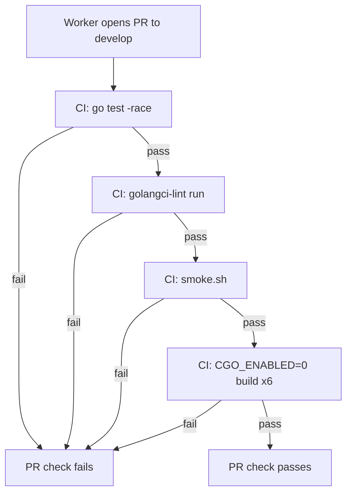
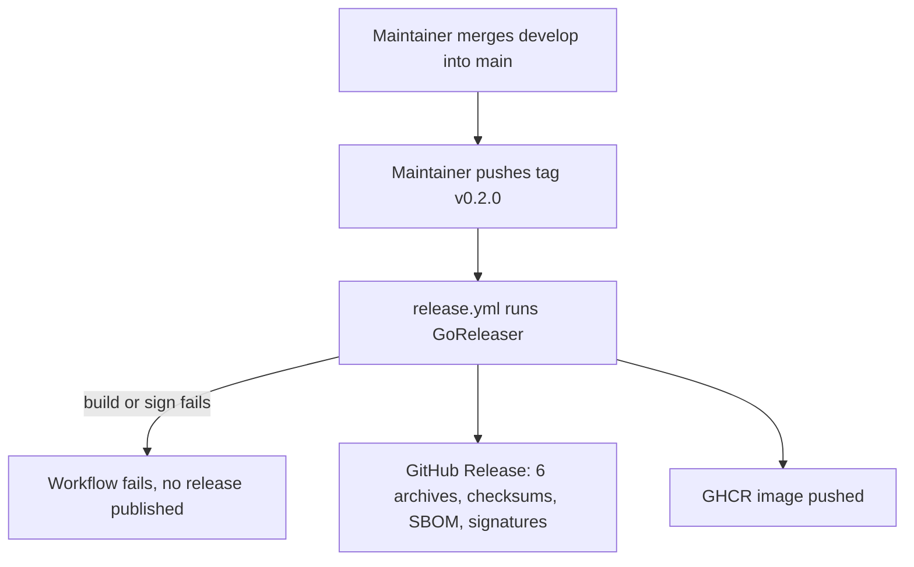

## Purpose

The project builds and passes its 12 tests, but it has no CI, no lint config, no release automation and no integration branch. It also needs CGO, so the documented cross-compile commands fail. This feature adds only the missing foundation items. It does not change user-visible behavior.

Audit of the Epic 0 items against the repository on 2026-11-21:

| Item | State | Evidence | In this epic |
|---|---|---|---|
| Repo scaffold | Present | `cmd/`, `internal/`, `web/`, `go.mod` | No |
| Test harness | Partial | `go test ./...` passes, with tests only in `tilecalc` and `xmlparser` | Yes: fake tile server, fixtures |
| Lint with complexity rules | Missing | No lint config. `gofmt -l .` lists 5 files | Yes |
| CI workflow | Missing | No `.github/` | Yes |
| Branch model | Missing | Only `main` exists | Yes: create `develop` |
| Deploy wiring (releases) | Missing | No goreleaser, no Dockerfile, no tag | Yes |
| Seed and demo data | Missing | No `testdata/` | Yes |
| Smoke path | Missing | No script | Yes |
| CGO-free build | Missing | `mattn/go-sqlite3` (`internal/mbtiles/mbtiles.go:10`) | Yes |

## User stories

- As an OSS user, I want a release binary for my platform, so that I do not need a Go toolchain.
- As a server operator, I want a container image, so that I run the server with no build step.
- As the maintainer, I want CI on every PR, so that a worker's change cannot break the build silently.

## Functional requirements

- FR-foundation-1 — `go.mod` declares `go 1.26.0` and `toolchain go1.27.4`.
- FR-foundation-2 — The output writer uses `modernc.org/sqlite`.
- FR-foundation-3 — `CGO_ENABLED=0 go build ./cmd/atak-dl` succeeds for linux, darwin and windows on amd64 and arm64.
- FR-foundation-4 — An output file written with the new driver is byte-compatible in schema with the current output file: the same tables, columns, indexes and metadata keys.
- FR-foundation-5 — `gofmt -l .` prints no file.
- FR-foundation-6 — `.golangci.yml` uses the golangci-lint v2 format and enables `gocyclo`, `gocognit`, `cyclop`, `funlen`, `revive`, `gosec`, `errorlint` and `unused`.
- FR-foundation-7 — The lint thresholds are: cyclomatic complexity 15, cognitive complexity 20, function length 80 lines or 50 statements.
- FR-foundation-8 — `go.mod` pins golangci-lint with a `tool` directive.
- FR-foundation-9 — `internal/testtiles` provides an `httptest` tile server that returns a configured response for each tile.
- FR-foundation-10 — The test tile server can return each of these responses:
  - a PNG
  - a JPEG
  - 404
  - 429 with `Retry-After`
  - 503
  - an HTML body with status 200
  - a delayed response
- FR-foundation-11 — `testdata/sources/` holds three fixture source files: a `{$x}/{$y}/{$z}` map source, a `{$q}` quadkey map source and a `customWmsMapSource`.
- FR-foundation-12 — `internal/download` and `internal/mbtiles` have integration tests that use the test tile server.
- FR-foundation-13 — `scripts/smoke.sh` builds the binary and starts `serve` on a free port.
- FR-foundation-14 — `scripts/smoke.sh` checks that `GET /` returns 200 and that `GET /api/sources` returns a non-empty JSON array, then stops the server.
- FR-foundation-15 — `.github/workflows/ci.yml` runs on every pull request to `develop` and `main`.
- FR-foundation-16 — The CI workflow runs `go test -race ./...`, `golangci-lint run`, `scripts/smoke.sh` and a `CGO_ENABLED=0` build for each of the six targets.
- FR-foundation-17 — A `develop` branch exists, created from `main`.
- FR-foundation-18 — `develop` is the default branch for pull requests.
- FR-foundation-19 — `.goreleaser.yaml` builds six archives with checksums, an SBOM and cosign keyless signatures.
- FR-foundation-20 — `.goreleaser.yaml` publishes a multi-arch image to `ghcr.io/crank-git/atak-map-downloader` on `gcr.io/distroless/static`.
- FR-foundation-21 — `.github/workflows/release.yml` runs GoReleaser when a tag that matches `v*` is pushed.
- FR-foundation-22 — `atak-dl --version` prints the version, the commit and the build date that GoReleaser sets.
- FR-foundation-23 — The README build section documents `CGO_ENABLED=0` builds, the two install methods (release archive and Docker) and `go test -race ./...`.
- FR-foundation-24 — The README does not contain the claim "1:1 functionality matching the Python version".

## User flows

### Flow 1 — A pull request runs CI

1. A worker opens a pull request to `develop`.
2. CI runs `go test -race ./...`. If it fails, the check fails.
3. CI runs `golangci-lint run`. If it fails, the check fails.
4. CI runs `scripts/smoke.sh`. If it fails, the check fails.
5. CI builds the six targets with `CGO_ENABLED=0`. If one build fails, the check fails.
6. The check passes.

### Flow 2 — The maintainer cuts a release

1. The maintainer merges `develop` into `main`.
2. The maintainer pushes a tag that matches `v*`.
3. The release workflow runs GoReleaser.
4. If a build or a signature fails, the workflow fails and publishes nothing.
5. GoReleaser publishes the GitHub Release and the GHCR image.

## Screens & states

No screen. The CLI adds `--version`.

## Behaviour rules

- CI uses `actions/setup-go` with `go-version-file: go.mod`.
- The release workflow has the permissions `contents: write`, `packages: write`, `id-token: write` and `attestations: write`.
- The Docker image runs as a non-root user. It exposes port 5000 and starts `atak-dl serve --addr 0.0.0.0:5000`.

## Data touched

No entity changes. The output file schema stays the same (FR-foundation-4).

## Interfaces

- `modernc.org/sqlite` v1.62.0 registers the driver name `sqlite`, not `sqlite3`. Verify this at https://pkg.go.dev/modernc.org/sqlite before you change `sql.Open` (retrieved 2026-11-21).
- GoReleaser v2.20.3. Use `archives.formats` and `snapshot.version_template`, per https://goreleaser.com/deprecations/. Use `dockers_v2` for the multi-arch image. Read https://goreleaser.com/customization/ before you write the config.
- golangci-lint v2.15.0 config format: https://golangci-lint.run/docs/configuration/ (`version: "2"`, `linters.default: standard`).
- cosign keyless signing in GoReleaser: https://goreleaser.com/customization/sign/.

## Edge cases & failures

- If modernc is slower than the engine's write rate, the writer becomes the bottleneck. Feature 07 adds batched transactions. This epic only switches the driver and keeps one insert per tile.
- If `gofmt` changes the five unformatted files, the diff is format-only. Commit it alone, before any logic change.

## Acceptance criteria

- A binary built with `CGO_ENABLED=0 go build ./cmd/atak-dl` writes an output file that `sqlite3` opens.
- An integration test downloads a 3×3 tile area from the test tile server and reads 9 rows from `tiles`.
- `sqlite3 <output file> .schema` shows the same four statements as before the change.
- `gofmt -l .` prints nothing on `develop`.
- `golangci-lint run` exits 0 on `develop`.
- A pull request with a failing test shows a failed CI check.
- `scripts/smoke.sh` exits 0 locally and in CI.
- A `v0.2.0-rc.1` tag produces a GitHub Release with 6 archives, `checksums.txt`, SBOM files and signatures.
- `docker run ghcr.io/crank-git/atak-map-downloader:v0.2.0-rc.1 --version` prints the version.
- The README contains no "Python version" text.

## Out of scope

- Behavior changes to downloads, the server or the web UI.
- Branch protection rules on GitHub. The maintainer sets them by hand.

## Open questions
