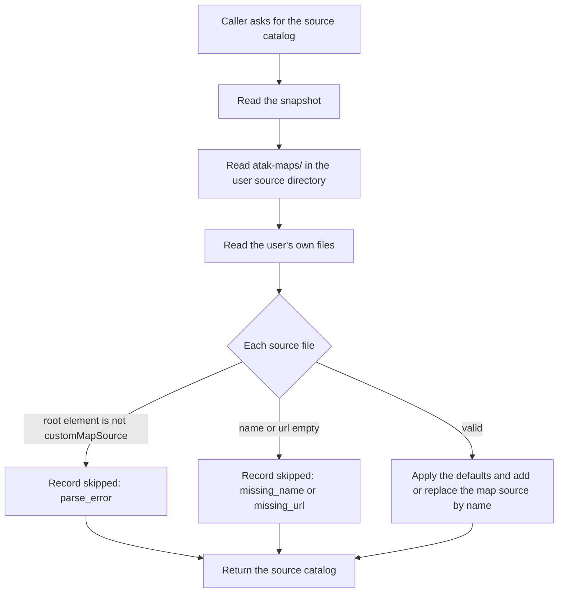
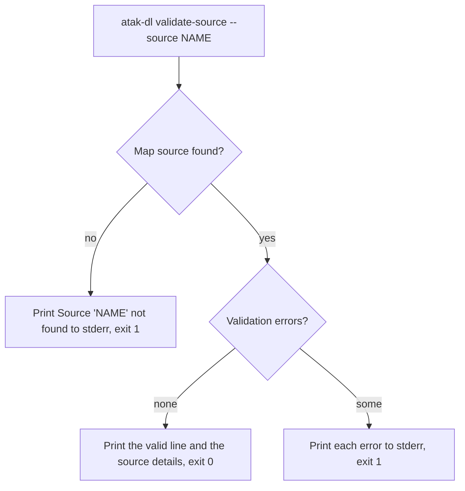

## Purpose

The source catalog tells the project which tile servers it can read. Each map source
comes from one MOBAC XML source file in the embedded snapshot or in the user source
directory. The CLI and the web UI read the same source catalog, so a map source that
loads is available everywhere.

This file describes the behavior that exists today. It records the defects plainly and
points each defect at the feature that repairs it. Feature 09 (`09-source-sync.md`)
holds the snapshot, the sync command and the precedence of the source files.

## User stories

- As a solo operator, I want to list the map sources, so that I can choose one by name.
- As a solo operator, I want to validate one map source, so that I know its URL template
  and its zoom range.
- As a solo operator, I want to add a source file to a directory, so that the project can
  use a new tile server.

## Functional requirements

- FR-map-sources-1 — The project reads the source catalog from the embedded snapshot and
  from the user source directory that `--mapsources-dir` names. The default directory is
  `<user config dir>/atak-dl/mapsources` (FR-source-sync-4 to -7).
- FR-map-sources-2 — The project walks the directory recursively and reads every file
  whose name ends in `.xml`, in any letter case.
- FR-map-sources-3 — The project parses a source file only when its root element is
  `<customMapSource>`.
- FR-map-sources-4 — The project reads these child elements: `name`, `url`, `minZoom`,
  `maxZoom`, `tileType`, `tileUpdate`, `backgroundColor`, `ignoreErrors`, `serverParts`.
- FR-map-sources-5 — The project removes leading and trailing white space from `name`
  and from `url`.
- FR-map-sources-6 — The project skips a source file that has an empty `name` or an
  empty `url`, and logs the warning `missing required fields`.
- FR-map-sources-7 — If both `minZoom` and `maxZoom` are 0, the project sets `maxZoom`
  to 18.
- FR-map-sources-8 — If `tileType` is empty, the project sets it to `png`.
- FR-map-sources-9 — If `tileUpdate` is empty, the project sets it to `None`.
- FR-map-sources-10 — If `backgroundColor` is empty, the project sets it to `#000000`.
- FR-map-sources-11 — The project splits `serverParts` on white space and on commas into
  a list of server parts (FR-source-sync-22).
- FR-map-sources-12 — The project identifies each map source by its trimmed `name`.
- FR-map-sources-13 — The project substitutes `{$x}`, `{$y}` and `{$z}` in the URL
  template with the XYZ tile coordinates.
- FR-map-sources-14 — The project substitutes `{$q}` with the Bing quadkey of the tile.
- FR-map-sources-15 — The project substitutes `{$serverpart}` with the server part that
  the caller supplies. With no supplied server part, it uses the server part of the tile
  key, `(x + y) mod len(serverParts)` (FR-source-sync-23).
- FR-map-sources-16 — The project reads the snapshot and the user source directory on
  each call for the source catalog. It keeps no cache.
- FR-map-sources-17 — The `list-sources` command prints each map source, sorted by name,
  as `name (tileType) - Zoom min-max - tileUpdate`, and then the count.
- FR-map-sources-18 — The `validate-source` command reports a validation error for each
  of these conditions:
  - an empty name or an empty URL,
  - a `minZoom` or a `maxZoom` outside 0 to 25,
  - a `minZoom` greater than `maxZoom`,
  - a `tileType` other than `png`, `jpg`, `jpeg` or `webp`, in any letter case,
  - a URL template that has neither all of `{$x}`, `{$y}` and `{$z}` nor `{$q}`.
- FR-map-sources-19 — `GET /api/sources` returns the source catalog as a JSON array,
  sorted by name.
- FR-map-sources-20 — `POST /api/validate-source` returns the validation result for one
  map source as JSON.

## User flows

### Flow 1 — The project loads the source catalog



1. A command or a server route asks for the source catalog.
2. The project reads the layers in this order:
   1. the embedded snapshot, unless the command has `--no-snapshot`
   2. `<user source directory>/atak-maps/`
   3. the other files in the user source directory
3. If the root element is not `<customMapSource>`, the project records the source file
   as skipped with reason `parse_error`.
4. If `name` or `url` is empty, the project records the source file as skipped with
   reason `missing_name` or `missing_url`.
5. The project applies the defaults and adds the map source under its name. A map source
   of a later layer replaces a map source of the same name (FR-source-sync-5).
6. The project returns the source catalog. A missing user source directory adds no map
   source.

### Flow 2 — The solo operator validates a map source



1. The solo operator runs `atak-dl validate-source --source NAME`.
2. If the map source is not in the source catalog, the CLI prints
   `Source 'NAME' not found` to stderr and exits with code 1.
3. If validation finds no error, the CLI prints `✓ Source 'NAME' is valid` and the
   source details, and exits with code 0.
4. If validation finds errors, the CLI prints `✗ Source 'NAME' has validation errors:`
   and one line per error to stderr, and exits with code 1.

## Screens & states

This feature has no screen of its own. It shows in three places:

- CLI output of `list-sources`. Populated state: the header `Available Map Sources`, one
  line per map source, and `Found N map sources`. Empty state: `No map sources found.`
  and `Make sure XML files exist in: <dir>`, with exit code 0.
- CLI output of `validate-source`. See Flow 2.
- The source picker `<select id="mapSourceSelect">` in `web/index.html`, filled by
  `populateSourceSelect` in `web/static/js/app.js`. Loading state:
  `Loading sources...`. Populated state: one option per map source as
  `name (format) - Zoom min-max`. Error state: a status log line only. See
  `04-web-ui.md`.

## Behaviour rules

- The source catalog holds one map source per name. A map source of a later layer
  replaces a map source of the same name from an earlier layer, so the user's own file
  always wins (FR-source-sync-5).
- In one directory of one layer, the second source file with a name is skipped with
  reason `duplicate_name` (FR-source-sync-31).
- `tileType` keeps the letter case of the source file. Two shipped source files use
  `JPG` and `PNG` in capitals.
- The engine does not read `ignoreErrors` from the source file. Only the job setting
  controls error handling. See `03-tile-download.md`.
- `tileUpdate` and `backgroundColor` are display values only. No other code reads them.
- `serve` uses the root `--mapsources-dir` flag and defines no local copy of it
  (FR-source-sync-9).
- `list-sources --skipped`, `GET /api/sources/skipped` and the web UI show each skipped
  source file with its reason (FR-source-sync-26 to -30).

## Data touched

- Reads: every `*.xml` file under `maps/` in the snapshot, and every `*.xml` file under
  the user source directory.
- Writes: nothing on disk.
- In memory, the `MapSource` struct (`internal/xmlparser/xmlparser.go:16`):

| Field | Type | Source element | Default |
|---|---|---|---|
| `Name` | string | `name` (trimmed) | required |
| `URL` | string | `url` (trimmed) | required |
| `MinZoom` | int | `minZoom` | 0 |
| `MaxZoom` | int | `maxZoom` | 18 when both zoom values are 0 |
| `TileType` | string | `tileType` | `png` |
| `TileUpdate` | string | `tileUpdate` | `None` |
| `BackgroundColor` | string | `backgroundColor` | `#000000` |
| `IgnoreErrors` | bool | `ignoreErrors` | false |
| `ServerParts` | []string | `serverParts`, split on white space and commas | empty |
| `InvertYCoordinate` | bool | `invertYCoordinate` is exactly `true` | false |
| `Kind` | string | the root element | `tile` |
| `Origin` | string | the layer of the source file | `snapshot` or `user` |

The binary embeds the 53 source files of
[joshuafuller/ATAK-Maps](https://github.com/joshuafuller/ATAK-Maps) v2.3.1 (MIT). Five of
them use `<customWmsMapSource>` and one uses `<customMultiLayerMapSource>`, so 47 load.

## Interfaces

### CLI

| Command | Flags | Output | Exit code |
|---|---|---|---|
| `atak-dl list-sources` | `--mapsources-dir` (root flag, default `<user config dir>/atak-dl/mapsources`) | See Screens & states | 0 |
| `atak-dl validate-source` | `--source` (required) | See Flow 2 | 0 valid, 1 not found or invalid |

### HTTP

`GET /api/sources` (`apiSources` in `cmd/atak-dl/commands/web.go`). Any method is accepted.

```json
[{"name": "Google Satellite", "url": "https://...{$x}...", "min_zoom": 0,
  "max_zoom": 20, "format": "jpg", "kind": "tile", "origin": "snapshot"}]
```

Each item also has the policy keys of feature 06.

The response has the header `Content-Type: application/json`. With an empty source
catalog, the body is `[]` (#74).

`POST /api/validate-source` (`cmd/atak-dl/commands/web.go`, `apiValidateSource`). Request:
`{"source_name": "<name>"}`. An old map source name resolves to its new name, the response
`source_name` is the new name, and the server log gets the deprecation warning
(FR-source-sync-16).

| Status | Body |
|---|---|
| 200 | `{"valid": bool, "source_name", "url", "zoom_range": [min, max], "format", "issues": [string] or null}` |
| 400 | `invalid_json` |
| 404 | `unknown_source`, also for a map source that upstream removed |
| 405 | `method_not_allowed` |
| 413 | `body_too_large` (#81) |

Every error body has the error shape `{"error": {"code": "<code>", "message": "<text>"}}`
and `Content-Type: application/json` (#74).

The web UI does not call this route.

### Module contract

`internal/xmlparser`:

- `New(dir) *XMLParser` and `NewWithSnapshot(fsys, dir) *XMLParser`
- `DiscoverSources() map[string]*MapSource`
- `SkippedSources() []SkippedSource`
- `ParseFile(path) (*MapSource, error)` and `ParseFS(fsys, name) (*MapSource, error)`.
  They are plain functions. They return a `*SkipError` for a source file with no valid
  `customMapSource`.
- `GetSource(name) *MapSource`
- `ListSources() []string`
- `ValidateSource(*MapSource) []string`
- `(*MapSource).FormatURL(x, y, z int, serverPart string) string`
- `(*MapSource).GetServerPart(x, y int) string`

## Edge cases & failures

What the code handles:

- A missing user source directory adds no map source. The snapshot still loads.
- A source file with an empty `name` or `url` is skipped with reason `missing_name` or
  `missing_url`.
- A source file that is not valid XML is skipped with reason `parse_error`.

What the code does not handle:

- **WMS source files do not load.** The five `<customWmsMapSource>` files of the
  snapshot are skipped with reason `parse_error`. The WMS parser waits for #41.
- **A missing `tileType` defaults to `png` with no check of the URL.**
- **`fs.WalkDir` errors are ignored** (`walkXML` in `internal/xmlparser/xmlparser.go`).
  An unreadable directory looks the same as an empty one.

Known defects and the planned feature that repairs each:

| Defect | Repaired by | State |
|---|---|---|
| WMS source files dropped with no message | `source-sync` (09) | Reported as skipped. The WMS parser waits for #41. |
| `invertYCoordinate` and other placeholders not read | `source-sync` (09) | Repaired (#42) |
| Comma-separated server parts | `source-sync` (09) | Repaired (#42) |
| Out-of-date source files, read from a folder next to the binary | `source-sync` (09) | Repaired (#37, #39) |
| No terms-of-use or rate-limit data per map source | `polite-downloading` (06) | Repaired |
| `serve` flag that hides `--mapsources-dir` | `source-sync` (09) | Repaired (#37) |
| Cache map with no lock | `source-sync` (09) | Repaired: the cache is gone (#38) |

## Acceptance criteria

- [ ] `atak-dl list-sources` on a clean machine prints 47 map sources and
      `Found 47 map sources`.
- [ ] `atak-dl --no-snapshot --mapsources-dir=/nonexistent list-sources` prints
      `No map sources found.` and exits with code 0.
- [ ] `atak-dl validate-source --source="Google Satellite"` prints
      `✓ Source 'Google Satellite' is valid` and exits with code 0.
- [ ] `atak-dl validate-source --source="Google - Satellite Only"` prints the deprecation
      warning and `✓ Source 'Google Satellite' is valid`.
- [ ] `atak-dl validate-source --source=missing` prints `Source 'missing' not found` and
      exits with code 1.
- [ ] `go test ./internal/xmlparser/` passes, including the `FormatURL`, quadkey and
      `GetServerPart` tests.
- [ ] `GET /api/sources` returns a JSON array of 47 objects with the keys `name`, `url`,
      `min_zoom`, `max_zoom`, `format`, `kind` and `origin`, and the policy keys of
      feature 06.
- [ ] No map source in the output of `list-sources` has a name from the five WMS source
      files.

## Out of scope

- WMS sources, which the parser skips.
- Writing or editing source files. The project reads them only.

## Open questions

- The project reads `ignoreErrors` from the source file but never uses it. The code does
  not show whether this was meant to override the job setting.
