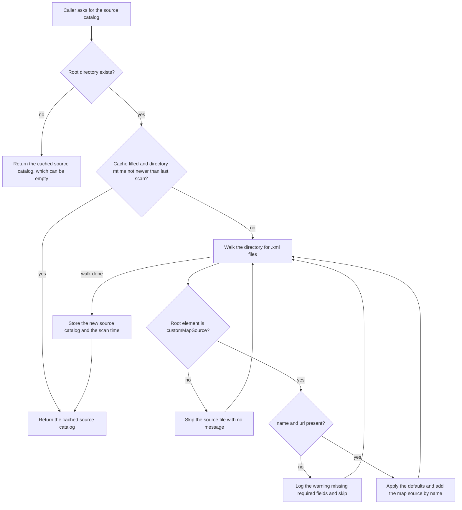
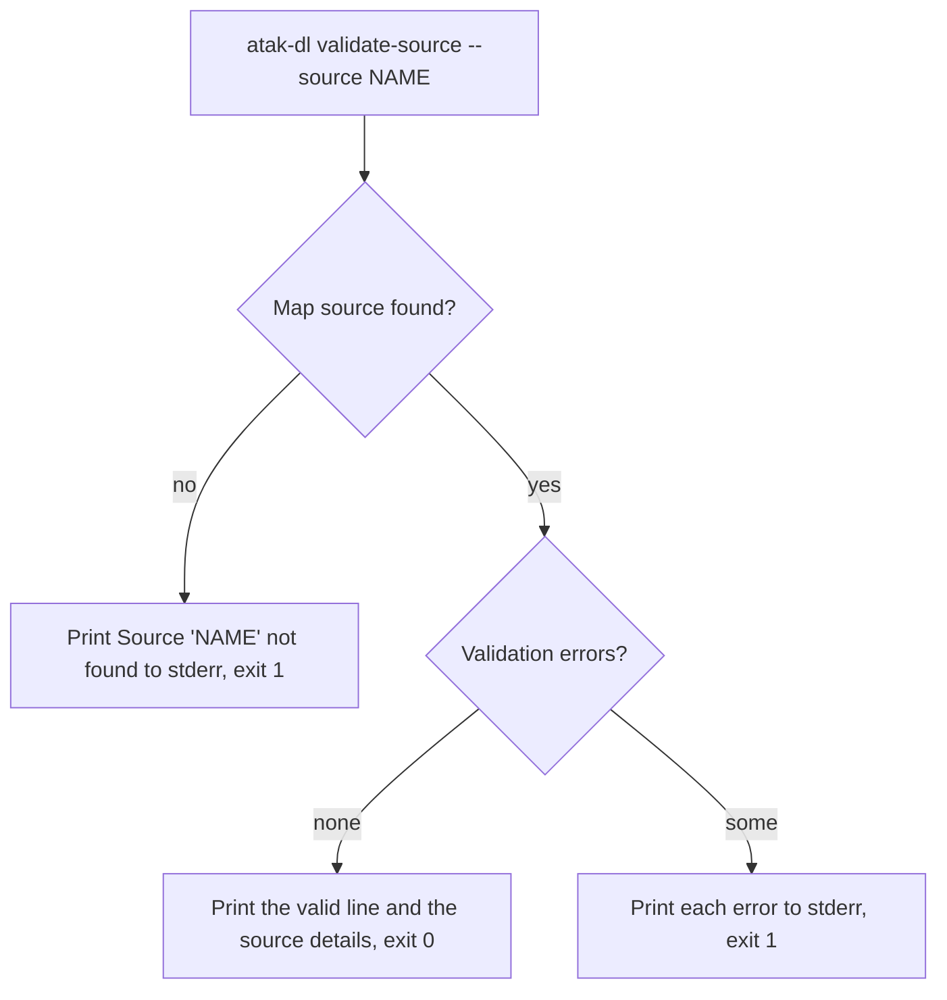

## Purpose

The source catalog tells the project which tile servers it can read. Each map source
comes from one MOBAC XML source file in the `mapsources/` directory. The CLI and the web
UI read the same source catalog, so a map source that loads is available everywhere.

This file describes the behavior that exists today. It records the defects plainly and
points each defect at the planned feature that repairs it.

## User stories

- As a solo operator, I want to list the map sources, so that I can choose one by name.
- As a solo operator, I want to validate one map source, so that I know its URL template
  and its zoom range.
- As a solo operator, I want to add a source file to a directory, so that the project can
  use a new tile server.

## Functional requirements

- FR-map-sources-1 — The project reads the source catalog from the directory that the
  `--mapsources-dir` flag names. The default directory is `mapsources`.
- FR-map-sources-2 — The project walks the directory recursively and reads every file
  whose name ends in `.xml`, in any letter case.
- FR-map-sources-3 — The project parses a source file only when its root element is
  `<customMapSource>`.
- FR-map-sources-4 — The project reads these child elements: `name`, `url`, `minZoom`,
  `maxZoom`, `tileType`, `tileUpdate`, `backgroundColor`, `ignoreErrors`, `serverParts`.
- FR-map-sources-5 — The project removes leading and trailing white space from `name`
  and from `url`.
- FR-map-sources-6 — The project skips a source file that has an empty `name` or an
  empty `url`, and logs the warning `missing required fields`.
- FR-map-sources-7 — If both `minZoom` and `maxZoom` are 0, the project sets `maxZoom`
  to 18.
- FR-map-sources-8 — If `tileType` is empty, the project sets it to `png`.
- FR-map-sources-9 — If `tileUpdate` is empty, the project sets it to `None`.
- FR-map-sources-10 — If `backgroundColor` is empty, the project sets it to `#000000`.
- FR-map-sources-11 — The project splits `serverParts` on white space into a list of
  server parts.
- FR-map-sources-12 — The project identifies each map source by its trimmed `name`.
- FR-map-sources-13 — The project substitutes `{$x}`, `{$y}` and `{$z}` in the URL
  template with the XYZ tile coordinates.
- FR-map-sources-14 — The project substitutes `{$q}` with the Bing quadkey of the tile.
- FR-map-sources-15 — The project substitutes `{$serverpart}` with the server part that
  the caller supplies. With no supplied server part, it uses the first server part.
- FR-map-sources-16 — The project keeps the parsed source catalog in memory. It scans
  again only when the modification time of the root directory is newer than the last
  scan.
- FR-map-sources-17 — The `list-sources` command prints each map source, sorted by name,
  as `name (tileType) - Zoom min-max - tileUpdate`, and then the count.
- FR-map-sources-18 — The `validate-source` command reports a validation error for each
  of these conditions:
  - an empty name or an empty URL,
  - a `minZoom` or a `maxZoom` outside 0 to 25,
  - a `minZoom` greater than `maxZoom`,
  - a `tileType` other than `png`, `jpg`, `jpeg` or `webp`, in any letter case,
  - a URL template that has neither all of `{$x}`, `{$y}` and `{$z}` nor `{$q}`.
- FR-map-sources-19 — `GET /api/sources` returns the source catalog as a JSON array,
  sorted by name.
- FR-map-sources-20 — `POST /api/validate-source` returns the validation result for one
  map source as JSON.

## User flows

### Flow 1 — The project loads the source catalog



1. A command or a server route asks for the source catalog.
2. If the root directory does not exist, the project returns the cached source catalog.
   On the first call, the cached source catalog is empty.
3. If the cache is filled and the directory modification time is not newer than the
   last scan, the project returns the cached source catalog.
4. The project walks the directory and reads each `.xml` source file.
5. If the root element is not `<customMapSource>`, the project skips the source file and
   shows no message.
6. If `name` or `url` is empty, the project logs `missing required fields` and skips the
   source file.
7. The project applies the defaults and adds the map source under its name.
8. The project stores the new source catalog and the scan time, then returns it.

### Flow 2 — The solo operator validates a map source



1. The solo operator runs `atak-dl validate-source --source NAME`.
2. If the map source is not in the source catalog, the CLI prints
   `Source 'NAME' not found` to stderr and exits with code 1.
3. If validation finds no error, the CLI prints `✓ Source 'NAME' is valid` and the
   source details, and exits with code 0.
4. If validation finds errors, the CLI prints `✗ Source 'NAME' has validation errors:`
   and one line per error to stderr, and exits with code 1.

## Screens & states

This feature has no screen of its own. It shows in three places:

- CLI output of `list-sources`. Populated state: the header `Available Map Sources`, one
  line per map source, and `Found N map sources`. Empty state: `No map sources found.`
  and `Make sure XML files exist in: <dir>`, with exit code 0.
- CLI output of `validate-source`. See Flow 2.
- The source picker `<select id="mapSourceSelect">` in `web/index.html:36`, filled by
  `populateSourceSelect` in `web/static/js/app.js:200`. Loading state:
  `Loading sources...`. Populated state: one option per map source as
  `name (format) - Zoom min-max`. Error state: a status log line only. See
  `04-web-ui.md`.

## Behaviour rules

- The source catalog holds one map source per name. When two source files have the same
  name, the source file that the walk reads last replaces the earlier one with no
  message.
- The cache check uses only the modification time of the root directory. An edit to a
  source file inside a subdirectory does not change that time.
- When the source catalog is empty, the cache check always scans again.
- `tileType` keeps the letter case of the source file. Two shipped source files use
  `JPG` and `PNG` in capitals.
- The engine does not read `ignoreErrors` from the source file. Only the job setting
  controls error handling. See `03-tile-download.md`.
- `tileUpdate` and `backgroundColor` are display values only. No other code reads them.
- The `serve` command defines its own `--mapsources-dir` flag (`serve.go:21`). That flag
  hides the root flag, so `atak-dl --mapsources-dir=X serve` uses `mapsources`.
- The default slog level is Info. The skip messages for unparsable source files log at
  Debug level, so the solo operator does not see them.

## Data touched

- Reads: every `*.xml` file under the source directory.
- Writes: nothing on disk.
- In memory, the `MapSource` struct (`internal/xmlparser/xmlparser.go:16`):

| Field | Type | Source element | Default |
|---|---|---|---|
| `Name` | string | `name` (trimmed) | required |
| `URL` | string | `url` (trimmed) | required |
| `MinZoom` | int | `minZoom` | 0 |
| `MaxZoom` | int | `maxZoom` | 18 when both zoom values are 0 |
| `TileType` | string | `tileType` | `png` |
| `TileUpdate` | string | `tileUpdate` | `None` |
| `BackgroundColor` | string | `backgroundColor` | `#000000` |
| `IgnoreErrors` | bool | `ignoreErrors` | false |
| `ServerParts` | []string | `serverParts`, split on white space | empty |

The shipped `mapsources/` directory holds 33 source files from
[joshuafuller/ATAK-Maps](https://github.com/joshuafuller/ATAK-Maps) (MIT), copied on
2026-02-06. Three of them use `<customWmsMapSource>`, so 30 load.

## Interfaces

### CLI

| Command | Flags | Output | Exit code |
|---|---|---|---|
| `atak-dl list-sources` | `--mapsources-dir` (root flag, default `mapsources`) | See Screens & states | 0 |
| `atak-dl validate-source` | `--source` (required) | See Flow 2 | 0 valid, 1 not found or invalid |

### HTTP

`GET /api/sources` (`cmd/atak-dl/commands/web.go:136`). Any method is accepted.

```json
[{"name": "Google - Satellite Only", "url": "https://...{$x}...", "min_zoom": 0,
  "max_zoom": 20, "format": "jpg"}]
```

The response has no `Content-Type: application/json` header. With an empty source
catalog, the body is `null`.

`POST /api/validate-source` (`web.go:231`). Request: `{"source_name": "<name>"}`.

| Status | Body |
|---|---|
| 200 | `{"valid": bool, "source_name", "url", "zoom_range": [min, max], "format", "issues": [string] or null}` |
| 400 | `{"error":"Invalid request"}` as `text/plain` |
| 404 | `{"error":"Source not found"}` as `text/plain` |
| 405 | `Method not allowed` as `text/plain` |

The web UI does not call this route.

### Module contract

`internal/xmlparser`:

- `New(dir) *XMLParser`
- `DiscoverSources(forceRescan bool) map[string]*MapSource`
- `ParseFile(path) (*MapSource, error)`. It returns `nil, nil` for a source file with a
  missing `name` or `url`.
- `GetSource(name) *MapSource`
- `ListSources() []string`
- `ValidateSource(*MapSource) []string`
- `(*MapSource).FormatURL(x, y, z int, serverPart string) string`
- `(*MapSource).GetServerPart(tileIndex int) string`

## Edge cases & failures

What the code handles:

- A missing source directory gives an empty source catalog. `list-sources` prints the
  empty-state hint, and `serve` prints `Warning: No map sources found in <dir>`.
- A source file with an empty `name` or `url` is skipped with a visible warning.
- A source file that is not valid XML is skipped.

What the code does not handle:

- **WMS source files are dropped with no message.** `xml.Unmarshal` fails on
  `<customWmsMapSource>`. The error text contains `customMapSource`, so the walk does
  not log it at all (`xmlparser.go:129-132`). Three shipped source files are affected:
  - `GRG/grg_FEMA_NFHL_Flood_Hazard_Zones.xml`
  - `NaturalResourcesCanada/naturalresourcescanada_cbmt.xml`
  - `NaturalResourcesCanada/naturalresourcescanada_toporama.xml`

  The project has no code that builds a WMS request.
- **Comma-separated server parts stay as one part.** `t1,t2,t3` in
  `openseamap/*.xml` becomes the single part `t1,t2,t3`. Those URL templates have no
  `{$serverpart}`, so the result does not change today.
- **Unknown placeholders stay in the URL.** The project sends any MOBAC placeholder
  other than the five above to the tile server unchanged.
- **`invertYCoordinate` is not read.** No shipped source file uses it today.
- **A missing `tileType` defaults to `png` with no check of the URL.**
  `michelin/michelin_osm_michelin.xml` has no `tileType`.
- **The cache is not safe for concurrent use.** Every server request calls
  `DiscoverSources`, and the cache map has no lock (`xmlparser.go:93-97`).
- **`filepath.WalkDir` errors are ignored** (`xmlparser.go:123`). An unreadable
  directory looks the same as an empty one.
- **The shipped source files are out of date.** ATAK-Maps v2.3.1 (2026-10-31) has 53
  source files in a new `maps/base/` and `maps/overlays/` layout. It renamed every map
  and removed some dead endpoints.

Known defects and the planned feature that repairs each:

| Defect | Repaired by |
|---|---|
| WMS source files dropped with no message | `source-sync` (09) |
| `invertYCoordinate` and other placeholders not read | `source-sync` (09) |
| Comma-separated server parts | `source-sync` (09) |
| Out-of-date source files, read from a folder next to the binary | `source-sync` (09) |
| No terms-of-use or rate-limit data per map source | `polite-downloading` (06) |
| `serve` flag that hides `--mapsources-dir` | `source-sync` (09) |
| Cache map with no lock | `security-hardening` (05) |

## Acceptance criteria

- [ ] `atak-dl list-sources` in a fresh clone prints 30 map sources and
      `Found 30 map sources`.
- [ ] `atak-dl list-sources --mapsources-dir=/nonexistent` prints
      `No map sources found.` and exits with code 0.
- [ ] `atak-dl validate-source --source="Google - Satellite Only"` prints
      `✓ Source 'Google - Satellite Only' is valid` and exits with code 0.
- [ ] `atak-dl validate-source --source=missing` prints `Source 'missing' not found` and
      exits with code 1.
- [ ] `go test ./internal/xmlparser/` passes, including the `FormatURL`, quadkey and
      `GetServerPart` tests.
- [ ] `GET /api/sources` returns a JSON array of 30 objects with the keys `name`, `url`,
      `min_zoom`, `max_zoom` and `format`.
- [ ] No map source in the output of `list-sources` has a name from the three WMS source
      files.

## Out of scope

- WMS sources, which the parser skips.
- Writing or editing source files. The project reads them only.

## Open questions

- The project reads `ignoreErrors` from the source file but never uses it. The code does
  not show whether this was meant to override the job setting.
