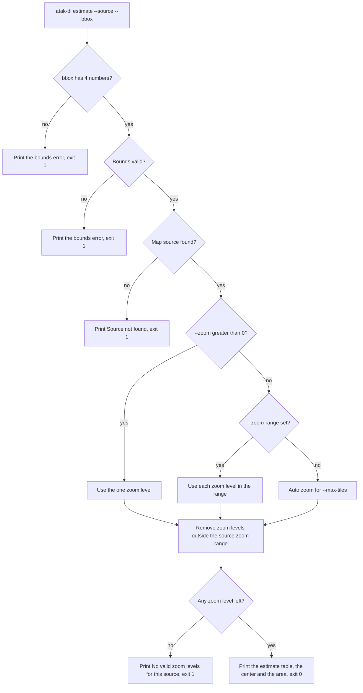
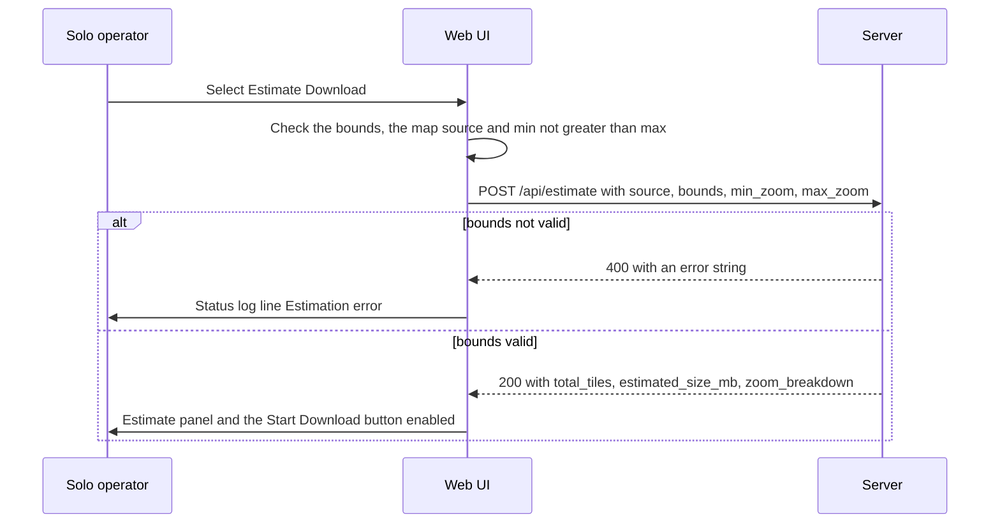

## Purpose

Before the solo operator downloads tiles, the project calculates how many tiles the
bounds and the zoom range need. The project also gives an approximate size. The tile
info command converts one coordinate to its XYZ tile and prints sample URLs. Both use
the Web Mercator calculations in `internal/tilecalc`.

This file describes the behavior that exists today.

## User stories

- As a solo operator, I want an estimate of the tile count and size, so that I can choose
  a zoom range that fits the device.
- As a solo operator, I want the project to choose a zoom level for a tile budget, so
  that I need no manual sum.
- As a solo operator, I want the tile for one coordinate, so that I can check a URL
  template against a known place.

## Functional requirements

- FR-area-estimate-1 — The project rejects bounds where the minimum latitude is not less
  than the maximum latitude.
- FR-area-estimate-2 — The project rejects bounds where the minimum longitude is not less
  than the maximum longitude.
- FR-area-estimate-3 — The project rejects a latitude outside −90 to 90.
- FR-area-estimate-4 — The project rejects a longitude outside −180 to 180.
- FR-area-estimate-5 — The project clamps latitude to −85.0511 to 85.0511 before it
  calculates a tile.
- FR-area-estimate-6 — The project clamps the tile x and y values to 0 to 2^z − 1.
- FR-area-estimate-7 — The project calculates the tile range for one zoom level from the
  south-west corner and the north-east corner of the bounds.
- FR-area-estimate-8 — The tile count for one zoom level is
  `(maxX − minX + 1) × (maxY − minY + 1)`.
- FR-area-estimate-9 — The `estimate` command chooses its zoom levels in this order:
  1. `--zoom`, when it is greater than 0,
  2. `--zoom-range`, when it is not empty,
  3. auto zoom, in all other cases.
- FR-area-estimate-10 — Auto zoom returns the highest zoom level from 1 to 18 whose tile
  count is not more than `--max-tiles`. The default of `--max-tiles` is 10000.
- FR-area-estimate-11 — The `estimate` command removes each zoom level outside the zoom
  range of the map source.
- FR-area-estimate-12 — The `estimate` command prints a warning to stderr for each zoom
  level that it removes.
- FR-area-estimate-13 — The `estimate` command uses the size per tile of the map source's
  tile type: `jpg` 18 KB, `png` 25 KB, and any other type 20 KB.
- FR-area-estimate-14 — The `estimate` command prints the tile count, the size and the
  resolution in meters per pixel for each zoom level.
- FR-area-estimate-15 — `POST /api/estimate` uses the size per tile of the tile type of the
  named map source.
- FR-area-estimate-16 — `POST /api/estimate` swaps the minimum and the maximum zoom level
  when the minimum is larger.
- FR-area-estimate-17 — The `tile-info` command prints the XYZ tile, the tile bounds and
  the resolution for one coordinate and zoom level.
- FR-area-estimate-18 — The `tile-info` command prints the URL of that tile for three map
  sources. They are the first three, by name, whose zoom range includes the zoom level.
- FR-area-estimate-19 — `POST /api/tile-info` returns the XYZ tile and the tile bounds
  for one coordinate as JSON.
- FR-area-estimate-20 — If `source` names an old map source, `POST /api/estimate` returns
  the estimate for the new name and the deprecation warning in `warning` (FR-source-sync-16).
- FR-area-estimate-21 — The `tile-info` command rejects a `--lat` value outside -85.0511 to
  85.0511 with exit code 1. Web Mercator shows no latitude outside this range.
- FR-area-estimate-22 — The `tile-info` command rejects a `--lon` value outside -180 to 180
  with exit code 1.
- FR-area-estimate-23 — The `tile-info` command rejects a `--zoom` value outside 0 to 25
  with exit code 1. 25 is the highest zoom level of an area (`tilecalc.MaxZoomLevel`).

## User flows

### Flow 1 — The solo operator runs the `estimate` command



1. The solo operator runs `atak-dl estimate --source NAME --bbox minLat,minLon,maxLat,maxLon`.
2. If `--bbox` does not hold four numbers, the CLI prints the error and exits with code 1.
3. If the bounds are not valid, the CLI prints the error and exits with code 1.
4. If the map source is not in the source catalog, the CLI prints
   `Source 'NAME' not found` and exits with code 1.
5. The CLI chooses the zoom levels from `--zoom`, from `--zoom-range` or from auto zoom.
6. The CLI removes each zoom level outside the source zoom range and warns about it.
7. If no zoom level is left, the CLI prints `No valid zoom levels for this source` and
   exits with code 1.
8. The CLI prints one line per zoom level, a total when there is more than one zoom
   level, and the area details.

### Flow 2 — The web UI requests an estimate



1. The solo operator selects **Estimate Download**.
2. If no bounds or no map source is selected, the web UI logs
   `Select area and map source first` and stops.
3. If the minimum zoom level is greater than the maximum, the web UI logs
   `Invalid zoom range` and stops.
4. The web UI sends `POST /api/estimate`. The request names the selected map source.
5. If the server returns an error, the web UI logs `Estimation error: <message>`.
6. If the server returns 200, the web UI shows the estimate and enables
   **Start Download**.

## Screens & states

- CLI output of `estimate`. Example from `--bbox=40.68,-74.05,40.88,-73.91` with auto
  zoom:

  ```
  Auto-selected zoom level: 17

  Download Estimate for 'Google - Satellite Only'
  -----------------------------------
    Zoom 17: 5,044 tiles, 88.7 MB, 0.9 m/px
  ```

- CLI output of `tile-info`: `Tile coordinates`, `Tile bounds`, `Resolution`, then up to
  three sample URLs.
- The web UI estimate panel `#estimationResult` (`web/index.html:155`), filled by
  `displayEstimation` (`web/static/js/app.js:773-806`). It shows the tile count, the size in
  MB or GB, the zoom range and a time at a fixed 10 tiles per second. It adds a warning
  above 10,000 tiles and a stronger warning above 100,000 tiles. Error state: a status
  log line only.

## Behaviour rules

- The `estimate` command requires `--source`, but the tile count does not depend on the
  map source. The command uses the map source only to remove zoom levels.
- Auto zoom returns 1 when zoom level 1 already exceeds `--max-tiles`. It returns 18 when
  no zoom level up to 18 exceeds it.
- Auto zoom gives one zoom level, not a zoom range.
- `--zoom 0` is the same as no `--zoom`, so the CLI cannot request zoom level 0 with it.
  `--zoom-range 0-3` includes zoom level 0.
- `POST /api/estimate` replaces a `min_zoom` of 0 with 1 and a `max_zoom` of 0 with 18.
- The web UI accepts a zoom range where the minimum equals the maximum, so it can
  estimate one zoom level (FR-offline-web-ui-24).
- The web UI and the CLI use one size-per-tile table (`tilecalc.TileSizeKB`), so they
  give the same size for the same map source.
- `POST /api/estimate` with no map source uses 20 KB per tile.
- The `tile-info` command prints the tile bounds as the north-west corner, then the
  south-east corner.

## Data touched

None on disk. The calculations are pure functions in `internal/tilecalc`.

## Interfaces

### CLI

| Command | Flag | Default | Notes |
|---|---|---|---|
| `estimate` | `--source` | — | Required |
| | `--bbox` | — | Required. `min_lat,min_lon,max_lat,max_lon` |
| | `--zoom` | 0 | One zoom level when greater than 0 |
| | `--zoom-range` | — | `min-max` |
| | `--max-tiles` | 10000 | Tile budget for auto zoom |
| `tile-info` | `--lat` | — | Required. From -85.0511 to 85.0511 |
| | `--lon` | — | Required. From -180 to 180 |
| | `--zoom` | 10 | Marked required. From 0 to 25 |

### HTTP

`POST /api/estimate` (`cmd/atak-dl/commands/web.go:266-328`).

Request: `{"bounds": [west, south, east, north], "min_zoom": int, "max_zoom": int}`, or `{"areas": [...]}` with the areas of feature 11 (FR-area-selection-25).

| Status | Body |
|---|---|
| 200 | `{"total_tiles", "estimated_size_mb", "zoom_breakdown": {"<z>": count}, "bounds", "zoom_range": [min, max], "areas": [{"name", "tiles"}], "unique_tiles"}`. `total_tiles` is equal to `unique_tiles` (FR-area-selection-10). |
| 400 | `invalid_json`, `invalid_bounds` with the bounds error as the message, `invalid_area`, or `zoom_out_of_range` |
| 405 | `method_not_allowed` |
| 413 | `body_too_large` (#81) |

Every error body has the error shape `{"error": {"code": "<code>", "message": "<text>"}}`
and `Content-Type: application/json` (#74).

`POST /api/tile-info` (`web.go:348-374`). Request: `{"lat", "lon", "zoom"}`. A `zoom` of 0
becomes 10. Response:
`{"tile_x", "tile_y", "zoom", "bounds": [west, south, east, north], "coordinate": [lat, lon]}`.
The web UI does not call this route.

### Module contract

`internal/tilecalc`:

- `NewGeographicBounds(minLat, maxLat, minLon, maxLon) (*GeographicBounds, error)`
- `(*TileCalculator).LatLonToTile(lat, lon, zoom) (x, y)`
- `(*TileCalculator).TileToLatLon(x, y, zoom) (lat, lon)`
- `(*TileCalculator).CalculateTileBounds(*GeographicBounds, zoom) *TileBounds`
- `(*TileCalculator).CalculateZoomForArea(*GeographicBounds, maxTiles) int`
- `(*TileCalculator).EstimateDownloadSize(*TileBounds, avgKB) map[string]interface{}`
- `(*TileCalculator).CalculateResolutionAtLatitude(lat, zoom) float64`
- `(*TileBounds).TileCount()`
- `(*TileBounds).IterTiles() <-chan [2]int`, row by row

## Edge cases & failures

What the code handles:

- Inverted or out-of-range bounds give a clear error in the CLI and a 400 response from
  `/api/estimate`.
- Latitudes beyond the Web Mercator limit are clamped, not rejected.

What the code does not handle:

- **Bounds that cross the antimeridian are rejected.** The minimum longitude must be less
  than the maximum.
- **A bad `--zoom-range` becomes zoom level 0.** `strconv.Atoi` errors are ignored
  (`estimate.go:67-68`), so `--zoom-range a-b` gives `0-0`.
- **No upper limit on the tile count.** `/api/estimate` accepts any zoom range and any
  bounds.
- **The time shown in the web UI assumes 10 tiles per second**
  (`app.js:785`). It does not use the concurrency setting.

Known defects and the planned feature that repairs each:

| Defect | Repaired by |
|---|---|
| No tile-count cap and no output file split | `robust-downloads` (07) |
| Estimate colour classes and the fixed time rate | `offline-web-ui` (08) |
| Rectangle bounds only, with no polygon | `area-selection` (11) |
| Bad `--zoom-range` silently becomes 0 | `robust-downloads` (07) |

## Acceptance criteria

- [ ] `atak-dl estimate --source="Google - Satellite Only" --bbox=40.68,-74.05,40.88,-73.91`
      prints `Auto-selected zoom level: 17` and `Zoom 17: 5,044 tiles`.
- [ ] `atak-dl estimate --source="Google - Satellite Only" --bbox=40.88,-74.05,40.68,-73.91`
      prints a `min_lat` error and exits with code 1.
- [ ] `atak-dl tile-info --lat=40.7589 --lon=-73.9851 --zoom=15` prints
      `Tile coordinates: (9649, 12314)`.
- [ ] `atak-dl tile-info --lat=85.0512 --lon=0 --zoom=10` prints
      `Error: --lat 85.0512 is outside the range -85.0511 to 85.0511` and exits with code 1.
- [ ] `go test ./internal/tilecalc/` passes, including the NYC zoom 10 tile `(301, 385)`.
- [ ] `POST /api/estimate` with inverted bounds returns status 400.
- [ ] `POST /api/estimate` with `min_zoom` 12 and `max_zoom` 10 returns
      `"zoom_range": [10, 12]`.

## Out of scope

- Size estimates from real tile sizes.
- Bounds other than one rectangle.

## Open questions

- The 15 KB and 20 KB values per tile have no recorded source. The code does not show
  which value is intended.
