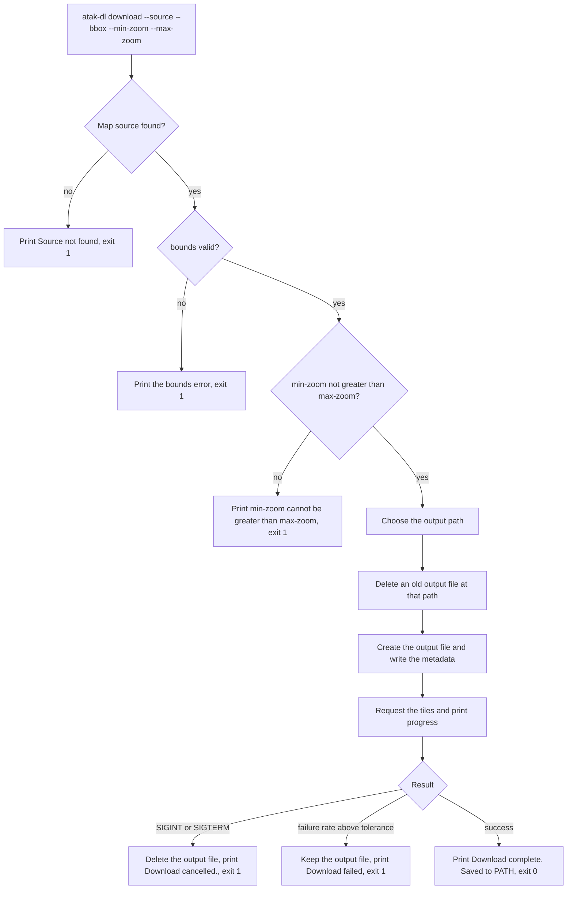
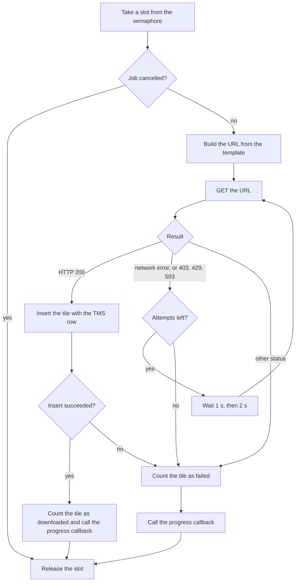

## Purpose

The engine downloads every tile for the bounds and the zoom range from one map source.
It writes the tiles into one SQLite output file that ATAK can import. The CLI `download`
command and the web UI both start a job through the same engine
(`internal/download/download.go`).

This file describes the behavior that exists today. It records the defects plainly and
points each defect at the planned feature that repairs it.

## User stories

- As a solo operator, I want to download tiles from the CLI, so that a script
  can prepare offline maps.
- As a solo operator, I want to see progress and an ETA, so that I know when the job
  ends.
- As a solo operator, I want to stop a job with Ctrl-C, so that a wrong request does not
  run for hours.
- As an ATAK user, I want a single output file, so that I can copy it to the device.

## Functional requirements

- FR-tile-download-1 — The engine requests each tile in the bounds for every zoom level
  in the zoom range.
- FR-tile-download-2 — The engine runs at most `MaxConcurrent` tile requests at the same
  time. The default is 5.
- FR-tile-download-3 — The engine sends the header `User-Agent: ATAK-Map-Downloader/1.0`
  with each tile request.
- FR-tile-download-4 — The engine stops each tile request after 30 seconds.
- FR-tile-download-5 — The engine skips TLS certificate verification unless `VerifySSL`
  is true. The default is false.
- FR-tile-download-6 — The engine makes at most 3 attempts per tile.
- FR-tile-download-7 — The engine waits 1 second after the first failed attempt and
  2 seconds after the second.
- FR-tile-download-8 — The engine retries a tile after a network error or after HTTP
  status 403, 429 or 503.
- FR-tile-download-9 — The engine marks a tile as failed after any other HTTP status
  that is not 200, with no retry.
- FR-tile-download-10 — The engine stores the response body of an HTTP 200 response as
  the tile data, unchanged.
- FR-tile-download-11 — The engine writes the tile row in TMS order:
  `tile_row = 2^z − 1 − y`.
- FR-tile-download-12 — The engine deletes an output file that already exists at the
  output path before it creates the new one.
- FR-tile-download-13 — The engine writes the metadata keys `name`, `type`, `version`,
  `description`, `format`, `bounds`, `minzoom` and `maxzoom`.
- FR-tile-download-14 — When the job is cancelled, the engine deletes the output file.
- FR-tile-download-15 — If `IgnoreErrors` is false, the engine reports failure when the
  failure rate is greater than the failure tolerance.
- FR-tile-download-16 — The engine reports failure when it processed no tile.
- FR-tile-download-17 — If `IgnoreErrors` is true, the engine reports success for a job
  that was not cancelled.
- FR-tile-download-18 — The `download` command writes the output file to the
  `./downloads` directory unless `--output` names a path.
- FR-tile-download-19 — The `download` command prints progress on one line each time the
  percentage grows by 1 or more.
- FR-tile-download-20 — The `download` command cancels the job on SIGINT or SIGTERM.

## User flows

### Flow 1 — The solo operator runs the `download` command



1. The solo operator runs `atak-dl download` with `--source` and `--bbox`.
2. If the map source is not in the source catalog, the CLI prints
   `Source 'NAME' not found` and exits with code 1.
3. If the bounds are not valid, the CLI prints the error and exits with code 1.
4. If `--min-zoom` is greater than `--max-zoom`, the CLI prints
   `min-zoom cannot be greater than max-zoom` and exits with code 1.
5. The CLI uses `--output`, or builds a file name in `./downloads`.
6. The engine deletes any file at the output path.
7. The engine creates the output file and writes the metadata.
8. The engine requests the tiles. The CLI prints progress.
9. If the solo operator presses Ctrl-C, the engine deletes the output file. The CLI
   prints `Download cancelled.`, then `Error: context canceled` and the usage text, and
   exits with code 1.
10. If the failure rate is above the failure tolerance, the CLI prints
    `Download failed: failure rate N% exceeds threshold 20.0%` and exits with code 1. The
    output file stays on disk.
11. If the job succeeds, the CLI prints `Download complete. Saved to PATH` and exits with
    code 0.

### Flow 2 — The engine processes one tile



1. The engine takes a slot from the semaphore.
2. If the job is cancelled, the engine releases the slot and stops.
3. The engine builds the URL from the URL template of the map source.
4. The engine sends a GET request.
5. If the status is 200, the engine inserts the tile with the TMS row.
6. If a network error or status 403, 429 or 503 occurs, the engine waits and tries again.
   It makes at most 3 attempts.
7. If any other status occurs, or the attempts run out, the engine counts the tile as
   failed.
8. If the insert fails, the engine counts the tile as failed.
9. The engine calls the progress callback and releases the slot.

## Screens & states

CLI output of `download`:

- Running: `\r12.0% (605/5044) - 31.2 tiles/s - ETA: 142s`, written over itself.
- Success: `Download complete. Saved to downloads/<file>.sqlite`.
- Failure: `Download failed: failure rate 35.0% exceeds threshold 20.0%`.
- Cancelled: `Download cancelled.`, then cobra prints `Error: context canceled` and the
  usage text.
- The engine logs `starting download`, `download complete` and each retry through slog
  to stderr.

For the web UI screens of a job, see `04-web-ui.md`.

## Behaviour rules

- The engine processes the zoom levels in order. Within one zoom level, it walks the
  tiles row by row.
- The `download` command defaults are `--min-zoom` 1, `--max-zoom` 15 and
  `--concurrent` 5.
- The CLI failure tolerance is fixed at 0.2. The web UI default is 0.3.
- The engine does not check the zoom range against the zoom range of the map source.
- The engine does not limit the total tile count.
- The engine does not skip tiles that an earlier job already wrote. Every job starts a
  new output file.
- `DelayBetweenBatches` (default 200 ms) is set in `Config`, but the engine never reads
  it.
- The engine chooses the server part from the count of downloaded tiles at that moment.
  Concurrent tile requests often read the same count.
- `metadata.minzoom` is the first zoom level of the request, and `metadata.maxzoom` is
  the last.

## Data touched

The output file is a SQLite file. The schema is from `internal/mbtiles/mbtiles.go:29-34`:

```sql
CREATE TABLE metadata (name text, value text);
CREATE TABLE tiles (zoom_level integer, tile_column integer, tile_row integer, tile_data blob);
CREATE UNIQUE INDEX name ON metadata (name);
CREATE UNIQUE INDEX tile_index ON tiles (zoom_level, tile_column, tile_row);
```

Metadata rows (`internal/download/download.go:139-148`):

| Key | Value |
|---|---|
| `name` | `<source> - minLat,minLon to maxLat,maxLon` at 4 decimals |
| `type` | `baselayer` |
| `version` | `1.0` |
| `description` | `Downloaded from <source>` |
| `format` | the `tileType` of the map source, in its original letter case |
| `bounds` | `minLon,minLat,maxLon,maxLat` at 4 decimals |
| `minzoom` | the first zoom level of the request |
| `maxzoom` | the last zoom level of the request |

The metadata has no `center` key.

File name (`download.go:304-321`):

- With no custom name:
  `<source>_<minLat>_<minLon>_to_<maxLat>_<maxLon>_z<min>-<max>.sqlite`, coordinates at
  4 decimals.
- With a custom name: `<name>_z<min>-<max>.sqlite`.
- The project keeps only `A–Z`, `a–z`, `0–9`, space, `-` and `_`, then changes spaces to
  `_`.

The engine writes one autocommit `INSERT OR REPLACE` per tile. It uses one `*sql.DB`
for all goroutines, with no PRAGMA settings.

### How ATAK reads the output file

ATAK detects an imagery SQLite file by the columns of its `tiles` table, not by its
extension. In ATAK-CIV, a `tiles` table with exactly `zoom_level`, `tile_column`,
`tile_row` and `tile_data` is the "momap" type. That type reads TMS rows and the
`minzoom`, `maxzoom` and `format` keys
([TilesetInfo.java](https://github.com/deptofdefense/AndroidTacticalAssaultKit-CIV/blob/main/takkernel/engine/src/main/java/com/atakmap/android/maps/tilesets/TilesetInfo.java),
ATAK-CIV 4.6.0.5, retrieved 2026-11-21). The output file matches that path.

This conclusion comes from the archived ATAK-CIV 4.6 source code. No one has imported an
output file on a device to confirm it. Current ATAK 5.x, iTAK and WinTAK behavior is not
known.

## Interfaces

### CLI

| Flag | Default | Notes |
|---|---|---|
| `--source` | — | Required |
| `--bbox` | — | Required. `min_lat,min_lon,max_lat,max_lon` |
| `--min-zoom` | 1 | |
| `--max-zoom` | 15 | |
| `--output` | — | Full output path. Overrides the generated name |
| `--name` | — | Custom file name without extension |
| `--concurrent` | 5 | Not validated |
| `--ignore-errors` | false | |

Exit codes: 0 on success, 1 on any error, failure or cancel.

### Module contract

`internal/download`:

- `DefaultConfig() Config`
- `NewEngine(Config) *Engine`
- `(*Engine).DownloadTiles(ctx, *MapSource, *GeographicBounds, zoomLevels []int,
  outputPath string, cb ProgressCallback) (bool, error)`. The callback returns false to
  cancel the job.
- `GenerateOutputFilename(source, bounds, minZoom, maxZoom, customName) string`
- `DownloadsDir() string`, which returns `./downloads` relative to the working directory.

`DownloadTiles` returns `(false, err)` for every failure. It never returns
`(false, nil)`.

`internal/mbtiles`:

- `Create(path, metadata) (*sql.DB, error)`
- `InsertTile(db, z, x, tmsY, data) error`

The driver is `github.com/mattn/go-sqlite3` v1.14.24, which needs CGO.

## Edge cases & failures

What the code handles:

- Rate-limit statuses (403, 429, 503) get two retries.
- SIGINT and SIGTERM stop new tile requests and delete the partial output file.
- A failed tile insert counts as a failed tile.

What the code does not handle:

- **TLS verification is off by default.** `InsecureSkipVerify = true` unless
  `VerifySSL` is set (`download.go:100-103`). The CLI has no flag to turn it on.
- **The engine stores any HTTP 200 body as a tile.** It does not check the content type
  or decode the image. An HTML error page or a "blocked" image goes into the output file.
- **The engine logs no detail for a failed tile.** It counts the tile and drops the
  error (`download.go:194-200`).
- **Progress uses only the downloaded count.** With any failed tile, the percentage never
  reaches 100, and the ETA is too long.
- **Data races.** Many goroutines write `progress.CurrentTile`, `progress.CurrentURL`,
  `progress.Downloaded` and `progress.Failed` with no lock (`download.go:191-212`). The
  CLI callback updates `lastPercent` with no lock (`commands/download.go:92-99`).
- **The failure path calls the callback before it updates `progress.Failed`**
  (`download.go:196-198`).
- **The retry waits ignore cancel.** `time.Sleep` does not watch the context, and the
  request does not use `NewRequestWithContext`. A cancel can wait for running requests.
- **Retries do not read `Retry-After` and have no jitter.**
- **A cancel leaves the tile producer goroutine blocked** after `goto wait`
  (`download.go:174`).
- **A late cancel is lost.** The engine checks the context only in the loop that starts
  tile requests (`download.go:171-176`). If the signal arrives after the last tile
  request starts, the job ends as a normal job. The CLI callback always returns true.
- **The engine deletes an existing output file with no warning** (`mbtiles.go:18-22`).
  The generated name has no time stamp, so a repeat of the same request replaces the
  earlier output file.
- **A cancel throws away every tile already fetched.** There is no resume.
- **`--concurrent 0` blocks forever.** The semaphore has no capacity. A negative value
  makes `make(chan)` panic.
- **No limit on the tile count or the zoom range.**
- **`os.MkdirAll` errors are ignored** (`commands/download.go:79`).
- **The CLI prints `Error: context canceled` and the usage text after a cancel**, because
  `SilenceUsage` is not set.
- **The CGO dependency breaks cross-compiles.** The README shows plain `GOOS`/`GOARCH`
  builds, which fail or produce a binary with no SQLite. On the maintainer's macOS 27
  machine, `go run ./cmd/atak-dl` fails to link today:
  `ld: multiple errors: tapi error: malformed file ... unknown architecture`.
- **Rate limits do not exist.** The engine sends requests as fast as the semaphore
  allows.

Known defects and the planned feature that repairs each:

| Defect | Repaired by |
|---|---|
| TLS off by default | `security-hardening` (05) |
| No rate limit, no `Retry-After`, fixed User-Agent, unused `DelayBetweenBatches` | `polite-downloading` (06) |
| No check of tile content, no failed-tile log, no resume, no tile cap | `robust-downloads` (07) |
| Silent delete of an existing output file, delete on cancel | `robust-downloads` (07) |
| Data races, cancel that ignores retry waits, `--concurrent 0` | `robust-downloads` (07) |
| Progress that never reaches 100 with failures | `robust-downloads` (07) |
| CGO driver and broken cross-compiles | `foundation` (00) |
| No `center` key, no other output formats | `output-formats` (10) |

## Acceptance criteria

- [ ] `atak-dl download --source="USGS - Usgsbasemap" --bbox=40.75,-74.0,40.76,-73.99 --min-zoom=10 --max-zoom=12`
      writes an output file under `./downloads/` whose name ends in `_z10-12.sqlite`.
- [ ] The output file has the tables `metadata` and `tiles` with the columns above.
- [ ] For each tile, `tile_row` equals `2^zoom_level − 1 − y`, where `y` is the XYZ row.
- [ ] The `metadata` table holds the keys `name`, `type`, `version`, `description`,
      `format`, `bounds`, `minzoom` and `maxzoom`.
- [ ] Ctrl-C during a job prints `Download cancelled.`, leaves no output file and exits
      with code 1.
- [ ] `atak-dl download --source="USGS - Usgsbasemap" --bbox=40.75,-74.0,40.76,-73.99 --min-zoom=12 --max-zoom=10`
      prints `min-zoom cannot be greater than max-zoom` and exits with code 1.

## Out of scope

- WMS map sources.
- Output formats other than the four-column TMS SQLite file.
- Image conversion.

## Open questions

- No one has confirmed on a device that ATAK 5.x imports the output file. The momap
  conclusion comes from archived 4.6 source code.
- The code does not show why the metadata `type` is always `baselayer`, including for
  overlay map sources such as the `GRG` overlays.
