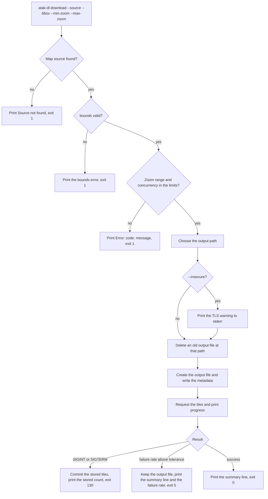
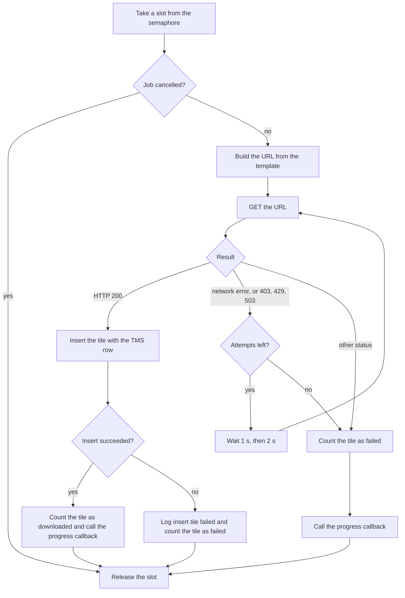

## Purpose

The engine downloads every tile for the bounds and the zoom range from one map source.
It writes the tiles into one SQLite output file that ATAK can import. The CLI `download`
command and the web UI both start a job through the same engine
(`internal/download/download.go`).

This file describes the behavior that exists today. It records the defects plainly and
points each defect at the planned feature that repairs it. A statement that an Epic 0 or
Epic 1 pull request changed names that pull request, for example (#75).

## User stories

- As a solo operator, I want to download tiles from the CLI, so that a script
  can prepare offline maps.
- As a solo operator, I want to see progress and an ETA, so that I know when the job
  ends.
- As a solo operator, I want to stop a job with Ctrl-C, so that a wrong request does not
  run for hours.
- As an ATAK user, I want a single output file, so that I can copy it to the device.

## Functional requirements

- FR-tile-download-1 — The engine requests each tile in the bounds for every zoom level
  in the zoom range.
- FR-tile-download-2 — The engine runs at most `MaxConcurrent` tile requests at the same
  time. The default is 5.
- FR-tile-download-3 — Replaced by FR-polite-downloading-14 (#87). The engine sent the header `User-Agent: ATAK-Map-Downloader/1.0`
  with each tile request.
- FR-tile-download-4 — The engine stops each tile request after 30 seconds.
- FR-tile-download-5 — The engine verifies TLS certificates unless `VerifyTLS` is false.
  The default is true (#75).
- FR-tile-download-6 — The engine makes at most 3 attempts per tile in the main pass and
  1 in the retry pass (#28).
- FR-tile-download-7 — The engine waits 1 second after the first failed attempt and
  2 seconds after the second.
- FR-tile-download-8 — The engine retries a tile after a network error or after HTTP
  status 403, 429 or 503.
- FR-tile-download-9 — The engine marks a tile as failed after any other HTTP status
  that is not 200, with no retry.
- FR-tile-download-10 — The engine stores the response body of an HTTP 200 response as
  the tile data, unchanged, if the body is a valid image (#27).
- FR-tile-download-11 — The engine writes the tile row in TMS order:
  `tile_row = 2^z − 1 − y`.
- FR-tile-download-12 — The engine opens an output file that already exists at the
  output path, and it keeps the tiles that the file holds (#26).
- FR-tile-download-13 — The engine writes the metadata keys `name`, `type`, `version`,
  `description`, `format`, `bounds`, `minzoom` and `maxzoom`.
- FR-tile-download-14 — When the job is cancelled, the engine keeps the output file and
  every tile it stored (#26).
- FR-tile-download-15 — If `IgnoreErrors` is false, the engine reports failure when the
  failure rate is greater than the failure tolerance.
- FR-tile-download-16 — The engine reports failure when it processed no tile.
- FR-tile-download-17 — If `IgnoreErrors` is true, the engine reports success for a job
  that was not cancelled.
- FR-tile-download-18 — The `download` command writes the output file to the
  `./downloads` directory unless `--output` names a path.
- FR-tile-download-19 — The `download` command prints progress on one line each time the
  percentage grows by 1 or more.
- FR-tile-download-20 — The `download` command cancels the job on SIGINT or SIGTERM.
- FR-tile-download-21 — `download --insecure` turns off TLS verification for the job and
  prints `warning: TLS certificate verification is off for this job` to stderr (#75).
- FR-tile-download-22 — The `download` command rejects a zoom range outside the zoom range
  of the map source with the error code `zoom_out_of_range` (#81).
- FR-tile-download-23 — The `download` command rejects a `--concurrent` value below 1 or
  above 32 with the error code `invalid_concurrency` (#81).

## User flows

### Flow 1 — The solo operator runs the `download` command



1. The solo operator runs `atak-dl download` with `--source` and `--bbox`.
2. If the map source is not in the source catalog, the CLI prints
   `Source 'NAME' not found` and exits with code 1.
3. If the bounds are not valid, the CLI prints the error and exits with code 1.
4. The CLI checks the zoom range, `--concurrent` and the tile count with `checkJobLimits`
   (`cmd/atak-dl/commands/download.go:81-89`, #81, #29). If a check fails, the CLI prints
   `Error: <code>: <message>` with no usage text. A tile count above `--max-tiles` exits
   with code 4, and the other checks exit with code 1. Examples:
   - `Error: zoom_out_of_range: min_zoom 12 is above max_zoom 10`
   - `Error: invalid_concurrency: concurrency 0 is outside the range 1-32`
   - `Error: too_many_tiles: the job has 600000 tiles, and the tile cap is 500000`
5. The CLI uses `--output`, or builds a file name in `./downloads`.
6. If `--insecure` is set, the CLI prints the TLS warning to stderr (#75).
7. If a file exists at the output path, the CLI applies `--resume`, `--overwrite` and
   `--force` to it (#26). With no flag, the CLI exits with code 3.
8. The engine opens or creates the output file and writes the metadata.
9. The engine requests the tiles. The CLI prints progress.
10. If the solo operator presses Ctrl-C, the engine stops its requests within 500 ms and
    commits the stored tiles (#29). The CLI prints
    `Cancelled. N of T tiles stored. Run again with --resume.` and exits with code 130.
11. If the failure rate is above the failure tolerance, the CLI prints the summary line,
    then `Error: failure rate N% exceeds threshold 20.0%`, and exits with code 5. The
    output file stays on disk.
12. If the job succeeds, the CLI prints the summary line
    `Done: N downloaded, N skipped, N failed in 2h41m -> PATH` and exits with code 0.

### Flow 2 — The engine processes one tile



1. The engine takes a slot from the semaphore.
2. If the job is cancelled, the engine releases the slot and stops.
3. The engine builds the URL from the URL template of the map source.
4. The engine sends a GET request.
5. If the status is 200 and the body is a valid image, the engine sends the tile to the
   writer (#27). The writer stores the TMS row.
6. If a network error or status 403, 429 or 503 occurs, the engine waits and tries again.
   It makes at most 3 attempts.
7. If any other status occurs, or the attempts run out, the engine counts the tile as
   failed. It records the tile in `atakdl_failed_tiles`, and the retry pass requests it
   once more (#28).
8. If the insert fails, the engine logs `insert tile failed` and counts the tile as
   failed. It does not call the progress callback (`internal/download/download.go:272-276`).
9. Otherwise, the engine calls the progress callback and releases the slot.
10. After the last tile, the engine calls the progress callback once more with the final
    counts (`download.go:181-185`).

## Screens & states

CLI output of `download`:

- Running: `\r37.4% (44,880/120,000) - 12.1 tiles/s - 1,200 skipped - 14 failed - ETA 1h43m`,
  written over itself. The percentage counts downloaded, skipped and failed tiles (#29).
- Success: `Done: 118,640 downloaded, 1,200 skipped, 160 failed in 2h41m -> downloads/<file>.sqlite`.
- Failure: the summary line, then `Error: failure rate 35.0% exceeds threshold 20.0%`.
- Cancelled: `Cancelled. 41,200 of 120,000 tiles stored. Run again with --resume.`
- The engine logs `starting download`, `download complete` and each retry through slog
  to stderr.

For the web UI screens of a job, see `04-web-ui.md`.

## Behaviour rules

- The engine processes the zoom levels in order. Within one zoom level, it walks the
  tiles row by row.
- The `download` command defaults are `--min-zoom` 1, `--max-zoom` 15 and
  `--concurrent` 5.
- The CLI failure tolerance is fixed at 0.2. The web UI default is 0.3.
- The engine does not check the zoom range against the zoom range of the map source.
  The `download` command and `POST /api/jobs` check it before the job starts, with
  `checkJobLimits` (`cmd/atak-dl/commands/jobs.go:320-337`, #81).
- The engine does not limit the total tile count.
- The engine does not skip tiles that an earlier job already wrote. Every job starts a
  new output file.
- `Config` has no `DelayBetweenBatches` field. #78 removed it, because the engine never
  read it.
- The engine chooses the server part from the count of downloaded tiles at that moment.
  Concurrent tile requests often read the same count.
- `metadata.minzoom` is the first zoom level of the request, and `metadata.maxzoom` is
  the last.

## Data touched

The output file is a SQLite file. The schema is from `internal/mbtiles/mbtiles.go:34-37`:

```sql
CREATE TABLE metadata (name text, value text);
CREATE TABLE tiles (zoom_level integer, tile_column integer, tile_row integer, tile_data blob);
CREATE UNIQUE INDEX name ON metadata (name);
CREATE UNIQUE INDEX tile_index ON tiles (zoom_level, tile_column, tile_row);
```

Metadata rows (`internal/download/download.go:202-214`):

| Key | Value |
|---|---|
| `name` | `<source> - minLat,minLon to maxLat,maxLon` at 4 decimals |
| `type` | `baselayer` |
| `version` | `1.0` |
| `description` | `Downloaded from <source>` |
| `format` | the `tileType` of the map source, in its original letter case |
| `bounds` | `minLon,minLat,maxLon,maxLat` at 4 decimals |
| `minzoom` | the first zoom level of the request |
| `maxzoom` | the last zoom level of the request |

The metadata has no `center` key.

File name (`download.go:333-351`):

- With no custom name:
  `<source>_<minLat>_<minLon>_to_<maxLat>_<maxLon>_z<min>-<max>.sqlite`, coordinates at
  4 decimals.
- With a custom name: `<name>_z<min>-<max>.sqlite`.
- The project keeps only `A–Z`, `a–z`, `0–9`, space, `-` and `_`, then changes spaces to
  `_`.

The tile goroutines send each tile to one writer goroutine per job (#25). The writer
commits one transaction per 500 tiles, and one more when the job ends. It writes each
tile with `INSERT OR REPLACE`. The driver opens the output file with `journal_mode=WAL`
and `busy_timeout=5000`, so a write waits up to 5 seconds for a locked file.

### How ATAK reads the output file

ATAK detects an imagery SQLite file by the columns of its `tiles` table, not by its
extension. In ATAK-CIV, a `tiles` table with exactly `zoom_level`, `tile_column`,
`tile_row` and `tile_data` is the "momap" type. That type reads TMS rows and the
`minzoom`, `maxzoom` and `format` keys
([TilesetInfo.java](https://github.com/deptofdefense/AndroidTacticalAssaultKit-CIV/blob/main/takkernel/engine/src/main/java/com/atakmap/android/maps/tilesets/TilesetInfo.java),
ATAK-CIV 4.6.0.5, retrieved 2026-11-21). The output file matches that path.

This conclusion comes from the archived ATAK-CIV 4.6 source code. No one has imported an
output file on a device to confirm it. Current ATAK 5.x, iTAK and WinTAK behavior is not
known.

## Interfaces

### CLI

| Flag | Default | Notes |
|---|---|---|
| `--source` | — | Required |
| `--bbox` | — | Required. `min_lat,min_lon,max_lat,max_lon` |
| `--min-zoom` | 1 | |
| `--max-zoom` | 15 | |
| `--output` | — | Full output path. Overrides the generated name |
| `--name` | — | Custom file name without extension |
| `--concurrent` | 5 | From 1 to 32. Another value fails with `invalid_concurrency` (#81) |
| `--ignore-errors` | false | |
| `--insecure` | false | Turns off TLS verification for the job, with a warning (#75) |

`--min-zoom` and `--max-zoom` must be inside the zoom range of the map source, or the
command fails with `zoom_out_of_range` (#81).

Exit codes (feature 07, #29):

- 0: success
- 1: error
- 2: terms not accepted (#85)
- 3: output file conflict
- 4: tile cap exceeded (`--max-tiles`, default 500,000)
- 5: job failed above failure tolerance
- 130: cancelled

### Module contract

`internal/download`:

- `DefaultConfig() Config`
- `NewEngine(Config) *Engine`
- `(*Engine).DownloadTiles(ctx, *MapSource, *GeographicBounds, zoomLevels []int,
  outputPath string, cb ProgressCallback) (Result, error)`. The callback gets a copy of
  the progress counters, and it returns false to cancel the job. `Result.OK` is true when
  the job ends within its failure tolerance.
- `GenerateOutputFilename(source, bounds, minZoom, maxZoom, customName) string`
- `DownloadsDir() string`, which returns `./downloads` relative to the working directory.

`DownloadTiles` returns `Result.OK` false and an error for every failure. It never
returns `Result.OK` false with a nil error. The error is `write_failed` when the writer
fails, and the engine keeps the output file.

`internal/mbtiles`:

- `Open(path, metadata) (*Writer, error)` opens or creates the file, and it loads the
  keys of the stored tiles. It never deletes a file. The CLI and the job API delete a
  file only for `--overwrite` or `"if_exists": "overwrite"` (#26).
- `(*Writer).Has(z, x, y) bool` and `(*Writer).Put(z, x, y, data) error` take the XYZ
  row. The writer stores the TMS row.
- `(*Writer).Close() error` commits the last transaction and returns the first write
  error. Then it runs `PRAGMA wal_checkpoint(TRUNCATE)` and `PRAGMA journal_mode=DELETE`.
  The output file is then one file with no `-wal` or `-shm` file, so ATAK can open it
  read-only.

The driver is `modernc.org/sqlite` v1.62.0, a pure-Go driver, so the build needs no CGO
(`mbtiles.go:11-12`, #63). See [ADR 0005](../../adr/0005-pure-go-sqlite.md).

## Edge cases & failures

What the code handles:

- Rate-limit statuses (403, 429, 503) get two retries.
- SIGINT and SIGTERM stop new tile requests within 500 ms. The engine commits the stored
  tiles and keeps the output file (#26, #29).
- A failed tile write counts as a failed tile, and it stops the job with `write_failed`.
- TLS verification is on by default. A tile that fails verification counts as failed
  (#75).
- `--concurrent` outside 1–32 and a zoom range outside the map source's zoom range stop
  the command before the job starts (#81).
- The build needs no CGO. `CGO_ENABLED=0` builds succeed for linux, darwin and windows on
  amd64 and arm64 (#63, #69).

What the code does not handle:

- **`serve` ignores the `os.MkdirAll` error for the downloads directory**
  (`commands/serve.go:53`).
  `mbtiles.Open` creates the directory again and returns the error, so a job reports it.

Known defects and the planned feature that repairs each:

| Defect | Repaired by |
|---|---|
| No rate limit, no `Retry-After`, fixed User-Agent | `polite-downloading` (06) |
| No check of tile content, no failed-tile log, no resume, no tile cap | `robust-downloads` (07) |
| Silent delete of an existing output file, delete on cancel | `robust-downloads` (07) |
| Data races, cancel that ignores retry waits | `robust-downloads` (07) |
| Progress that never reaches 100 with failures | `robust-downloads` (07) |
| No `center` key, no other output formats | `output-formats` (10) |

## Acceptance criteria

- [ ] `atak-dl download --source="USGS - Usgsbasemap" --bbox=40.75,-74.0,40.76,-73.99 --min-zoom=10 --max-zoom=12`
      writes an output file under `./downloads/` whose name ends in `_z10-12.sqlite`.
- [ ] The output file has the tables `metadata` and `tiles` with the columns above.
- [ ] For each tile, `tile_row` equals `2^zoom_level − 1 − y`, where `y` is the XYZ row.
- [ ] The `metadata` table holds the keys `name`, `type`, `version`, `description`,
      `format`, `bounds`, `minzoom` and `maxzoom`.
- [ ] Ctrl-C during a job prints `Cancelled. N of T tiles stored. Run again with --resume.`,
      keeps the output file and exits with code 130 (#29).
- [ ] `atak-dl download --source="USGS - Usgsbasemap" --bbox=40.75,-74.0,40.76,-73.99 --min-zoom=12 --max-zoom=10`
      prints `Error: zoom_out_of_range: min_zoom 12 is above max_zoom 10` and exits with
      code 1 (#81).
- [ ] `atak-dl download --insecure` prints
      `warning: TLS certificate verification is off for this job` to stderr (#75).

## Out of scope

- WMS map sources.
- Output formats other than the four-column TMS SQLite file.
- Image conversion.

## Open questions

- No one has confirmed on a device that ATAK 5.x imports the output file. The momap
  conclusion comes from archived 4.6 source code.
- The code does not show why the metadata `type` is always `baselayer`, including for
  overlay map sources such as the `GRG` overlays.
