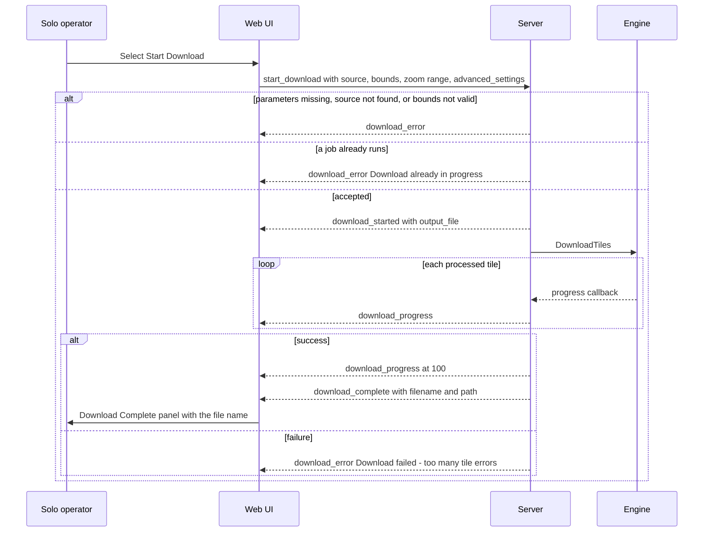
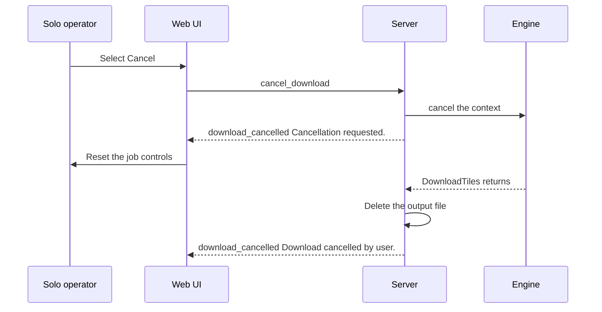
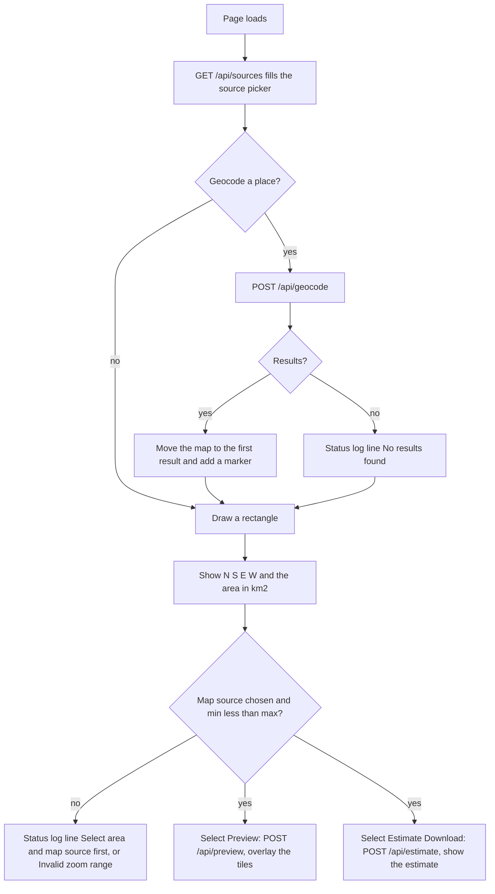

## Purpose

The `serve` command starts a local HTTP server. The server delivers a single-page web UI
and a JSON API, plus a websocket that runs one job at a time. The web UI lets the map
preparer do these tasks:

- select bounds on a base map,
- choose a map source and a zoom range,
- see an estimate and a preview,
- start, follow and cancel a job.

The web UI and the server are embedded in the binary (`web/embed.go`). This file
describes the behavior that exists today.

## User stories

- As a solo operator, I want to draw a rectangle on a map, so that I do not type
  coordinates.
- As a solo operator, I want to geocode a place name, so that the map moves to my area.
- As a solo operator, I want a preview of the map source over my bounds, so that I can
  check the imagery first.
- As a solo operator, I want live progress and a Cancel button, so that I can stop a job
  that goes wrong.

## Functional requirements

- FR-web-ui-1 — The `serve` command listens on the address that `--addr` names. The
  default is `localhost:5000`.
- FR-web-ui-2 — The server returns the embedded `index.html` for `/`.
- FR-web-ui-3 — The server returns embedded files under `/static/`.
- FR-web-ui-4 — The server sends `Access-Control-Allow-Origin: *` on every response.
- FR-web-ui-5 — The server answers every `OPTIONS` request with status 204.
- FR-web-ui-6 — The server accepts a websocket upgrade on `/ws` from any origin.
- FR-web-ui-7 — The server runs at most one job at a time, for all connections.
- FR-web-ui-8 — The server rejects a `start_download` message while a job runs, with
  the `download_error` message `Download already in progress`.
- FR-web-ui-9 — Any websocket connection can cancel the running job.
- FR-web-ui-10 — The server sends a `download_progress` message after each processed
  tile.
- FR-web-ui-11 — `POST /api/preview` returns the URLs of up to 6 × 6 tiles at the
  maximum zoom level, centered on the bounds.
- FR-web-ui-12 — `POST /api/geocode` sends the query to Nominatim and returns up to 5
  results.
- FR-web-ui-13 — The web UI shows an OpenStreetMap base map centered on the United
  States at zoom level 4.
- FR-web-ui-14 — The web UI lets the solo operator draw one kind of shape, a rectangle.
- FR-web-ui-15 — The web UI enables **Estimate Download** and **Preview** after the map
  preparer draws a rectangle.
- FR-web-ui-16 — The web UI enables **Start Download** after a successful estimate.
- FR-web-ui-17 — The web UI sets the zoom input limits to the zoom range of the selected
  map source.
- FR-web-ui-18 — The web UI moves the map to the first geocode result at zoom level 12
  and adds a marker.
- FR-web-ui-19 — The web UI shows each preview tile as an image overlay at 0.8 opacity.
- FR-web-ui-20 — The web UI shows a progress bar, the tile counts, the rate, the ETA and
  the failed count during a job.
- FR-web-ui-21 — The web UI reconnects 2 seconds after the websocket closes.
- FR-web-ui-22 — The web UI saves the light or dark theme in `localStorage`.

## User flows

### Flow 1 — The solo operator starts and finishes a job

1. The solo operator selects **Start Download**.
2. The web UI sends `start_download` on the websocket.
3. If a parameter is missing, the map source is not found, or the bounds are not valid,
   the server sends `download_error`.
4. If a job already runs, the server sends `download_error` with
   `Download already in progress`.
5. The server sends `download_started` with the output file name.
6. The engine processes the tiles. The server sends `download_progress` after each tile.
7. If the job succeeds, the server sends a final `download_progress` at 100 and then
   `download_complete`. The web UI shows the **Download Complete!** panel.
8. If the job fails, the server sends `download_error` with
   `Download failed - too many tile errors. Try reducing concurrent downloads or enabling Ignore Errors.`

### Flow 2 — The solo operator cancels a job

1. The solo operator selects **Cancel**.
2. The web UI sends `cancel_download`.
3. The server cancels the context of the job.
4. The server sends `download_cancelled` with `Cancellation requested.`
5. The web UI resets the job controls at once. The job is still stopping.
6. When the engine returns, the server deletes the output file.
7. The server sends `download_cancelled` with `Download cancelled by user.`

### Flow 3 — The solo operator selects bounds and checks them

1. The web UI loads the source catalog from `GET /api/sources`.
2. The solo operator can type a place name and press Enter or the search button.
3. If Nominatim returns results, the web UI moves to the first result and adds a marker.
4. If there is no result, the web UI logs `No results found for "<query>"`.
5. The solo operator selects **Draw Rectangle** and draws the bounds.
6. The web UI shows the north, south, east and west values and the area in km².
7. If no map source is chosen, the web UI logs `Select area and map source first`.
8. If the minimum zoom level is not less than the maximum, the web UI logs
   `Invalid zoom range`.
9. The solo operator selects **Preview** to overlay sample tiles on the map.
10. The solo operator selects **Estimate Download** to see the estimate. See
    `02-area-estimate.md`.

## Screens & states

One screen, `web/index.html`, driven by `web/static/js/app.js`. It has two regions: the
sidebar (`col-md-3`) and the map (`col-md-9`).

Sidebar sections, top to bottom:

1. Title and theme toggle (`#themeToggle`).
2. **Map Source**: `#mapSourceSelect`.
3. **Area Selection**: geocode input `#addressSearch`, **Draw Rectangle**, **Clear**,
   and `#selectionInfo`.
4. **Zoom Levels**: `#minZoom` (default 1) and `#maxZoom` (default 15), each 1–20, plus
   a zoom guide.
5. **Download Options**: `#customName` and the collapsed **Advanced Settings**:
   - **Concurrent Downloads**: 1, 3, 5, 8 or 10. The default is 5.
   - **Batch Delay (seconds)**: 0.1 to 1.0. The engine does not use this value.
   - **Failure Tolerance**: 10 % to 50 %. The default is 30 %.
   - **Ignore Errors & Continue**.
   - **Verify SSL Certificates**, unchecked.
6. **Estimate Download** and **Preview**, then `#estimationResult`.
7. **Start Download** and **Cancel**, then `#downloadProgress`.
8. `#downloadResults`, which shows the file name and the fixed text `downloads/ folder`.
9. **Status**: `#statusLog`, at most 50 lines and 200 px high.

| State | What the web UI shows today |
|---|---|
| Sources loading | The option `Loading sources...` |
| Sources failed | A status log line only |
| Empty source catalog | The server returns `null`. The JavaScript fails on `sources.length` and logs an error line |
| No bounds | `Click "Draw Rectangle" to select an area on the map`. Estimate and Preview disabled |
| Estimate or preview error | A status log line only |
| Request in flight | Nothing. `#loadingModal` exists but no code shows it |
| Job running | Spinner text `Downloading...`, progress bar, **Cancel** visible |
| Job failed | A status log line, and the controls reset |
| Job cancelled | A status log line, and the controls reset |
| Job complete | **Download Complete!** panel with the file name |
| Websocket closed | The status log line `Disconnected - reconnecting...` only |

Accessibility signals:

- Present:
  - `<label for>` on the geocode input, the zoom inputs, the file name and the advanced
    settings.
  - `aria-expanded` and `aria-controls` on the **Advanced Settings** toggle.
  - `role="status"` with visually hidden text on the modal spinner.
- Missing:
  - A label on the source picker, which has only an `<h5>`.
  - `aria-label` on the icon-only theme and search buttons.
  - `aria-valuenow` on the progress bar.
  - `aria-live` on the status log.
  - A keyboard path to draw bounds.

Theme and layout:

- The theme toggle sets `data-bs-theme`. The web UI does not read
  `prefers-color-scheme`.
- In dark mode, `style.css:107-113` puts a colour filter on `.leaflet-tile` and inverts
  the map controls. The preview image overlays do not get the filter.
- One breakpoint at 768 px stacks the sidebar and the map.

External dependencies, all loaded at run time (`web/index.html:9-16`, `:241-243`):

| Asset | Version | Host |
|---|---|---|
| Leaflet | 1.9.4 | unpkg.com |
| leaflet-draw | 1.0.4 | unpkg.com |
| Bootstrap CSS and bundle | 5.3.0 | cdn.jsdelivr.net |
| Font Awesome | 6.4.0 | cdnjs.cloudflare.com |
| Base map tiles | — | `{s}.tile.openstreetmap.org` |

## Behaviour rules

- The server has no authentication.
- The server has no read, write or idle timeouts (`http.ListenAndServe`, `serve.go:45`).
- The server creates `./downloads` at start and writes every output file there.
- In `start_download`, a value of 0 means "use the default". So the web UI cannot set
  0 for:
  - `min_zoom` (default 1) or `max_zoom` (default 15),
  - `max_concurrent` (default 5),
  - `delay_between_batches` (default 0.2),
  - `failure_tolerance` (default 0.3).
- `POST /api/preview` replaces a `min_zoom` of 0 with 1 and a `max_zoom` of 0 with 18.
  It uses only the maximum zoom level.
- The preview grid has a maximum number of tiles per side:
  - 6 at zoom level 10 or less,
  - 4 from zoom level 11 to 15,
  - 3 above zoom level 15.
- The preview uses the first server part for every tile.
- The web UI changes a maximum zoom level that is not above the minimum to the minimum
  plus 1.
- On a source change, the web UI sets the zoom inputs to `max(1, source min)` and
  `min(15, source max)`.
- The geocode request goes from the server to
  `https://nominatim.openstreetmap.org/search` with `limit=5`, the User-Agent
  `ATAK-Map-Downloader/1.0` and a 10-second timeout. The server does not limit the
  request rate.

## Data touched

- Writes output files under `./downloads`. See `03-tile-download.md`.
- In memory: one `dlState` per server, holding `downloading bool` and `cancel`, behind a
  mutex (`web.go:30-34`). Nothing survives a restart.
- Browser: `localStorage.theme`.

## Interfaces

### HTTP routes

All routes are in `cmd/atak-dl/commands/web.go:52-134`. Success responses do not set
`Content-Type: application/json`. Error responses come from `http.Error`, so their
`Content-Type` is `text/plain`, and their JSON is built by string concatenation.

| Method | Path | Request | Success response | Errors |
|---|---|---|---|---|
| GET | `/` | — | `index.html` | — |
| GET | `/static/*` | — | Embedded file | 404 |
| any | `/api/sources` | — | See `01-map-sources.md` | — |
| POST | `/api/estimate` | See `02-area-estimate.md` | | 400, 405 |
| POST | `/api/tile-info` | See `02-area-estimate.md` | | 400, 405 |
| POST | `/api/validate-source` | See `01-map-sources.md` | | 400, 404, 405 |
| POST | `/api/preview` | `{"source", "bounds": [w, s, e, n], "min_zoom", "max_zoom"}` | `{"tiles": [{"url", "x", "y", "zoom", "bounds": [w, s, e, n]}], "zoom", "source", "total_tiles", "bounds"}` | 400, 404, 405 |
| POST | `/api/geocode` | `{"query"}` | `{"query", "results": [{"display_name", "lat", "lon", "boundingbox", "type", "class"}], "count"}` | 400, 405, 500 |
| GET | `/ws` | Websocket upgrade | See below | — |
| OPTIONS | any | — | 204 | — |

The web UI calls `/api/sources`, `/api/estimate`, `/api/preview`, `/api/geocode` and
`/ws`. It does not call `/api/tile-info` or `/api/validate-source`.

### Websocket protocol

Messages are JSON. Each client message has the form `{"type", "data"}`.

Client to server:

| `type` | `data` |
|---|---|
| `start_download` | `{"source", "bounds": [w, s, e, n], "min_zoom", "max_zoom", "custom_name", "advanced_settings": {"max_concurrent", "delay_between_batches", "failure_tolerance", "ignore_errors", "verify_ssl"}}` |
| `cancel_download` | none |
| `get_download_status` | none |

Server to client:

| `type` | Fields | When |
|---|---|---|
| `status` | `message` | On connect: `Connected to ATAK Downloader`. Reply to `get_download_status`: `Download in progress` or `No active download` |
| `download_started` | `message`, `output_file` | The job starts |
| `download_progress` | `progress`, `downloaded`, `total`, `failed`, `rate`, `eta`, `message` | After each processed tile, and once at 100 on success |
| `download_complete` | `message`, `filename`, `path` | The job succeeds. `path` is the path on the server |
| `download_error` | `message` | Rejected request, or failed job |
| `download_cancelled` | `message` | `Cancellation requested.`, `No active download.`, or `Download cancelled by user.` |

## Edge cases & failures

What the code handles:

- A second `start_download` while a job runs gets a clear error.
- A closed websocket makes the web UI reconnect.
- The `/static/` route uses `fs.Sub` on an `embed.FS`, which rejects `..` paths.
- The output file name keeps only safe characters, so `custom_name` cannot leave
  `./downloads`.

What the code does not handle:

- **Any web page can drive the server.** CORS is `*` and `CheckOrigin` returns true
  (`web.go:44`, `:54`). A page the solo operator visits can start jobs that write files
  to disk, or use the geocode route.
- **`--addr 0.0.0.0:5000` exposes the server to the network** with no authentication.
- **Concurrent websocket writes.** Every engine goroutine calls `conn.WriteJSON` through
  the progress callback, and the read loop writes too. gorilla/websocket allows only one
  concurrent writer, so frames can break or the server can panic.
- **The finished output file cannot be fetched from the browser.** No route serves
  `./downloads`. The web UI shows only the file name.
- **A closed websocket orphans the job.** The job keeps running and writes to the dead
  connection. A new connection cannot see its progress. `get_download_status` returns
  only text.
- **The first `download_cancelled` resets the web UI before the job stops.** An
  immediate **Start Download** then gets `Download already in progress`.
- **`sendWS` drops a message when the socket is not open.** **Start Download** then
  stays on `Downloading...` with no job.
- **Every failed job reports "too many tile errors"**, including a failure to create the
  output file and `no tiles processed`.
- **`/api/preview` ignores the bounds error** (`web.go:290`). Bounds that are not valid
  give a nil pointer, and the handler panics. `net/http` recovers it and drops the
  connection.
- **Preview tiles can fail to show.** The overlays set `crossOrigin: 'anonymous'`
  (`app.js:363`), so a tile server that sends no CORS header blocks the image.
- **The web UI needs the internet.** Every library and the base map come from public
  hosts, so the page does not work on a disconnected machine.
- **`logStatus` writes server and user text through `innerHTML`** (`app.js:559`). The
  geocode popup does the same with `display_name` (`app.js:412`).
- **The geocode route breaks the Nominatim usage policy.** It has no rate limit, no cache
  and no contact detail in the User-Agent
  ([Nominatim usage policy](https://operations.osmfoundation.org/policies/nominatim/),
  retrieved 2026-11-21).
- **The base map uses `tile.openstreetmap.org`**, whose usage policy requires an
  identifying User-Agent and forbids offline bulk use
  ([OSM tile usage policy](https://operations.osmfoundation.org/policies/tiles/),
  retrieved 2026-11-21). The browser sends its own User-Agent.
- **gorilla/websocket v1.5.3 is the last release**, from June 2024
  ([pkg.go.dev versions](https://pkg.go.dev/github.com/gorilla/websocket?tab=versions),
  retrieved 2026-11-21).
- **Unused code:** `safeFilename`, `safeNameRe` and the `mapsDir` field (`web.go:28`,
  `:577-581`), and the `loadingModal` object (`app.js:576-581`).

Known defects and the planned feature that repairs each:

| Defect | Repaired by |
|---|---|
| CORS `*`, any-origin websocket, no auth on a non-loopback bind, no server timeouts, `innerHTML` writes, preview panic | `security-hardening` (05) |
| Concurrent websocket writes, gorilla/websocket | `security-hardening` (05) |
| Geocode route that breaks the Nominatim policy | `polite-downloading` (06) |
| CDN dependencies, OSM base map, no fetch of the output file, missing loading and error states, accessibility gaps, unused Batch Delay control | `offline-web-ui` (08) |
| Rectangle only | `area-selection` (11) |
| One global job, orphaned jobs, no job history | `team-server` (12) |

## Acceptance criteria

- [ ] `atak-dl serve` prints `Open http://localhost:5000 in your browser` and serves the
      page at that address.
- [ ] `GET /` returns HTML whose `<title>` is `ATAK Tile Downloader`.
- [ ] Every response carries `Access-Control-Allow-Origin: *`.
- [ ] A websocket connection to `/ws` receives
      `{"type":"status","message":"Connected to ATAK Downloader"}` first.
- [ ] A second `start_download` while a job runs receives a `download_error` with
      `Download already in progress`.
- [ ] `POST /api/preview` with valid bounds and `max_zoom` 16 returns at most 9 tiles.
- [ ] After a rectangle is drawn, **Estimate Download** and **Preview** are enabled.
- [ ] After a successful estimate, **Start Download** is enabled.

## Out of scope

- More than one job at a time.
- Authentication.
- Serving output files to the browser.

## Open questions

- The **Batch Delay** control and `delay_between_batches` reach the engine, which does not
  use them. The code does not show whether a delay was ever planned.
- The code does not show whether `/api/tile-info` and `/api/validate-source` were meant
  for the web UI or for scripts.
