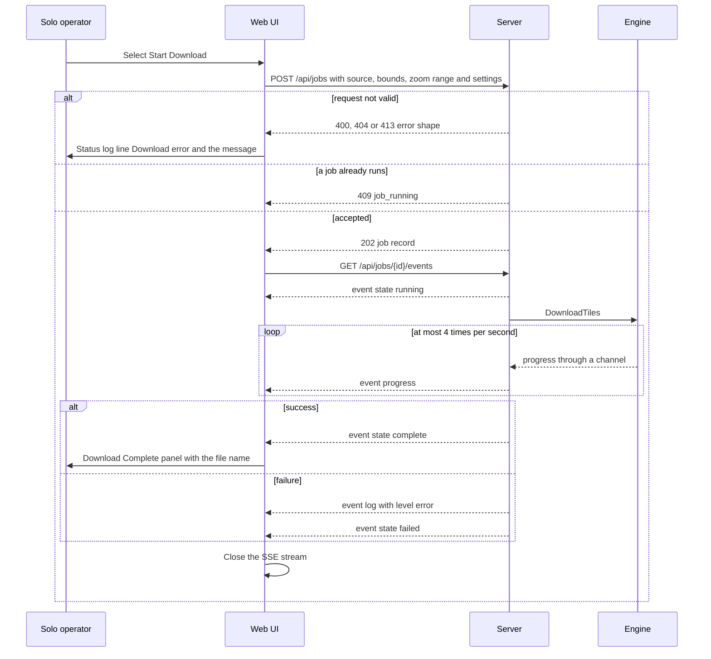
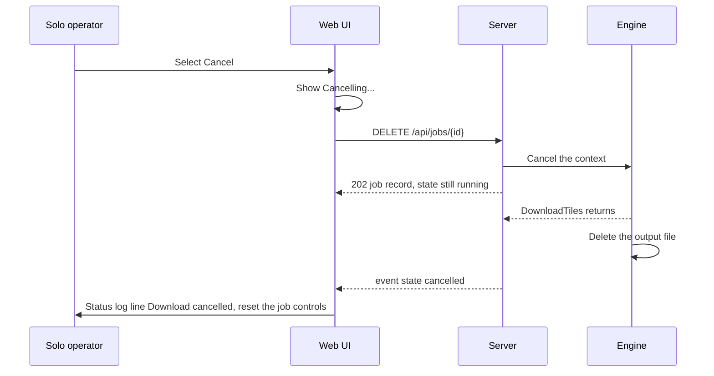
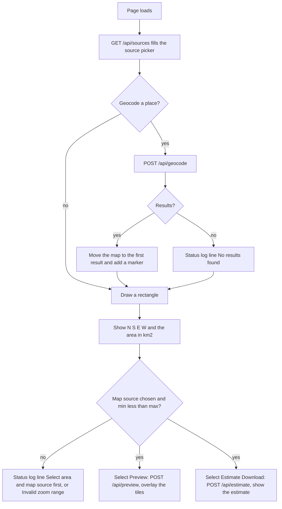

## Purpose

The `serve` command starts a local HTTP server. The server delivers a single-page web UI
and a JSON API. The job API runs one job at a time and sends its progress as an SSE
stream (#76). The web UI lets the solo operator do these tasks:

- select bounds on a base map,
- choose a map source and a zoom range,
- see an estimate and a preview,
- start, follow and cancel a job.

The web UI and the server are embedded in the binary (`web/embed.go`). This file
describes the behavior that exists today. A statement that an Epic 0 or Epic 1 pull
request changed names that pull request, for example (#76).

## User stories

- As a solo operator, I want to draw a rectangle on a map, so that I do not type
  coordinates.
- As a solo operator, I want to geocode a place name, so that the map moves to my area.
- As a solo operator, I want a preview of the map source over my bounds, so that I can
  check the imagery first.
- As a solo operator, I want live progress and a Cancel button, so that I can stop a job
  that goes wrong.

## Functional requirements

- FR-web-ui-1 — The `serve` command listens on the address that `--addr` names. The
  default is `localhost:5000`.
- FR-web-ui-2 — The server returns the embedded `index.html` for `/`.
- FR-web-ui-3 — The server returns embedded files under `/static/`.
- FR-web-ui-4 — The server sends no `Access-Control-Allow-*` header (#77).
- FR-web-ui-5 — The server rejects a cross-origin browser request with status 403 and
  error code `cross_origin`, unless its method is `GET`, `HEAD` or `OPTIONS` (#77).
- FR-web-ui-6 — The server serves the job API on `/api/jobs` (#76). See
  `05-security-hardening.md`.
- FR-web-ui-7 — The server runs at most one job at a time, for all clients (#76).
- FR-web-ui-8 — If a job runs, `POST /api/jobs` returns 409 with error code
  `job_running` (#76).
- FR-web-ui-9 — Any client that knows the job id can cancel the job with
  `DELETE /api/jobs/{id}` (#76).
- FR-web-ui-10 — The server sends at most 4 `progress` events per second per job (#76).
- FR-web-ui-11 — `POST /api/preview` returns the URLs of up to 6 × 6 tiles at the
  maximum zoom level, centered on the bounds.
- FR-web-ui-12 — `POST /api/geocode` sends the query to Nominatim and returns up to 5
  results.
- FR-web-ui-13 — The web UI shows an OpenStreetMap base map centered on the United
  States at zoom level 4.
- FR-web-ui-14 — The web UI lets the solo operator draw one kind of shape, a rectangle.
- FR-web-ui-15 — The web UI enables **Estimate Download** and **Preview** after the
  solo operator draws a rectangle.
- FR-web-ui-16 — The web UI enables **Start Download** after a successful estimate.
- FR-web-ui-17 — The web UI sets the zoom input limits to the zoom range of the selected
  map source.
- FR-web-ui-18 — The web UI moves the map to the first geocode result at zoom level 12
  and adds a marker.
- FR-web-ui-19 — The web UI shows each preview tile as an image overlay at 0.8 opacity.
- FR-web-ui-20 — The web UI shows a progress bar, the tile counts, the rate, the ETA and
  the failed count during a job.
- FR-web-ui-21 — The web UI closes the SSE stream when it receives a final `state`
  event (#78).
- FR-web-ui-22 — The web UI saves the light or dark theme in `localStorage`.
- FR-web-ui-23 — The server rejects a request body larger than 1 MiB with status 413
  and error code `body_too_large` (#81).
- FR-web-ui-24 — If the host in `--addr` is not a loopback address, `serve` prints a
  warning to stderr that the server has no authentication (#81).

## User flows

### Flow 1 — The solo operator starts and finishes a job



1. The solo operator selects **Start Download**.
2. If a job runs, the web UI keeps Start disabled, so the solo operator cannot start a
   second job from the same page.
3. The web UI makes Estimate, Start and the settings read-only, and sends `POST /api/jobs`
   (`web/static/js/app.js:883`).
4. If the request is not valid, the server returns 400, 404 or 413 with the error shape.
   The web UI logs `Download error: <message>` and resets the job controls. The reset
   applies only when the job panel shows no job.
5. If a job already runs, the server returns 409 with `job_running`.
6. The server starts the job and returns 202 with the job record. The web UI logs
   `Output file: <name>`.
7. The web UI opens `GET /api/jobs/{id}/events` with `EventSource` (`app.js:347`). The
   first event is a `state` event.
8. The server sends `progress` events, at most 4 per second (`jobs.go:135`).
9. If the job succeeds, the server sends `state` with `complete`. The web UI shows the
   **Download Complete!** panel with `Downloaded N of M tiles.` and the file name.
10. If the job fails, the server sends a `log` event with level `error`, then `state`
    with `failed`. The web UI logs the engine error, for example
    `failure rate 35.0% exceeds threshold 30.0%` (#76, #78).
11. The server ends the stream after the final `state` event. The web UI closes its
    `EventSource` (`app.js:369-374`), because `EventSource` reconnects to an ended
    stream (#78).

### Flow 2 — The solo operator cancels a job



1. The solo operator selects **Cancel**.
2. The web UI logs `Cancelling download...` and shows `Cancelling...` on the button.
3. The web UI sends `DELETE /api/jobs/{id}` (`app.js:987`).
4. The server cancels the context of the job. It returns 202 with the job record, which
   still shows `running` (#76).
5. The engine commits the stored tiles and keeps the output file (#26).
6. The server sends `state` with `cancelled` and ends the stream.
7. The web UI closes the stream, logs `Download cancelled` and resets the job controls
   (#78).
8. If the `DELETE` request fails, the web UI logs `Cancel error: <message>` and shows
   **Cancel** again.

### Flow 3 — The solo operator selects bounds and checks them



1. The web UI loads the source catalog from `GET /api/sources`.
2. The solo operator can type a place name and press Enter or the search button.
3. If Nominatim returns results, the web UI moves to the first result and adds a marker.
4. If there is no result, the web UI logs `No results found for "<query>"`.
5. The solo operator selects **Draw Rectangle** and draws the bounds.
6. The web UI shows the north, south, east and west values and the area in km².
7. If no map source is chosen, the web UI logs `Select area and map source first`.
8. If the minimum zoom level is not less than the maximum, the web UI logs
   `Invalid zoom range`.
9. The solo operator selects **Preview** to overlay sample tiles on the map.
10. The solo operator selects **Estimate Download** to see the estimate. See
    `02-area-estimate.md`.

## Screens & states

One screen, `web/index.html`, driven by `web/static/js/app.js`. It has two regions: the
sidebar (`col-md-3`) and the map (`col-md-9`).

Sidebar sections, top to bottom:

1. Title and theme toggle (`#themeToggle`).
2. **Map Source**: `#mapSourceSelect`.
3. **Area Selection**: geocode input `#addressSearch`, **Draw Rectangle**, **Clear**,
   and `#selectionInfo`.
4. **Zoom Levels**: `#minZoom` (default 1) and `#maxZoom` (default 15), each 1–20, plus
   a zoom guide.
5. **Download Options**: `#customName` and the collapsed **Advanced Settings**
   (`web/index.html:115-152`):
   - **Concurrent Downloads**: 1, 3, 5, 8 or 10. The default is 5.
   - **Failure Tolerance**: 10 %, 20 %, 30 % or 50 %. The default is 30 %.
   - **Ignore Errors & Continue**, unchecked.
   - **Verify TLS**, checked (#75, #78).

   The **Batch Delay** control is removed (#78).
6. **Estimate Download** and **Preview**, then `#estimationResult`.
7. **Start Download** and **Cancel**, then `#downloadProgress`.
8. `#downloadResults`, which shows `Downloaded N of M tiles.`, the file name and the fixed
   text `downloads/ folder`.
9. **Status**: `#statusLog`, at most 50 lines and 200 px high.

| State | What the web UI shows today |
|---|---|
| Sources loading | The option `Loading sources...` |
| Sources failed | A status log line only |
| Empty source catalog | The server returns `[]` (#74). The web UI logs `Loaded 0 map sources` and shows only the placeholder option |
| No bounds | `Click "Draw Rectangle" to select an area on the map`. Estimate and Preview disabled |
| Estimate or preview error | A status log line with the `message` of the error shape (#74) |
| Request in flight | A spinner in the button of the request, and `Loading map sources` while the source list loads (FR-offline-web-ui-18) |
| Job running | Spinner text `Downloading...`, progress bar, **Cancel** visible. Estimate, Start and the settings are read-only |
| Job failed | A status log line with the engine error, and the controls reset (#78) |
| Job cancelled | The status log line `Download cancelled`, and the controls reset (#78) |
| Job complete | **Download Complete!** panel with the tile counts and the file name |
| SSE stream lost | The status log line `Lost the job event stream`, and the controls reset (#78) |

Accessibility signals:

- Present:
  - `<label for>` on the geocode input, the zoom inputs, the file name and the advanced
    settings.
  - `aria-expanded` and `aria-controls` on the **Advanced Settings** toggle.
  - `role="status"` on the connection indicator.
- Missing:
  - A label on the source picker, which has only an `<h5>`.
  - `aria-label` on the icon-only theme and search buttons.
  - `aria-valuenow` on the progress bar.
  - `aria-live` on the status log.
  - A keyboard path to draw bounds.

Theme and layout:

- The theme toggle sets `data-theme`. The web UI follows `prefers-color-scheme` until
  the solo operator selects a theme (FR-offline-web-ui-29).
- In dark mode, no CSS filter applies to the map tiles or the preview tiles, so the
  tiles show the colours of the output file (FR-offline-web-ui-30).
- One breakpoint at 768 px stacks the sidebar and the map.

External dependencies, all loaded at run time (`web/index.html:9-16`, `:231-233`):

| Asset | Version | Host |
|---|---|---|
| Leaflet | 1.9.4 | unpkg.com |
| leaflet-draw | 1.0.4 | unpkg.com |
| Bootstrap CSS and bundle | 5.3.0 | cdn.jsdelivr.net |
| Font Awesome | 6.4.0 | cdnjs.cloudflare.com |
| Base map tiles | — | `{s}.tile.openstreetmap.org` |

Feature 08 replaces these assets. Since #31, the binary embeds Leaflet and Leaflet-Geoman, and only the base map tiles come from another host.

## Behaviour rules

- The server has no authentication.
- The server sets these timeouts (`serve.go:91-99`, #81):
  - `ReadHeaderTimeout` 10 s,
  - `ReadTimeout` 30 s,
  - `IdleTimeout` 120 s.

  It sets no `WriteTimeout`, because an SSE stream stays open for the full job.
- The server limits every request body to 1 MiB (`web.go:64-79`, #81). It returns 413
  `body_too_large` at once when `Content-Length` is larger. It returns the same error
  when a body with no `Content-Length` grows past the limit.
- `newServerHandler` applies the cross-origin check first and the body limit second
  (`web.go:56-62`, #77, #81).
- The server creates `./downloads` at start and writes every output file there.
- In `POST /api/jobs`, an optional setting that the client does not send gets the engine
  default (`jobs.go:20-50`, #76):
  - `concurrency` 5,
  - `failure_tolerance` 0.2,
  - `ignore_errors` false,
  - `verify_tls` true.

  The web UI always sends all four settings. Its failure tolerance default is 0.3.
- `POST /api/jobs` and the `download` command check the zoom range and the concurrency
  with the same function, `checkJobLimits` (`jobs.go:320-337`, #81):
  - If `min_zoom` is above `max_zoom`, the error code is `zoom_out_of_range`.
  - If the zoom range is outside the zoom range of the map source, the error code is
    `zoom_out_of_range`.
  - If the concurrency is below 1 or above 32, the error code is `invalid_concurrency`.
- `POST /api/preview` replaces a `min_zoom` of 0 with 1 and a `max_zoom` of 0 with 18.
  It uses only the maximum zoom level.
- The preview grid has a maximum number of tiles per side:
  - 6 at zoom level 10 or less,
  - 4 from zoom level 11 to 15,
  - 3 above zoom level 15.
- The preview uses the first server part for every tile.
- The web UI changes a maximum zoom level that is not above the minimum to the minimum
  plus 1.
- On a source change, the web UI sets the zoom inputs to `max(1, source min)` and
  `min(15, source max)`.
- The geocode request goes from the server to
  `https://nominatim.openstreetmap.org/search` with `limit=5`, the User-Agent
  `ATAK-Map-Downloader/1.0` and a 10-second timeout. The server does not limit the
  request rate.
- If a geocode result has a `lat` or `lon` that is not a number, the server returns 500
  `internal` (`web.go:398-404`, #81).

## Data touched

- Writes output files under `./downloads`. See `03-tile-download.md`.
- In memory: one `dlState` per server, behind a mutex (`web.go:29-35`, #76). It holds
  `downloading bool` and `job`, the last job that the job API started. The last job
  stays after it ends, so `GET /api/jobs/{id}` can read its result. Nothing survives a
  restart.
- Browser: `localStorage.theme`.

## Interfaces

### HTTP routes

The router is in `cmd/atak-dl/commands/web.go:87-100`. The job routes use method and
path patterns on a separate `http.ServeMux` (`jobs.go:244-258`, #76).

Every JSON success response sets `Content-Type: application/json` (`web.go:423-426`,
#74). Every error response uses the error shape from `writeError` (#74):

```json
{"error": {"code": "<code>", "message": "<text>"}}
```

| Method | Path | Request | Success response | Errors |
|---|---|---|---|---|
| GET | `/` | — | `index.html` | — |
| GET | `/static/*` | — | Embedded file | 404 `not_found` |
| any | `/api/sources` | — | See `01-map-sources.md` | — |
| POST | `/api/estimate` | See `02-area-estimate.md` | | 400 `invalid_json`, `invalid_bounds`; 405 `method_not_allowed`; 413 |
| POST | `/api/tile-info` | See `02-area-estimate.md` | | 400 `invalid_json`; 405; 413 |
| POST | `/api/validate-source` | See `01-map-sources.md` | | 400 `invalid_json`; 404 `unknown_source`; 405; 413 |
| POST | `/api/preview` | `{"source", "bounds": [w, s, e, n], "min_zoom", "max_zoom"}` | `{"tiles": [{"url", "x", "y", "zoom", "bounds": [w, s, e, n]}], "zoom", "source", "total_tiles", "bounds"}` | 400 `invalid_json`, `unknown_source`, `invalid_bounds`; 404 `unknown_source`; 405; 413 |
| POST | `/api/geocode` | `{"query"}` | `{"query", "results": [{"display_name", "lat", "lon", "boundingbox", "type", "class"}], "count"}` | 400 `invalid_json`, `invalid_query`; 405; 413; 500 `internal` |
| POST | `/api/jobs` | See Job API | 202 job record | 400, 404 `unknown_source`, 409 `job_running`, 413 |
| GET | `/api/jobs/{id}` | — | 200 job record | 404 `job_not_found` |
| GET | `/api/jobs/{id}/events` | — | 200 `text/event-stream` | 404 `job_not_found` |
| DELETE | `/api/jobs/{id}` | — | 202 job record | 404 `job_not_found` |
| any other | any other `/api/` path | — | — | 404 `not_found`, or 405 `method_not_allowed` for a job path |

Any route returns 403 `cross_origin` for a cross-origin browser request that is not
`GET`, `HEAD` or `OPTIONS` (#77). A path that matches no route returns 404 `not_found`
(#74).

The web UI calls `/api/sources`, `/api/estimate`, `/api/preview`, `/api/geocode` and the
job API. It does not call `/api/tile-info`, `/api/validate-source` or
`GET /api/jobs/{id}`.

### Job API

The job API replaces the websocket protocol and the `/ws` route (#76, #78).
`05-security-hardening.md` holds the requirements. This section records what is built.

`POST /api/jobs` request (`jobs.go:20-32`):

```json
{"source", "bounds": [w, s, e, n], "min_zoom", "max_zoom", "name",
 "concurrency", "failure_tolerance", "ignore_errors", "verify_tls"}
```

The job record (`jobs.go:62-78`):

```json
{"id", "source", "bounds", "min_zoom", "max_zoom", "state", "output_file",
 "total", "downloaded", "skipped", "failed", "created_at", "error"}
```

- `id` is 12 lowercase hex characters from `crypto/rand`.
- `state` is `running`, `complete`, `failed` or `cancelled`.
- `skipped` counts the tiles that the output file already holds. Only `"if_exists": "resume"`
  makes it above 0 (#26).

SSE events on `GET /api/jobs/{id}/events`:

| `event` | `data` | When |
|---|---|---|
| `state` | The job record | First on every stream, and once at the end of the job |
| `progress` | `{"downloaded", "skipped", "failed", "total", "rate", "eta_seconds"}` | At most 4 per second |
| `log` | `{"level", "message"}` | Before the final `state` of a failed job, with level `error` |

One goroutine per job sends the events (`jobs.go:145-176`). Engine goroutines send
progress to it through a channel.

## Edge cases & failures

What the code handles:

- A second `POST /api/jobs` while a job runs gets 409 `job_running` (#76).
- If the browser closes the SSE stream, the job continues. A new stream gets a `state`
  event with the current job record first (#76).
- A stream for a job that ended gets one `state` event, and then the stream ends (#76).
- The web UI waits for the final `state` event before it resets the job controls (#78).
- A cross-origin `POST` or `DELETE` from a browser gets 403 `cross_origin` (#77).
- A request with no `Sec-Fetch-Site` header and no `Origin` header passes the
  cross-origin check, so `curl` works (#77).
- `/api/preview` with bounds that are not valid returns 400 `invalid_bounds`
  (`web.go:315-319`, #74).
- A request body larger than 1 MiB gets 413 `body_too_large` (#81).
- The `/static/` route uses `fs.Sub` on an `embed.FS`, which rejects `..` paths.
- The output file name keeps only safe characters, so `name` cannot leave `./downloads`.
- The status log writes text through `textContent` (`app.js:960`, #78).
- The geocode popup writes `display_name` through `textContent` (`app.js:752`).

What the code does not handle:

- **`--addr 0.0.0.0:5000` exposes the server to the network** with no authentication.
  `serve` prints a warning, but it still starts (`serve.go:49-54`, #81).
- **The finished output file cannot be fetched from the browser.** No route serves
  `./downloads`. The web UI shows only the file name.
- **The server keeps only the last job.** `GET /api/jobs/{id}` for an earlier job returns
  404 `job_not_found` (`jobs.go:400-409`).
- **A restart loses the job.** The output file stays on disk. The `EventSource` then gets
  404, and the web UI logs `Lost the job event stream`.
- **A late cancel keeps the output file.** If the cancel arrives after the progress
  callback of the last tile, the engine does not see it. The job state is `cancelled`,
  but the output file stays (`jobs.go:369-397`).
- **Preview tiles can fail to show.** The overlays set `crossOrigin: 'anonymous'`
  (`app.js:621`), so a tile server that sends no CORS header blocks the image.
- **The web UI needs the internet.** Every library and the base map come from public
  hosts, so the page does not work on a disconnected machine.
- **The geocode route breaks the Nominatim usage policy.** It has no rate limit, no cache
  and no contact detail in the User-Agent
  ([Nominatim usage policy](https://operations.osmfoundation.org/policies/nominatim/),
  retrieved 2026-11-21).
- **The base map uses `tile.openstreetmap.org`**, whose usage policy requires an
  identifying User-Agent and forbids offline bulk use
  ([OSM tile usage policy](https://operations.osmfoundation.org/policies/tiles/),
  retrieved 2026-11-21). The browser sends its own User-Agent.
- **Unused code:** the `mapsDir` field (`web.go:24`).

Known defects and the planned feature that repairs each:

| Defect | Repaired by |
|---|---|
| No authentication on a non-loopback bind | `team-server` (12) |
| The geocode popup HTML | `security-hardening` (05) |
| Geocode route that breaks the Nominatim policy | `polite-downloading` (06) |
| Late cancel that keeps the output file | `robust-downloads` (07) |
| CDN dependencies, OSM base map, no fetch of the output file, missing loading and error states, accessibility gaps | `offline-web-ui` (08) |
| Rectangle only | `area-selection` (11) |
| One global job, only the last job in memory, no job history | `team-server` (12) |

## Acceptance criteria

- [ ] `atak-dl serve` prints `Open http://localhost:5000 in your browser` and serves the
      page at that address.
- [ ] `GET /` returns HTML whose `<title>` is `ATAK Tile Downloader`.
- [ ] No response carries an `Access-Control-Allow-Origin` header.
- [ ] A `POST /api/jobs` with `Sec-Fetch-Site: cross-site` returns 403 with code
      `cross_origin`.
- [ ] `GET /api/jobs/{id}/events` for a running job sends a `state` event first.
- [ ] A second `POST /api/jobs` while a job runs returns 409 with code `job_running`.
- [ ] A 2 MiB request body returns 413 with code `body_too_large`.
- [ ] `atak-dl serve --addr 0.0.0.0:5000` prints the no-authentication warning.
- [ ] `POST /api/preview` with valid bounds and `max_zoom` 16 returns at most 9 tiles.
- [ ] After a rectangle is drawn, **Estimate Download** and **Preview** are enabled.
- [ ] After a successful estimate, **Start Download** is enabled.
- [ ] On page load, **Verify TLS** is checked.

## Out of scope

- More than one job at a time.
- Authentication.
- Serving output files to the browser.

## Open questions

- The code does not show whether `/api/tile-info` and `/api/validate-source` were meant
  for the web UI or for scripts.
