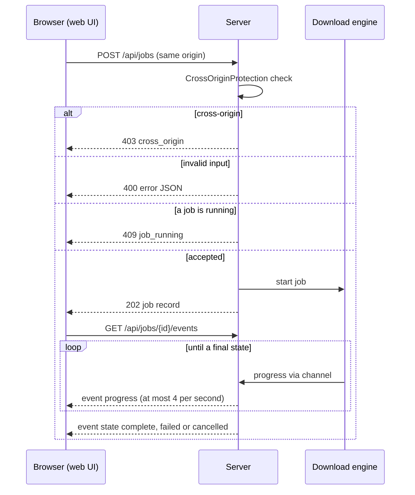
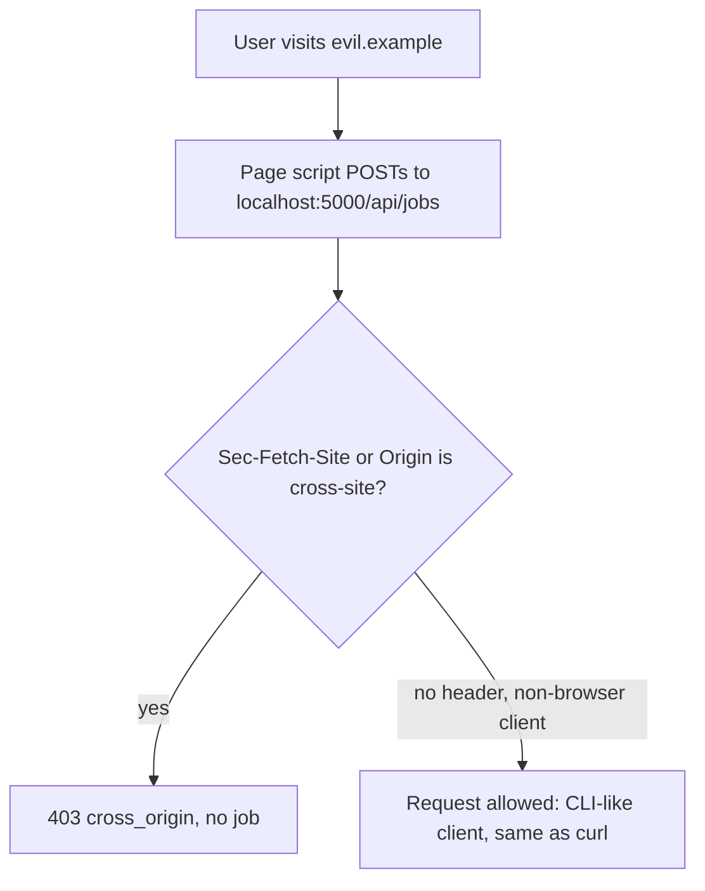

## Purpose

Today any web page that the user visits can start a job on the local server. That is possible because the server sends `Access-Control-Allow-Origin: *` and accepts websocket connections from any origin (`cmd/atak-dl/commands/web.go:44,54`). Tile requests skip TLS verification by default (`internal/download/download.go:42,100`). Progress messages are written to one websocket from many goroutines with no lock, and gorilla/websocket does not allow that.

This feature closes these gaps. It also replaces the websocket with a small job API over HTTP and SSE. The team server (feature 12) builds on that API.

## User stories

- As a solo operator, I want only my own browser tab to start a job, so that a malicious page cannot fill my disk.
- As any user, I want tile requests to verify TLS, so that a network attacker cannot replace tiles.
- As a team member, I want progress that does not drop or corrupt, so that I can trust the numbers.

## Functional requirements

### Cross-origin protection

- FR-security-hardening-1 — The server sends no `Access-Control-Allow-*` header.
- FR-security-hardening-2 — The server wraps every `POST` and `DELETE` route with `http.CrossOriginProtection`.
- FR-security-hardening-3 — The server rejects a cross-origin `POST` or `DELETE` with status 403 and error code `cross_origin`.

### TLS

- FR-security-hardening-4 — The download engine verifies TLS certificates by default.
- FR-security-hardening-5 — `atak-dl download --insecure` turns off TLS verification for that job.
- FR-security-hardening-6 — If TLS verification is off, the CLI prints a warning to stderr before the job starts.
- FR-security-hardening-7 — The web UI shows "Verify TLS" as checked by default.

### Job API

- FR-security-hardening-8 — `POST /api/jobs` starts a job and returns 202 with the job record.
- FR-security-hardening-9 — `GET /api/jobs/{id}` returns the job record.
- FR-security-hardening-10 — `GET /api/jobs/{id}/events` streams job events as SSE.
- FR-security-hardening-11 — `DELETE /api/jobs/{id}` cancels a queued or running job and returns 202.
- FR-security-hardening-12 — If a job is already running, `POST /api/jobs` returns 409 with error code `job_running`. Feature 12 replaces this rule with a queue.
- FR-security-hardening-13 — One goroutine per job sends events. Engine goroutines send progress through a channel to that goroutine.
- FR-security-hardening-14 — The server sends at most 4 `progress` events per second per job.
- FR-security-hardening-15 — A client that reconnects to `/events` receives a `state` event with the current job record first.
- FR-security-hardening-16 — The `/ws` route and the `gorilla/websocket` dependency are removed.

### Limits and timeouts

- FR-security-hardening-17 — The server rejects a request body larger than 1 MiB with status 413.
- FR-security-hardening-18 — The server sets `ReadHeaderTimeout` 10 s, `ReadTimeout` 30 s and `IdleTimeout` 120 s. The SSE route has no write timeout.
- FR-security-hardening-19 — The server and the CLI reject a zoom range outside the map source's zoom range with error code `zoom_out_of_range`.
- FR-security-hardening-20 — The server and the CLI reject a concurrency below 1 or above 32 with error code `invalid_concurrency`.
- FR-security-hardening-21 — `/api/preview` returns 400 with error code `invalid_bounds` for invalid bounds.

### Error shape

- FR-security-hardening-22 — Every error response has `Content-Type: application/json` and the body `{"error":{"code":"<code>","message":"<text>"}}`.
- FR-security-hardening-23 — Every JSON success response has `Content-Type: application/json`.
- FR-security-hardening-24 — `GET /api/sources` returns `[]`, not `null`, when the source catalog is empty.
- FR-security-hardening-25 — If the address in `--addr` is not a loopback address, `serve` prints a warning that the server has no authentication. Feature 12 replaces this warning with the token.

## User flows

### Flow 1 — The web UI starts a job

1. The web UI sends `POST /api/jobs`.
2. The server checks the origin. If the request is cross-origin, the server returns 403.
3. The server validates the input. If the input is invalid, the server returns 400.
4. If a job is running, the server returns 409.
5. The server starts the job and returns 202 with the job record.
6. The web UI opens `GET /api/jobs/{id}/events`.
7. The server sends `progress` events, at most 4 per second.
8. The server sends a final `state` event and closes the stream.

### Flow 2 — A malicious page tries to start a job

1. A page on another origin sends `POST` to the server.
2. The browser adds `Sec-Fetch-Site` and `Origin` headers.
3. `http.CrossOriginProtection` sees a cross-site request and the server returns 403.
4. A request without these headers comes from a client that is not a browser. The server allows it, as `curl` is allowed today.

## Screens & states

The web UI keeps its current screens (`web/index.html`). Changes:

- "Verify SSL" is renamed "Verify TLS" and is checked by default.
- The web UI shows the `message` of an error response in the existing status log.

Feature 08 redesigns the screens.

## Behaviour rules

- SSE events:
  - `event: state` carries the job record.
  - `event: progress` carries `{downloaded, skipped, failed, total, rate, eta_seconds}`.
  - `event: log` carries `{level, message}`.
- Job record: `{id, source, bounds, min_zoom, max_zoom, state, output_file, total, downloaded, skipped, failed, created_at, error}`.
- `id` is 12 lowercase hex characters from `crypto/rand`.
- Job states in this feature: `running`, `complete`, `failed` and `cancelled`. Feature 12 adds `queued`.
- The `delay_between_batches` setting is removed. The engine never read it (`internal/download/download.go:28`). Feature 06 replaces it with rate limits.
- Error codes: `cross_origin`, `invalid_json`, `invalid_bounds`, `zoom_out_of_range`, `invalid_concurrency`, `unknown_source`, `job_running`, `job_not_found`, `body_too_large`, `internal`, `invalid_query`, `not_found`, `method_not_allowed`.
- `invalid_query` is for an empty `/api/geocode` query, `not_found` is for a route that does not exist, and `method_not_allowed` comes with status 405. The PM accepted these three codes at the #74 gate.

## Data touched

- JOB gains `id`, `created_at` and `error`. It stays in memory in this feature.
- `download.Config.VerifySSL` is renamed `VerifyTLS`, with default `true`.

## Interfaces

| Method | Path | Request | Success | Errors |
|---|---|---|---|---|
| POST | `/api/jobs` | `{source, bounds:[w,s,e,n], min_zoom, max_zoom, name?, concurrency?, failure_tolerance?, ignore_errors?, verify_tls?}` | 202 job record | 400, 403, 404 `unknown_source`, 409, 413 |
| GET | `/api/jobs/{id}` | — | 200 job record | 404 `job_not_found` |
| GET | `/api/jobs/{id}/events` | — | 200 `text/event-stream` | 404 |
| DELETE | `/api/jobs/{id}` | — | 202 job record | 403, 404 |

- `http.CrossOriginProtection`: https://pkg.go.dev/net/http#CrossOriginProtection (Go 1.25+, retrieved 2026-11-21). Read its behavior for requests that have no `Sec-Fetch-Site` header before you write the tests.
- SSE wire format: https://html.spec.whatwg.org/multipage/server-sent-events.html.
- The existing routes `/api/sources`, `/api/estimate`, `/api/preview`, `/api/geocode`, `/api/tile-info` and `/api/validate-source` keep their request and response shapes, apart from the error shape.

## Edge cases & failures

- If the browser closes the SSE stream, the job continues. The web UI reconnects with `EventSource`, and it gets the current state first (FR-security-hardening-15).
- If the server restarts, the in-memory job is lost and its output file stays on disk. Feature 07 adds resume, and feature 12 adds a persistent job store.
- If a cancel arrives while the engine sleeps for a retry, the sleep ends at once. The engine uses `context`-aware waits (feature 07 owns the engine change, and this feature tests the cancel response time).
- If TLS verification fails for a tile, the tile counts as failed with the reason `tls`.

## Acceptance criteria

- A test `POST` with `Sec-Fetch-Site: cross-site` to `/api/jobs` returns 403 with code `cross_origin`.
- No response from the server contains an `Access-Control-Allow-Origin` header.
- A job against a test tile server with a self-signed certificate fails by default.
- The same job succeeds with `--insecure`, and stderr shows the warning.
- `go test -race ./...` passes with a test that runs a 1,000-tile job and reads every SSE event.
- A client that reconnects to `/events` during a job receives a `state` event first.
- `go.mod` does not list `github.com/gorilla/websocket`.
- A 2 MiB request body returns 413.
- `POST /api/jobs` with `max_zoom` above the map source's `max_zoom` returns 400 with code `zoom_out_of_range`.
- `POST /api/preview` with inverted bounds returns 400, and the server log shows no panic.
- Every error response in the handler tests parses as the error shape.
- `atak-dl serve --addr 0.0.0.0:5000` prints the no-authentication warning.

## Out of scope

- The token and the queue. Feature 12 adds them.
- HTTPS for the server itself. Operators put a reverse proxy in front if they need it.

## Open questions
