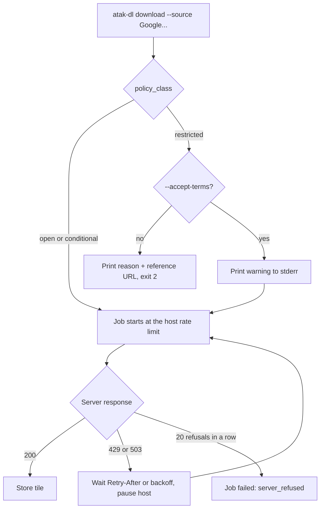
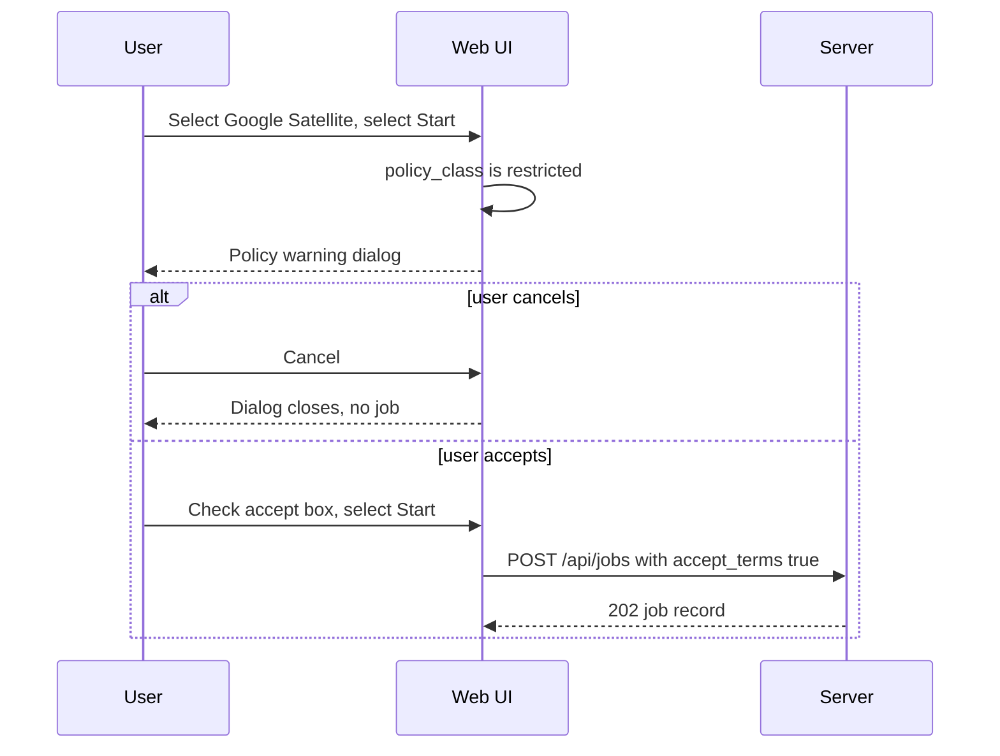
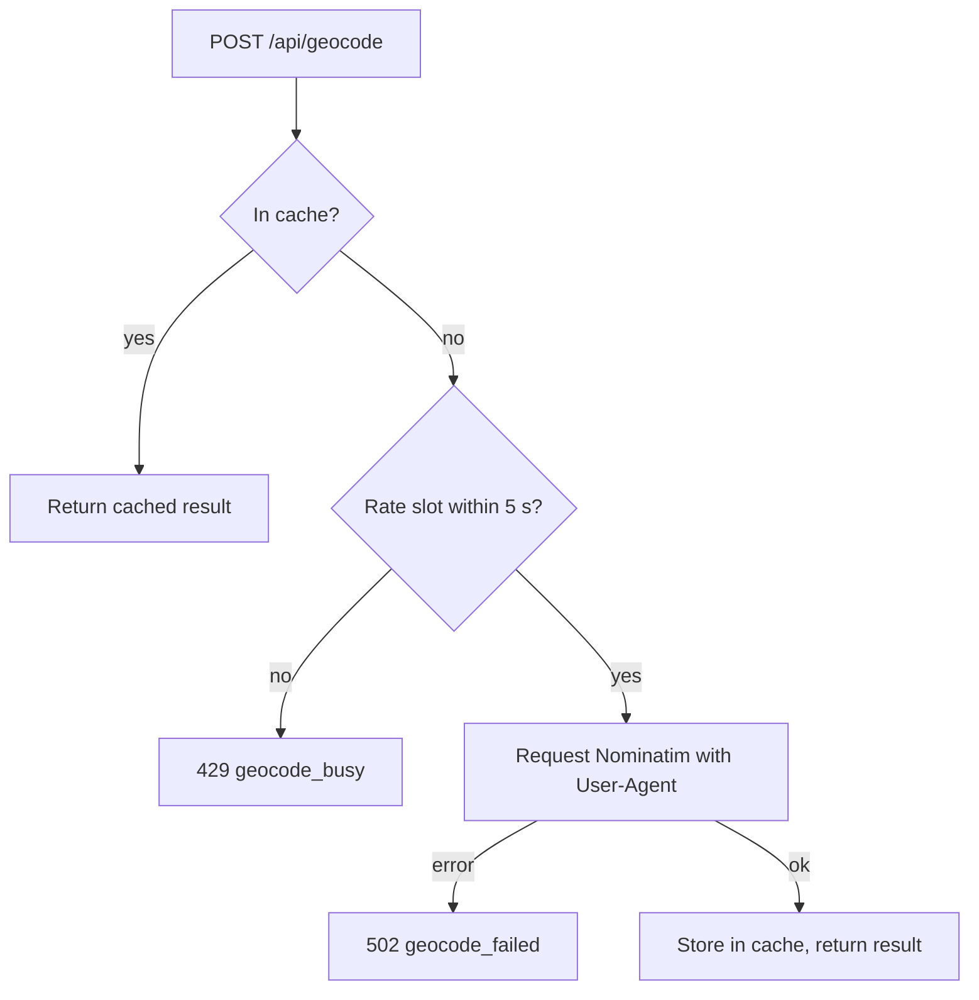

## Purpose

Today the project sends a fixed User-Agent `ATAK-Map-Downloader/1.0` with no contact URL (`internal/download/download.go:288`). It has no rate limit and no `Retry-After` handling. It proxies Nominatim with no limit (`cmd/atak-dl/commands/web.go:330-387`).

Several bundled map sources come from providers whose terms prohibit bulk download. Other providers allow it only at low request rates. This feature gives every map source a policy class and a rate limit, and it backs off when a server refuses. It warns before a job on a restricted map source. It also makes geocoding follow the Nominatim usage policy. The user chose "Tag + warn": restricted map sources stay available, and the user decides.

## User stories

- As a solo operator, I want to know when a map source's terms prohibit my job, so that I make an informed choice.
- As a team preparer, I want the project to slow down when a server refuses, so that my IP address is not blocked.
- As an OSS user, I want polite defaults, so that the project does not harm volunteer-run tile servers.

## Functional requirements

### Policy table

- FR-polite-downloading-1 — The binary embeds a policy table at `internal/policy/policy.json`.
- FR-polite-downloading-2 — Each policy entry has `host_patterns`, `policy_class`, `requests_per_second`, `reason` and `reference_url`.
- FR-polite-downloading-3 — `policy_class` is one of `open`, `conditional` or `restricted`.
- FR-polite-downloading-4 — The project matches a map source to the first entry with a pattern in `host_patterns` that matches the host of the map source URL.
- FR-polite-downloading-5 — A map source with no matching entry gets `policy_class` `conditional` and 4 requests per second.
- FR-polite-downloading-6 — The policy table ships the initial entries in Behaviour rules.

### Rate limits and backoff

- FR-polite-downloading-7 — The engine sends no more requests per second to the hosts of one policy entry than the entry allows.
- FR-polite-downloading-8 — The engine sends at most 4 requests at the same time to one host, whatever the job concurrency is.
- FR-polite-downloading-9 — If a tile response is 429 or 503 and has a `Retry-After` header, the engine waits that long before it sends the next request to that host.
- FR-polite-downloading-10 — If a 429 or 503 response has no `Retry-After` header, the engine waits with exponential backoff: 1 s, 2 s, 4 s, then 8 s at most, with ±20% jitter.
- FR-polite-downloading-11 — A backoff wait pauses all requests to that host, not only the one tile.
- FR-polite-downloading-12 — If a host returns 429, 503 or 403 for 20 consecutive tile requests, the engine stops the job with state `failed` and reason `server_refused`.
- FR-polite-downloading-13 — Every wait ends at once when the job is cancelled.

### User-Agent

- FR-polite-downloading-14 — Every tile request and every geocode request sends the User-Agent `atak-map-downloader/<version> (+https://github.com/Crank-Git/ATAKMapDownloader)`.

### Restricted map sources

- FR-polite-downloading-15 — `list-sources` prints the policy class of each map source.
- FR-polite-downloading-16 — `GET /api/sources` returns `policy_class`, `policy_reason`, `policy_reference_url` and `requests_per_second` for each map source.
- FR-polite-downloading-17 — If the map source is `restricted`, `atak-dl download` refuses to start a job unless the command has `--accept-terms`.
- FR-polite-downloading-18 — When `atak-dl download` refuses a restricted map source, it prints the reason and the reference URL, and it exits with code 2.
- FR-polite-downloading-19 — If the map source is `restricted`, `POST /api/jobs` returns 403 with error code `terms_not_accepted` unless the request has `"accept_terms": true`.
- FR-polite-downloading-20 — The web UI shows the policy warning dialog before it sends a job for a restricted map source.
- FR-polite-downloading-21 — The Start button in the policy warning dialog is disabled until the user checks "I accept responsibility for this download".

### Geocoding

- FR-polite-downloading-22 — The server sends at most 1 geocode request per second to Nominatim, across all clients.
- FR-polite-downloading-23 — The server caches geocode results in memory for 24 hours, keyed by the normalized query.
- FR-polite-downloading-24 — A geocode request that waits more than 5 seconds for the rate limit returns 429 with error code `geocode_busy`.
- FR-polite-downloading-25 — `serve --geocoder-url` sets the geocoder base URL. The default is `https://nominatim.openstreetmap.org`.
- FR-polite-downloading-26 — `serve --no-geocode` turns off the `/api/geocode` route, and the web UI hides the search box.

## User flows

### Flow 1 — A CLI job on a restricted map source

1. The user runs `atak-dl download` with a map source.
2. If the policy class is `open` or `conditional`, the job starts.
3. If the policy class is `restricted` and the command has no `--accept-terms`, the CLI prints the reason and the reference URL. It exits with code 2.
4. If the command has `--accept-terms`, the CLI prints a warning and the job starts.
5. The engine sends requests at the host rate limit.
6. If the server returns 429 or 503, the engine pauses the host for the `Retry-After` time or the backoff time.
7. If the host refuses 20 requests in a row, the job fails with reason `server_refused`.

### Flow 2 — The web UI on a restricted map source

1. The user selects a restricted map source and selects **Start**.
2. The web UI shows the policy warning dialog.
3. If the user selects **Cancel**, the dialog closes and no job starts.
4. If the user checks the box and selects **Start**, the web UI sends the job with `accept_terms`.

### Flow 3 — Geocoding

1. The server receives a geocode request.
2. If the cache holds the query, the server returns the cached result.
3. If no rate slot is free within 5 seconds, the server returns 429.
4. The server sends the request to Nominatim with the User-Agent.
5. If Nominatim fails, the server returns 502 with code `geocode_failed`.
6. The server stores the result in the cache and returns it.

## Screens & states

- **Policy warning dialog** — [mockups/04-source-policy-warning.html](../mockups/04-source-policy-warning.html). Regions: provider name, a `restricted` badge, the reason, the reference link, the rate limit, an accept checkbox, and **Cancel** and **Start**. States: unchecked (Start disabled) and checked (Start enabled).
- **Source picker** — each option shows a badge: `open`, `conditional` or `restricted`. A legend explains the three classes.
- **Job progress** — while the host is in backoff, the status line shows "Server asked us to slow down — waiting 8 s".

## Behaviour rules

Initial policy table. The research spike collected these sources on 2026-11-21. Re-read each reference before you ship, and record the retrieval date in `policy.json`.

| host_patterns | policy_class | requests/s | Reference |
|---|---|---|---|
| `*.google.com`, `*.googleapis.com` | restricted | 1 | https://developers.google.com/maps/documentation/tile/policies |
| `*.virtualearth.net`, `*.bing.com` | restricted | 1 | https://learn.microsoft.com/en-us/bingmaps/rest-services/directly-accessing-the-bing-maps-tiles |
| `*.arcgisonline.com`, `*.arcgis.com` | restricted | 1 | https://www.esri.com/content/dam/arcgisonline/docs/tou_summary.pdf |
| `tile.openstreetmap.org`, `*.tile.openstreetmap.org` | restricted | 1 | https://operations.osmfoundation.org/policies/tiles/ |
| `*.opentopomap.org` | conditional | 2 | https://opentopomap.org/about |
| `*.tile-cyclosm.openstreetmap.fr` | conditional | 2 | Volunteer-run. No published limit was found. |
| `*.openseamap.org` | conditional | 2 | Volunteer-run. No published limit was found. |
| `*.mtbmap.cz` | conditional | 2 | Volunteer-run. No published limit was found. |
| `*.waymarkedtrails.org` | conditional | 2 | Volunteer-run. No published limit was found. |
| `*.nationalmap.gov`, `*.usgs.gov` | open | 8 | https://www.usgs.gov/faqs/what-are-terms-uselicensing-map-services-and-data-national-map |
| `*.usda.gov` (NAIP) | open | 8 | https://www.usgs.gov/faqs/what-are-terms-uselicensing-map-services-and-data-national-map (NAIP is public domain) |
| `*.fema.gov` | conditional | 2 | The license is unverified (see Open questions). |
| `*.nrcan.gc.ca` | conditional | 2 | The license is unverified (see Open questions). |
| `maps.geogratis.gc.ca` | conditional | 2 | The license is unverified (see Open questions). |
| `*.maanmittauslaitos.fi` | conditional | 2 | The license is unverified (see Open questions). |
| `tiles.kartat.kapsi.fi` | conditional | 2 | The license is unverified (see Open questions). |
| `*.geoportal.gov.pl` | conditional | 2 | The license is unverified (see Open questions). |

- Each row of the table is one policy entry. All hosts of one entry share one rate limit, so two map sources of one provider cannot get twice the rate (#18 gate).
- `requests_per_second` can be lowered, but not raised, with `--rate-limit` on the CLI and `rate_limit` in the job API (#87).
- In the job API, a `rate_limit` of 0 or below returns 400 `invalid_rate_limit`.
- On the CLI, `--rate-limit 0` keeps the policy rate. A negative value fails with `invalid_rate_limit`.
- The host patterns match the hosts that the bundled source files use. `tiles.kartat.kapsi.fi` and `maps.geogratis.gc.ca` were added at the #84 gate, and the CyclOSM pattern is `*.tile-cyclosm.openstreetmap.fr` (#84).
- A host that matches no entry gets `conditional` at 4 requests per second, with the host itself as its only host pattern. That host gets its own rate limit.
- Each job counts its own consecutive refusals. The host pause is shared by every job (#87).
- The policy class comes only from the embedded table. A source file cannot set its own policy class.
- `/api/preview` is not a job. It returns the URLs of at most 36 tiles, and the browser gets those tiles for the preview. The server sends no tile request, and the preview needs no terms acceptance.

## Data touched

- New entity SOURCE_POLICY (embedded, read-only).
- MAP_SOURCE gains the derived fields `policy_class` and `requests_per_second`.
- JOB gains `accept_terms` and the failure reason `server_refused`.

## Interfaces

- `GET /api/sources` adds `policy_class`, `policy_reason`, `policy_reference_url` and `requests_per_second` to each item.
- `POST /api/jobs` accepts `accept_terms` (boolean) and `rate_limit` (number, requests per second).
- `GET /api/sources` also returns `policy_host`, the `host_patterns` of the chosen entry joined with `, ` (#84).
- `GET /api/config` returns `{"geocode": true|false}`. The web UI reads it at load and hides the search box when it is false (#88).
- `POST /api/geocode` keeps its shape. It adds 429 `geocode_busy` and 502 `geocode_failed`.
- CLI: `download --accept-terms`, `download --rate-limit <n>`, `serve --geocoder-url <url>`, `serve --no-geocode`.
- Nominatim usage policy: at most 1 request per second, an identifying User-Agent, caching, no bulk use (https://operations.osmfoundation.org/policies/nominatim/, retrieved 2026-11-21).
- OSM tile usage policy: an identifying User-Agent, honour cache headers, no offline bulk download (https://operations.osmfoundation.org/policies/tiles/, retrieved 2026-11-21).
- Rate limiter: `golang.org/x/time/rate`. Read https://pkg.go.dev/golang.org/x/time/rate for `Limiter.Wait(ctx)` semantics.

## Edge cases & failures

- If a map source uses several server parts on different hosts (for example `mt0` to `mt3`), the rate limit applies to the policy entry, so all parts share one limit.
- If `Retry-After` is an HTTP date, the engine converts it to a duration. If the value is invalid, the engine uses the backoff schedule.
- If `Retry-After` is longer than 300 seconds, the engine stops the job with reason `server_refused` instead of waiting.
- Some servers return a 200 "blocked" image (OSM does this to some TAK user agents, per ATAK-Maps commit 66be333). Feature 07 detects that through tile validation.
- If Nominatim is unreachable and the cache is empty, the user sees "Place search is unavailable" in the web UI.

## Acceptance criteria

- `atak-dl list-sources` shows `restricted` beside every Google, Bing and Esri map source.
- `atak-dl download --source "<a Google map source>" ...` without `--accept-terms` exits with code 2 and prints the Google reference URL.
- A test tile server with an `open` policy at 8 requests per second receives at most 9 requests in any 1-second window during a job.
- A test tile server that returns 429 with `Retry-After: 2` receives no request for 2 seconds after the response.
- A test tile server that returns 503 for every request ends the job after 20 refusals, with reason `server_refused`.
- Cancel during a backoff wait stops the job within 500 ms.
- Every request that the test tile server and a fake Nominatim receive has the User-Agent with the project URL.
- 10 geocode requests in 1 second reach the fake Nominatim at most 2 times.
- A repeated geocode query within 24 hours does not reach the fake Nominatim.
- In the web UI, Start on a restricted map source opens the policy warning dialog. Its Start button is disabled until the box is checked.

## Out of scope

- Removing restricted map sources from the snapshot.
- Per-user rate limits on the server.
- HTTP cache validation (ETag, `If-Modified-Since`). Feature 07 records tile hashes, but conditional requests are v1.1 work.

## Open questions

- The licenses for FEMA NFHL, NRCan, Finland MML and Poland Geoportal were not verified. Until someone verifies them, those hosts stay `conditional`.
