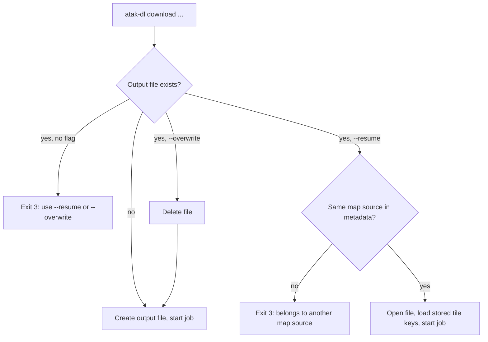
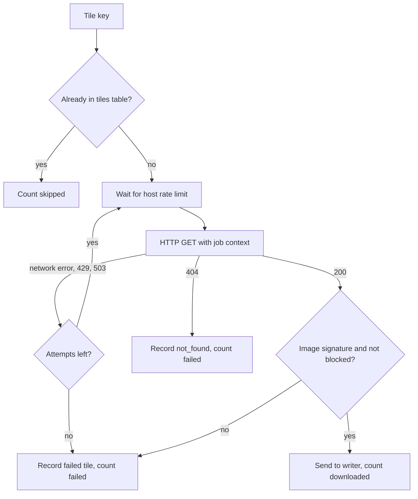
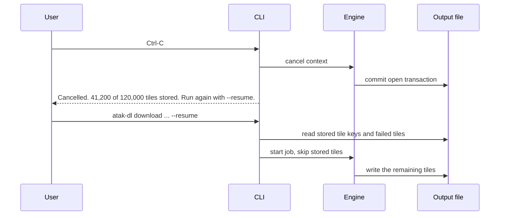

## Purpose

Today a job deletes an existing output file at the same path with no warning (`internal/mbtiles/mbtiles.go:18-22`). A cancelled job deletes its own output file, so every downloaded tile is lost (`internal/download/download.go:235-237`). The engine stores whatever bytes the server returns, which includes HTML error pages. The engine also has a data race on its progress fields (`download.go:191-212`), and it writes one autocommit insert per tile from many goroutines. Progress counts only successful tiles, so a job with failures never shows 100%.

This feature makes every job safe to stop and resume, and it keeps bad tiles out of the output file.

## User stories

- As a team preparer, I want to resume a cancelled 200,000-tile job, so that I do not download the same tiles again.
- As a solo operator, I want the project to refuse a job that would overwrite my output file, so that I do not lose it.
- As any user, I want only real images in my output file, so that ATAK does not show error pages as map tiles.
- As any user, I want a tile cap, so that a mistake in the zoom range does not start a 50-million-tile job.

## Functional requirements

### Writer

- FR-robust-downloads-1 — One writer goroutine per job writes all tiles to the output file.
- FR-robust-downloads-2 — The writer commits one transaction per 500 tiles, and one more transaction when the job ends.
- FR-robust-downloads-3 — The writer opens the output file with `journal_mode=WAL` and `busy_timeout=5000`.
- FR-robust-downloads-4 — The engine updates progress counters with atomic operations only.
- FR-robust-downloads-5 — `go test -race ./...` reports no race for a 10,000-tile job.

### Overwrite and resume

- FR-robust-downloads-6 — If the output file exists, `atak-dl download` exits with code 3 and the message "output file exists: use --resume or --overwrite".
- FR-robust-downloads-7 — `atak-dl download --overwrite` deletes the existing output file before the job starts.
- FR-robust-downloads-8 — `atak-dl download --resume` opens the existing output file and skips every tile that the `tiles` table already holds.
- FR-robust-downloads-9 — A resumed job counts each skipped tile as `skipped`.
- FR-robust-downloads-10 — If the existing output file was written for a different map source, `--resume` exits with code 3 and the message "output file belongs to map source <name>".
- FR-robust-downloads-11 — A cancelled job keeps its output file and every tile it stored.
- FR-robust-downloads-12 — A failed job keeps its output file and every tile it stored.
- FR-robust-downloads-13 — `POST /api/jobs` accepts `"if_exists": "fail" | "resume" | "overwrite"`, with the default `fail`.
- FR-robust-downloads-14 — If `if_exists` is `fail` and the output file exists, `POST /api/jobs` returns 409 with error code `output_exists`.

### Tile validation

- FR-robust-downloads-15 — The engine accepts a tile only if its first bytes match the PNG, JPEG, GIF or WebP signature.
- FR-robust-downloads-16 — The engine rejects a tile body of 0 bytes with reason `empty`.
- FR-robust-downloads-17 — The engine rejects a tile whose signature does not match an image with reason `not_image`.
- FR-robust-downloads-18 — The engine counts a rejected tile as failed.
- FR-robust-downloads-19 — If the SHA-256 of a tile matches a hash in `internal/download/blocked.json`, the engine rejects it with reason `blocked_image`.
- FR-robust-downloads-20 — If more than 50% of the first 100 tiles of a job have the same SHA-256, the engine logs a warning that the map source may return a placeholder image.

### Failure record and retry pass

- FR-robust-downloads-21 — The writer records each failed tile in the table `atakdl_failed_tiles (zoom_level, tile_column, tile_row, reason, attempts)` in the output file.
- FR-robust-downloads-22 — After the main pass, the engine runs one retry pass over the tiles in `atakdl_failed_tiles`.
- FR-robust-downloads-23 — The writer removes a tile from `atakdl_failed_tiles` when the tile succeeds.
- FR-robust-downloads-24 — `--resume` retries every tile in `atakdl_failed_tiles`.
- FR-robust-downloads-25 — If the engine gets a 404, it records the tile with reason `not_found` and does not retry it in the retry pass.

### Limits and progress

- FR-robust-downloads-26 — `atak-dl download` refuses a job whose tile count is above `--max-tiles`, with exit code 4. The default is 500,000.
- FR-robust-downloads-27 — `POST /api/jobs` returns 400 with error code `too_many_tiles` above the server's `--max-tiles`.
- FR-robust-downloads-28 — The progress percentage is `(downloaded + skipped + failed) / total`.
- FR-robust-downloads-29 — The CLI prints one final summary line: downloaded, skipped, failed, elapsed time and output file path.
- FR-robust-downloads-30 — If a cancel arrives, the engine stops sending requests within 500 ms. Then it commits the open transaction.
- FR-robust-downloads-31 — Every HTTP request uses the job context (`http.NewRequestWithContext`).

## User flows

### Flow 1 — Start a job when the output file exists

1. The user runs `atak-dl download`.
2. If the output file does not exist, the project creates it and starts the job.
3. If the file exists and the command has no flag, the CLI exits with code 3.
4. If the command has `--overwrite`, the project deletes the file and starts the job.
5. If the command has `--resume` and the metadata names another map source, the CLI exits with code 3.
6. If the command has `--resume` and the map source matches, the project opens the file and starts the job.

### Flow 2 — One tile through the engine

1. If the `tiles` table holds the tile, the engine counts it as skipped.
2. The engine waits for the host rate limit.
3. The engine sends the request with the job context.
4. If the request fails with a network error, 429 or 503, and attempts remain, the engine tries again from step 2.
5. If no attempts remain, the engine records the failed tile.
6. If the response is 404, the engine records the tile as `not_found`.
7. If the response is 200 and the body is not a valid image, the engine records the failed tile.
8. If the body is a valid image, the engine sends it to the writer.

### Flow 3 — Cancel and resume

1. The user presses Ctrl-C.
2. The engine stops sending requests, and the writer commits.
3. The CLI prints the stored count and the `--resume` hint.
4. The user runs the same command with `--resume`.
5. The engine skips the stored tiles and downloads the remaining tiles.

## Screens & states

CLI only in this feature. Feature 08 shows `skipped` and the `if_exists` choice in the web UI.

- Progress line: `37.4% (44,880/120,000) - 12.1 tiles/s - 1,200 skipped - 14 failed - ETA 1h43m`.
- Final summary: `Done: 118,640 downloaded, 1,200 skipped, 160 failed in 2h41m -> downloads/OpenTopoMap_Mt_Hood_z8-15.sqlite`.

## Behaviour rules

- Tile attempts: 3 in the main pass and 1 in the retry pass.
- If a cancel or a refusal stop ends a tile before it uses its attempts, the tile counts as neither downloaded nor failed. A resume requests it again.
- The progress percentage stops at 100. The retry pass of a resume can store a failed tile from outside the bounds, so the processed count can be above the total.
- When the writer closes, it runs `PRAGMA wal_checkpoint(TRUNCATE)` and then `PRAGMA journal_mode=DELETE`. The output file is then one file with no `-wal` or `-shm` file, so ATAK can open it read-only.
- The tile key set for `--resume` loads into memory. 500,000 keys take about 12 MB.
- A job with `--ignore-errors` succeeds whatever its failure rate is. It still records failed tiles.
- `blocked.json` starts empty. Add a hash only together with a test fixture of that image.
- Exit codes:
  - 0: success
  - 1: error
  - 2: terms not accepted (feature 06)
  - 3: output file conflict
  - 4: tile cap exceeded
  - 5: job failed above failure tolerance
  - 130: cancelled

## Data touched

- OUTPUT_FILE: the new table `atakdl_failed_tiles`. The metadata gains `atakdl_source`, the map source name that `--resume` checks.
- JOB: the new counter `skipped` and the field `if_exists`.

## Interfaces

- CLI `download`: `--resume`, `--overwrite` and `--max-tiles <n>`. `--concurrent` is validated from 1 to 32.
- `serve --max-tiles <n>`, default 500,000.
- `POST /api/jobs`: `if_exists`, plus the errors 409 `output_exists` and 400 `too_many_tiles`.
- SQLite pragmas with modernc.org/sqlite: read how the DSN sets pragmas (`_pragma=journal_mode(WAL)`) at https://pkg.go.dev/modernc.org/sqlite before you write the open call.
- File signatures: PNG `89 50 4E 47 0D 0A 1A 0A`, JPEG `FF D8 FF`, GIF `47 49 46 38`, WebP `52 49 46 46 ?? ?? ?? ?? 57 45 42 50`.

## Edge cases & failures

- If the disk fills, the writer fails. The engine stops the job with state `failed` and reason `write_failed`, and it keeps the committed tiles.
- If the process is killed with SIGKILL, at most 500 tiles are lost. WAL mode keeps the file consistent.
- If `--resume` opens a file with no `atakdl_source` key (a file from v0.1), the CLI accepts it only with `--resume --force`.
- If `POST /api/jobs` resumes into a file with no `atakdl_source` key, the server accepts it. The API has no `force` field.
- If `--resume` or `"if_exists": "resume"` finds a file that is not SQLite or has no `metadata` table, the CLI exits with code 3 and the API returns 409 `output_exists`. The message starts with "not an output file".
- `--overwrite` also deletes the `-wal` and `-shm` files of the output file, because they belong to the old file.
- The CLI deletes a file for `--overwrite` only after every other flag is valid.
- If the writer fails after a cancel, the job ends with `write_failed` and exit code 1, not 130. The cancel line counts the tiles as stored, but the output file lost them.
- If a server returns a valid image for a missing tile (for example a "no data" tile), validation passes. A blocked-image hash catches only known images.
- The ATAK reader ignores the `atakdl_failed_tiles` table. That is inferred from ATAK-CIV `TilesetInfo.java`, which inspects only `tiles`, and is a risk item in `spec.md`.

## Acceptance criteria

- A job against an existing output file without a flag exits with code 3, and the file is unchanged.
- A job cancelled at about 50% keeps its output file, and `SELECT count(*) FROM tiles` is greater than 0.
- `--resume` on that file sends requests only for the missing tiles. The test tile server counts the requests.
- A test tile server that returns `<html>` with status 200 produces 0 rows in `tiles` and 1 row in `atakdl_failed_tiles` with reason `not_image`.
- A tile that fails once with 503 and then succeeds is in `tiles` after the job, and is not in `atakdl_failed_tiles`.
- A 404 tile is in `atakdl_failed_tiles` with reason `not_found`.
- `atak-dl download` with a 600,000-tile estimate exits with code 4 before it sends a request.
- A job where 10% of tiles return 404 ends with a progress percentage of 100.
- `go test -race ./internal/download/...` passes for a 10,000-tile job with concurrency 16.
- Cancel stops all requests to the test tile server within 500 ms.

## Out of scope

- Splitting an output file into parts of a fixed size.
- Conditional requests to refresh changed tiles.
- Re-encoding tiles.

## Open questions
