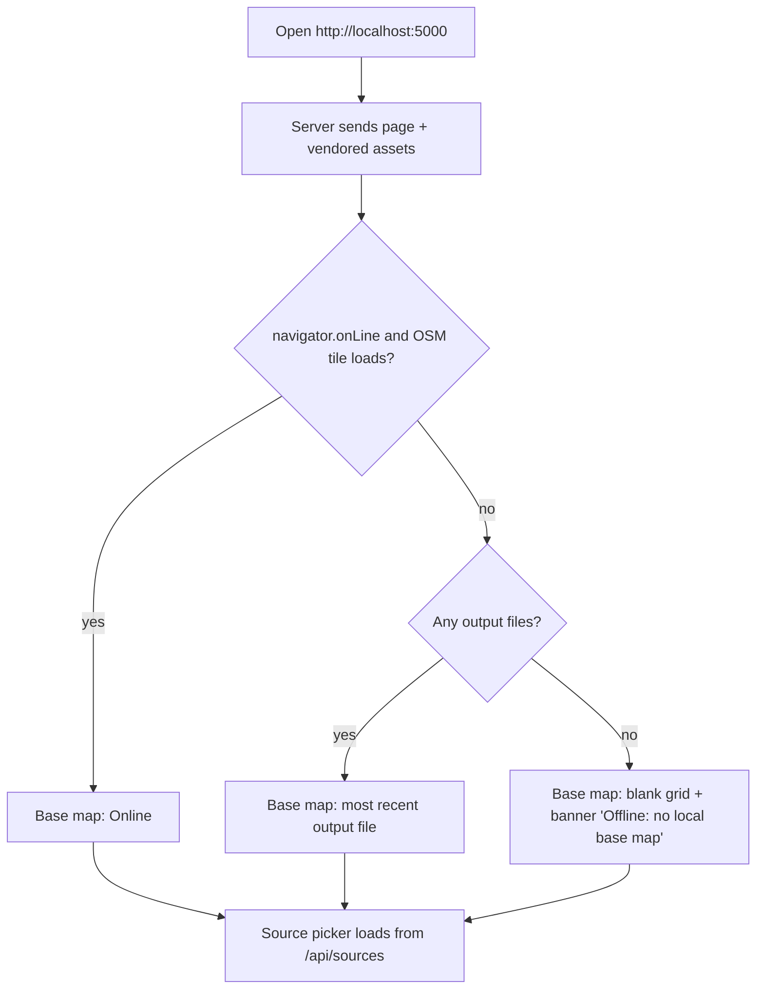
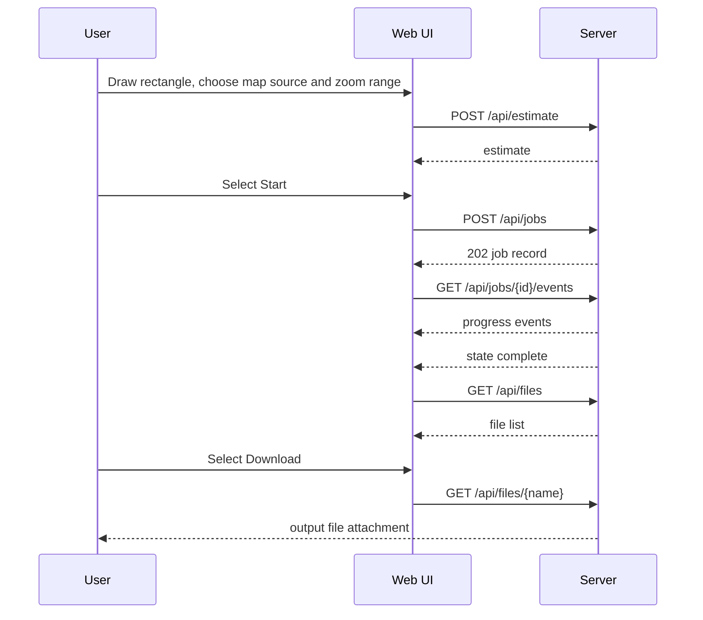
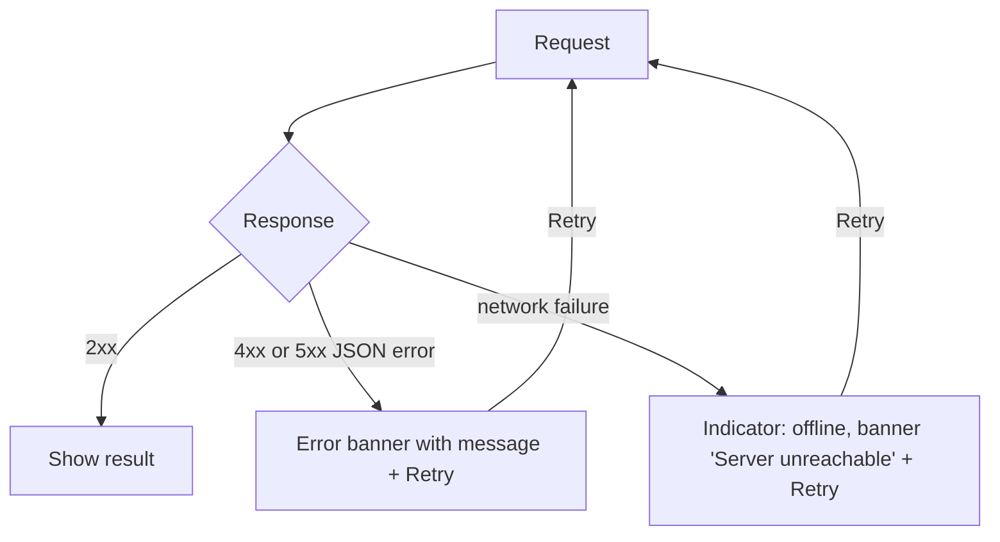

## Purpose

Today the web UI loads Leaflet, leaflet-draw, Bootstrap and Font Awesome from public CDNs (`web/index.html:9-16,241-243`). With no internet the page does not work, and ATAK users often prepare maps on poor connections. The finished output file stays on the server's disk with no route to fetch it, so a browser on another machine cannot get it. Errors appear only in a small status log. A loading modal exists but is never shown (`web/static/js/app.js:576-581`).

This feature vendors every asset, removes Bootstrap and Font Awesome, and adds an output file list with downloads. It adds a local base map from an output file and gives every screen its full set of states.

## User stories

- As a solo operator with no internet, I want the web UI to load, so that I can preview and use my existing output files.
- As a team member on another machine, I want a Download button for each output file, so that I get the file without shell access.
- As any user, I want clear loading and error states, so that I know what the project is doing.
- As a keyboard or screen-reader user, I want labeled controls and spoken status, so that I can use the web UI.

## Functional requirements

### Vendored assets

- FR-offline-web-ui-1 — The binary embeds Leaflet 1.9.4 and Leaflet-Geoman under `web/static/vendor/`.
- FR-offline-web-ui-2 — The web UI page loads no resource from a host other than the server, apart from tiles of the online base map and preview tiles.
- FR-offline-web-ui-3 — The web UI uses no Bootstrap and no Font Awesome.
- FR-offline-web-ui-4 — Icons are inline SVG.
- FR-offline-web-ui-5 — `web/static/vendor/LICENSES.md` lists the name, version, license and source URL of each vendored library.
- FR-offline-web-ui-6 — Geoman replaces leaflet-draw for the rectangle tool.

### Output files

- FR-offline-web-ui-7 — `GET /api/files` returns every output file in the output directory: name, size in bytes, modified time, format, map source, zoom range and bounds.
- FR-offline-web-ui-8 — `GET /api/files/{name}` returns the output file as an attachment.
- FR-offline-web-ui-9 — The server opens output files through `os.Root` on the output directory.
- FR-offline-web-ui-10 — `GET /api/files/{name}` returns 404 with error code `file_not_found` for a name that is not in the output directory.
- FR-offline-web-ui-11 — The web UI shows the output file list with a **Download** button per file.
- FR-offline-web-ui-12 — When a job completes, the web UI adds the new output file to the top of the list.

### Local base map

- FR-offline-web-ui-13 — `GET /api/files/{name}/tiles/{z}/{x}/{y}` returns one tile from an output file through the tile reader of its output format, which reads the rows of that format (#126).
- FR-offline-web-ui-14 — The tile route returns 204 for a tile that the output file does not hold.
- FR-offline-web-ui-15 — The base map switcher offers "Online (OpenStreetMap)" and one entry per output file.
- FR-offline-web-ui-16 — If the browser is offline at load time, the web UI selects the most recent output file as the base map.

### States and feedback

- FR-offline-web-ui-17 — The header shows a connection indicator with the states connected, reconnecting and offline.
- FR-offline-web-ui-18 — The web UI shows a loading state on the source picker, the estimate card and the preview while their requests run.
- FR-offline-web-ui-19 — The web UI shows an inline error banner with the server's error message when a request fails.
- FR-offline-web-ui-20 — The error banner has a **Retry** button for the request that failed.
- FR-offline-web-ui-21 — The job panel shows downloaded, skipped and failed counts, the rate and the ETA.
- FR-offline-web-ui-22 — The job panel offers "If the file exists: Fail, Resume, Overwrite", sent as `if_exists`.
- FR-offline-web-ui-23 — The estimate card uses the selected map source's size per tile, not a fixed 20 KB.
- FR-offline-web-ui-24 — The estimate and the preview accept a zoom range where the minimum equals the maximum.

### Accessibility and theme

- FR-offline-web-ui-25 — Every form control has a visible `<label>`.
- FR-offline-web-ui-26 — Every icon-only button has an `aria-label`.
- FR-offline-web-ui-27 — The job status region has `aria-live="polite"`.
- FR-offline-web-ui-28 — The progress bar sets `aria-valuenow`, `aria-valuemin` and `aria-valuemax`. The progress bar has an accessible name (`aria-label`) (Epic 4 batch gate).
- FR-offline-web-ui-29 — The theme follows `prefers-color-scheme` until the user selects a theme.
- FR-offline-web-ui-30 — Dark mode does not invert map tiles or preview tiles.
- FR-offline-web-ui-31 — The web UI inserts server strings and user strings as text, never as HTML.

## User flows

### Flow 1 — Load the web UI with no internet

1. The user opens the web UI.
2. The server sends the page and the vendored assets.
3. If the browser is online, the web UI uses the online base map.
4. If the browser is offline and an output file exists, the web UI uses the most recent output file as the base map.
5. If the browser is offline and no output file exists, the web UI shows a blank grid and an offline banner.
6. The web UI loads the source catalog.

### Flow 2 — Run a job and fetch the output file

1. The user draws a rectangle and chooses a map source and a zoom range.
2. The web UI requests an estimate and shows it.
3. The user selects **Start**.
4. The web UI sends the job and opens the event stream.
5. The web UI shows progress until the job completes.
6. The web UI refreshes the output file list.
7. The user selects **Download**, and the browser saves the output file.

### Flow 3 — A request fails

1. The web UI sends a request.
2. If the response succeeds, the web UI shows the result.
3. If the response is an error, the web UI shows the error banner with the message.
4. If the network fails, the indicator shows offline and the banner says "Server unreachable".
5. If the user selects **Retry**, the web UI sends the request again.

## Screens & states

**Workspace** — [mockups/01-workspace.html](../mockups/01-workspace.html). This is the only screen.

Regions:

- Header with the connection indicator and the theme toggle.
- Sidebar with the source picker, search, zoom range, estimate card, advanced settings, Start and Cancel.
- Job panel.
- Output file list.
- Map with the base map switcher.

| State | What the user sees |
|---|---|
| empty | No area drawn. The estimate card says "Draw an area on the map". Start is disabled. |
| loading | Skeleton rows in the source picker. A spinner in the estimate card. |
| estimating | The estimate card shows a spinner. Start is disabled. |
| ready | The estimate card shows tiles, size and time. A warning appears above 100,000 tiles. Start is enabled. |
| downloading | The job panel shows the progress bar and counts. Cancel is visible. The settings are read-only. |
| complete | The job panel shows the summary. The new output file is highlighted in the list. |
| error | The inline banner shows the message and Retry. |
| offline | The indicator is offline. Start is disabled. The base map does not change, because the local tiles come from the same server. |

## Behaviour rules

- The web UI picks the size per tile from the map source's tile type: `jpg` 18 KB, `png` 25 KB, and any other type 20 KB. These values are assumptions. The CLI `estimate` uses the same table.
- The output file list is sorted by modified time, newest first.
- The base map falls back (Flow 1) when `navigator.onLine` is false or the first OpenStreetMap tile fails. The offline indicator does not change the base map, because it reports on the server that sends the local tiles.
- While a job runs, Estimate, Start and the settings are read-only. A rejected start keeps the job panel and Cancel of the running job.
- The vendored assets add at most 520 KB to the binary. The PM raised the budget from 400 KB at the #31 gate, because Leaflet and Geoman measure about 500 KB.
- The connection indicator is "connected" while the event stream or the last request succeeded, "reconnecting" while `EventSource` reconnects, and "offline" after 3 failed attempts.

## Data touched

- OUTPUT_FILE is read through `os.Root`. The format and map source come from the `metadata` table.
- No new stored fields.

## Interfaces

| Method | Path | Success | Errors |
|---|---|---|---|
| GET | `/api/files` | 200 `[{name, size, modified, format, output_format, source, min_zoom, max_zoom, bounds, in_progress}]`. `format` is the tile format, or `data_package` for a data package. `output_format` is the output format, and it is empty for a data package. | — |
| GET | `/api/files/{name}` | 200 attachment, `Content-Disposition: attachment` | 404 `file_not_found` |
| GET | `/api/files/{name}/tiles/{z}/{x}/{y}` | 200 image, or 204 | 404 `file_not_found`, or 404 `not_found` for a tile outside its zoom level |

- Leaflet 1.9.4: https://leafletjs.com/reference.html (1.9.4 reference). The release list is at https://github.com/Leaflet/Leaflet/releases.
- Leaflet-Geoman v2.20.8: https://github.com/geoman-io/leaflet-geoman. Confirm the free-edition license before you vendor it.
- `os.Root`: https://pkg.go.dev/os#Root (Go 1.24+).

## Edge cases & failures

- If the Geoman license is not MIT-compatible, use Leaflet's own `L.Rectangle` with a small drag handler instead, and record the choice in an ADR.
- If an output file is a data package (feature 10), the tile route returns 404 for it, and the base map switcher omits it.
- If an output file is being written by a running job, `/api/files` lists it with `"in_progress": true`. The Download button is disabled.
- If a file name in the output directory has characters outside `[A-Za-z0-9._-]`, the list omits it.

## Acceptance criteria

- With the network turned off, the web UI loads, and the browser console shows no failed request to a host other than the server.
- `grep -r "unpkg\|jsdelivr\|cdnjs" web/` prints nothing.
- `GET /api/files/..%2Fgo.mod` returns 404.
- A completed job's output file appears in the list, and **Download** saves a file whose size matches `GET /api/files`.
- Selecting an output file as the base map shows its tiles at the correct position over the online base map. The test compares one known tile.
- A 500 response from `/api/estimate` shows the error banner with the message and a Retry button.
- Each control has a label, and each icon-only button has an `aria-label`. An axe check of the page reports no "critical" issue.
- In dark mode, the preview tile pixels are the same as in light mode.
- An estimate for a map source with tile type `jpg` uses 18 KB per tile.

## Out of scope

- Polygon and route areas. Feature 11 adds them.
- A jobs page and a token sign-in. Feature 12 adds them.
- An offline geocoder.

## Open questions

- The size-per-tile table (18 KB, 25 KB, 20 KB) is a guess. A later change can replace it with a measured average from the first 50 tiles of a job.
