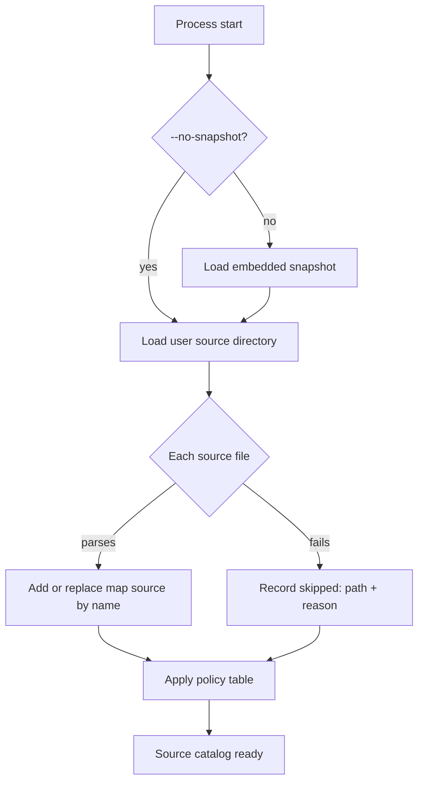
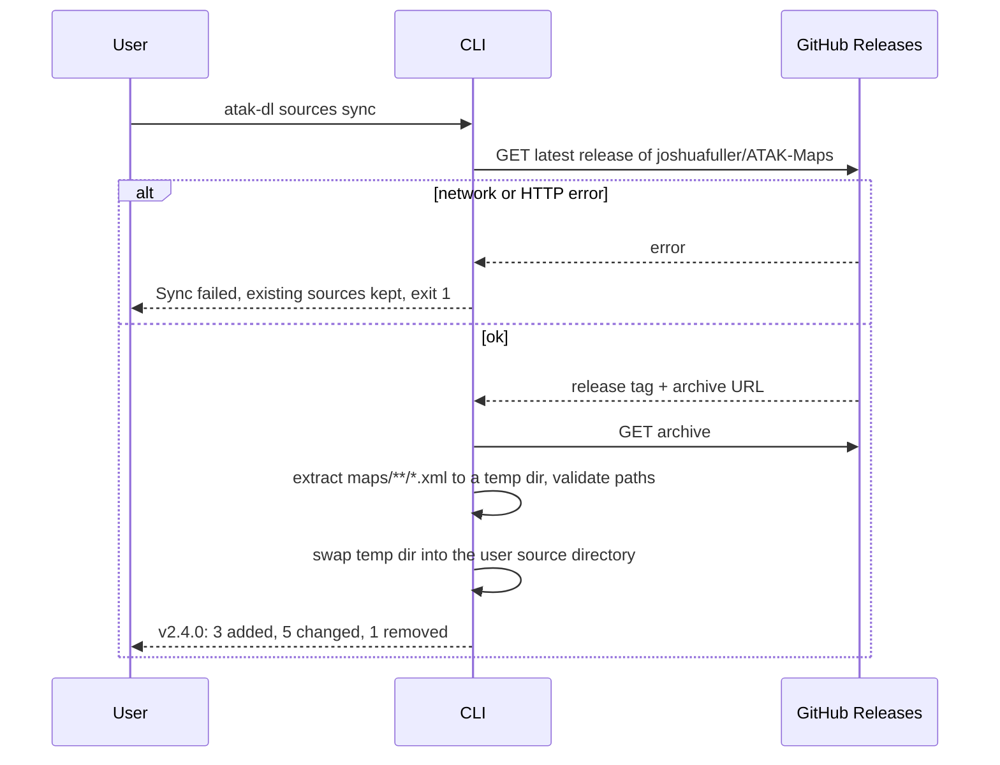

## Purpose

Today the project reads source files from a `mapsources/` folder that must sit next to the binary. The folder is a February 2026 copy of 33 files from joshuafuller/ATAK-Maps. ATAK-Maps is now at v2.3.1 with 53 source files in a new layout (`maps/base/<provider>/`, `maps/overlays/`), and it renamed every map source in v2.0.0 (https://github.com/joshuafuller/ATAK-Maps/blob/master/CHANGELOG.md). Some endpoints in the old copy are dead: USDA FSTopo, NAIP TNM and Finland MML were removed upstream in commit 66be333.

The parser skips the three WMS source files with no log (`internal/xmlparser/xmlparser.go:129-132`). It splits server parts on whitespace only, although some source files use commas. It ignores `invertYCoordinate`, and the `serve` command's local `--mapsources-dir` flag shadows the global one (`cmd/atak-dl/commands/serve.go:21`).

This feature embeds a pinned snapshot in the binary, adds a sync command, supports WMS, and reports every skipped source file with its reason.

## User stories

- As an OSS user, I want the binary to carry its map sources, so that one file is all I install.
- As a solo operator, I want new upstream map sources without a new release, so that I run one sync command.
- As a team preparer, I want WMS map sources such as FEMA flood zones, so that I prepare hazard overlays.
- As any user, I want to know why a source file did not load, so that I can fix it or report it.

## Functional requirements

### Snapshot

- FR-source-sync-1 — The binary embeds the source files of ATAK-Maps v2.3.1 under `internal/snapshot/maps/`, with the upstream directory layout.
- FR-source-sync-2 — `internal/snapshot/VERSION` holds the ATAK-Maps tag and commit of the snapshot.
- FR-source-sync-3 — The binary embeds the ATAK-Maps `LICENSE`, and `NOTICE.md` credits ATAK-Maps.
- FR-source-sync-4 — The source catalog loads the snapshot first. Then it loads the user source directory.
- FR-source-sync-5 — A map source from the user source directory replaces a snapshot map source with the same name.
- FR-source-sync-6 — The user source directory is `--mapsources-dir`, and its default is `<user config dir>/atak-dl/mapsources`.
- FR-source-sync-7 — `--no-snapshot` loads only the user source directory.
- FR-source-sync-8 — The repository `mapsources/` folder is removed.
- FR-source-sync-9 — `serve` uses the global `--mapsources-dir` flag and defines no local copy of it.

### Sync command

- FR-source-sync-10 — `atak-dl sources sync` downloads the latest ATAK-Maps release archive from GitHub into the user source directory.
- FR-source-sync-11 — `atak-dl sources sync --tag <tag>` downloads that release.
- FR-source-sync-12 — `sources sync` writes the tag and commit to `<user source directory>/VERSION`.
- FR-source-sync-13 — `sources sync` extracts only `.xml` files under `maps/`, and it rejects any archive path that leaves the target directory.
- FR-source-sync-14 — `sources sync` prints the number of added, changed and removed source files.

### Name aliases

- FR-source-sync-15 — `internal/snapshot/aliases.json` maps each map source name from the v0.1 `mapsources/` folder to its ATAK-Maps v2 name.
- FR-source-sync-16 — If `--source` names an old map source, the CLI uses the new name and prints a deprecation warning with the new name.
- FR-source-sync-17 — Alias support stays for at least one minor release after v0.5.0.

### Parser coverage

- FR-source-sync-18 — The parser loads `<customWmsMapSource>` source files as map sources with `kind: wms`.
- FR-source-sync-19 — For a WMS map source, the engine builds a GetMap request with the WMS version, layers, CRS, image format, 256×256 size and bounds of the tile.
- FR-source-sync-20 — The engine supports WMS CRS `EPSG:3857`. A WMS source file with another CRS is skipped with reason `unsupported_crs`.
- FR-source-sync-21 — The parser reads `invertYCoordinate`. If it is true, the engine sends `(2^z - 1) - y` as `{$y}`.
- FR-source-sync-22 — The parser splits `serverParts` on whitespace and on commas.
- FR-source-sync-23 — The engine picks the server part from the tile key, `(x + y) mod len(serverParts)`, so that each tile always uses the same part.
- FR-source-sync-24 — The parser accepts every placeholder that the ATAK-Maps XML reference documents. An unknown placeholder skips the source file with reason `unknown_placeholder`.
- FR-source-sync-25 — The parser treats a missing `tileUpdate` as `None`.

### Skipped sources

- FR-source-sync-26 — The source catalog records each skipped source file with its path and reason.
- FR-source-sync-27 — Skip reasons are:
  - `parse_error`
  - `missing_name`
  - `missing_url`
  - `unsupported_crs`
  - `unknown_placeholder`
  - `duplicate_name`
- FR-source-sync-28 — `atak-dl list-sources --skipped` prints every skipped source file with its reason.
- FR-source-sync-29 — `GET /api/sources/skipped` returns `[{path, reason, detail}]`.
- FR-source-sync-30 — The web UI shows "N sources skipped" under the source picker. The link opens the skipped list.
- FR-source-sync-31 — A duplicate map source name in the same directory is skipped with reason `duplicate_name`. The first file in lexical path order wins.

## User flows

### Flow 1 — The source catalog loads at start

1. If the command has no `--no-snapshot`, the project loads the embedded snapshot.
2. The project loads the user source directory.
3. For each source file that parses, the project adds the map source, or it replaces the map source with the same name.
4. For each source file that fails, the project records the path and the reason.
5. The project applies the policy table from feature 06.

### Flow 2 — Sync from upstream

1. The user runs `atak-dl sources sync`.
2. The CLI asks GitHub for the latest ATAK-Maps release.
3. If the request fails, the CLI keeps the existing source files and exits with code 1.
4. The CLI downloads the archive and extracts the XML files to a temporary directory.
5. The CLI replaces the user source directory with the temporary directory.
6. The CLI prints the counts.

## Screens & states

- CLI: `list-sources` adds a `kind` column (`tile` or `wms`) and an `origin` column (`snapshot` or `user`).
- Web UI: the "N sources skipped" link and a list dialog with path, reason and detail. The empty state is hidden when N is 0.

## Behaviour rules

- WMS tile bounds come from `tilecalc` for the tile at zoom level z, column x and row y, in EPSG:3857 metres.
- The WMS `BBOX` axis order for 1.3.0 with EPSG:3857 is `minx,miny,maxx,maxy`. Confirm this against the OGC WMS 1.3.0 standard before you build it.
- `sources sync` honours the GitHub API rate limit and sends the project User-Agent from feature 06.
- The snapshot adds about 200 KB to the binary.

## Data touched

- MAP_SOURCE gains `kind`, `invert_y`, `origin` and the WMS fields `wms_version`, `wms_layers`, `wms_crs` and `wms_params`.
- New SKIPPED_SOURCE records, kept in memory: `path`, `reason` and `detail`.

## Interfaces

- ATAK-Maps XML reference: https://github.com/joshuafuller/ATAK-Maps/blob/master/docs/xml-reference.md (read at the pinned tag before you write the parser).
- ATAK-Maps releases: https://github.com/joshuafuller/ATAK-Maps/releases (v2.3.1, 2026-10-31).
- GitHub REST "Get the latest release": https://docs.github.com/en/rest/releases/releases#get-the-latest-release.
- OGC WMS 1.3.0 GetMap: https://www.ogc.org/standards/wms.
- `GET /api/sources/skipped`: 200 `[{path, reason, detail}]`.
- `GET /api/sources`: each item adds `kind` and `origin`.
- CLI: `sources sync [--tag <tag>]`, `list-sources --skipped` and `--no-snapshot`.

## Edge cases & failures

- If the archive has a path with `..`, the CLI stops and changes nothing.
- If the archive has no `maps/` directory, the CLI stops and changes nothing. An upstream layout change is a reason to update this feature.
- If a WMS server returns an XML exception with status 200, tile validation from feature 07 rejects it with reason `not_image`.
- If an old map source name has no v2 equivalent (for example Michelin, removed upstream), `--source` fails with "map source removed upstream in ATAK-Maps v1.10.1".

## Acceptance criteria

- `atak-dl list-sources` on a clean machine with no `mapsources/` folder lists the snapshot map sources.
- `atak-dl list-sources --skipped` lists every snapshot source file that did not load, each with a reason. The loaded count plus the skipped count is 53.
- The FEMA NFHL WMS source file loads, and one tile request to a fake WMS server has `SERVICE=WMS`, `REQUEST=GetMap`, `LAYERS`, `CRS=EPSG:3857` and a `BBOX` that matches the tile.
- A fixture source file with `serverParts` `a,b,c` produces requests to three different hosts.
- The same tile key always uses the same server part.
- A fixture with `invertYCoordinate` true sends `{$y}` as the TMS row.
- `atak-dl download --source "Google - Satellite Only" ...` prints the deprecation warning and uses the v2 name.
- `atak-dl sources sync` against a fake release server writes the XML files and `VERSION`, and prints the counts.
- An archive with `../evil.xml` makes `sources sync` exit 1, and the user source directory is unchanged.
- `atak-dl --mapsources-dir X serve` loads source files from `X`.

## Out of scope

- WMS CRS other than EPSG:3857.
- WMTS capabilities parsing.
- Editing source files in the web UI.

## Open questions

- Which upstream map sources still need EPSG:4326? If any are important, a later feature can add reprojection.
