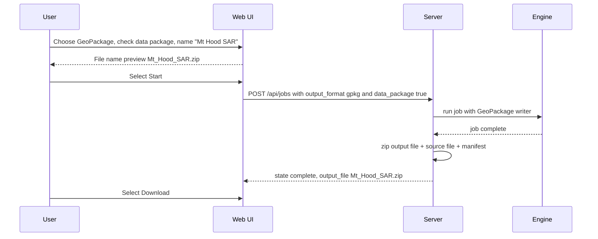
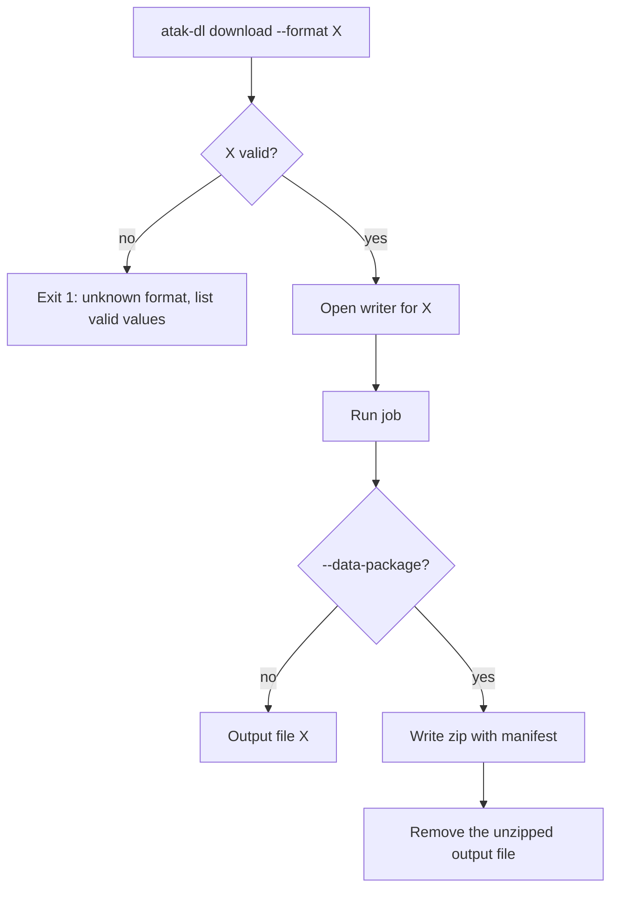

## Purpose

Today the project writes one output format: an SQLite file with the four-column TMS `tiles` table and a `.sqlite` extension (`internal/mbtiles/mbtiles.go:29-34`). ATAK detects the format by schema, not by extension. The archived ATAK-CIV source shows three relevant SQLite readers:

- A four-column `tiles` table loads as "momap".
- A table with an extra `tile_alpha` column loads as "mbtiles".
- `key, provider, tile` loads as OSMDroid.

A `.gpkg` file goes to a separate GeoPackage reader. Source: https://github.com/deptofdefense/AndroidTacticalAssaultKit-CIV/blob/main/takkernel/engine/src/main/java/com/atakmap/android/maps/tilesets/TilesetInfo.java (archived 4.6.0.5).

This feature completes the MBTiles metadata and adds OSMDroid and GeoPackage writers. It also adds a data package export, so that one zip carries the output file and its source file to a device or a TAK Server.

## User stories

- As a solo operator, I want an MBTiles file that QGIS and ATAK both open, so that I check the area on my desktop first.
- As a team preparer, I want a data package, so that team members import it in one step through ATAK's Import Manager.
- As a WinTAK user, I want GeoPackage, so that I use the same file in WinTAK and in GIS tools.
- As an ATAK user, I want the OSMDroid format, so that the file merges with tiles ATAK downloaded itself.

## Functional requirements

### Format selection

- FR-output-formats-1 — `atak-dl download --format mbtiles|osmdroid|gpkg` selects the output format. The default is `mbtiles`.
- FR-output-formats-2 — The output file extension is `.mbtiles` for `mbtiles`, `.sqlite` for `osmdroid` and `.gpkg` for `gpkg`.
- FR-output-formats-3 — `POST /api/jobs` accepts `output_format` with the same values and default.
- FR-output-formats-4 — The engine writes through one `output.Writer` interface: `Open`, `Has(z,x,y)`, `Put(z,x,y,data)`, `PutFailed`, `Close`.
- FR-output-formats-5 — `--resume` works for all three output formats.

### MBTiles

- FR-output-formats-6 — The MBTiles writer keeps the current `tiles` schema and the TMS row order.
- FR-output-formats-7 — The MBTiles writer writes the metadata keys `name`, `format`, `bounds`, `center`, `minzoom`, `maxzoom`, `type`, `version`, `description`, `attribution` and `atakdl_source`.
- FR-output-formats-8 — `format` is `png`, `jpg` or `webp`, in lower case, from the map source tile type.
- FR-output-formats-9 — `center` is `<lon>,<lat>,<zoom>` at the center of the bounds and the minimum zoom level of the job.
- FR-output-formats-10 — `type` is `overlay` for a map source from the snapshot's `overlays` directory and `baselayer` for every other map source.

### OSMDroid

- FR-output-formats-11 — The OSMDroid writer creates `tiles (key INTEGER PRIMARY KEY, provider TEXT, tile BLOB)`.
- FR-output-formats-12 — The OSMDroid writer computes `key = (((z << z) + x) << z) + y` with the XYZ row.
- FR-output-formats-13 — The OSMDroid writer sets `provider` to the map source name.
- FR-output-formats-14 — The OSMDroid writer creates the `ATAK_metadata` table with the schema and values that ATAK-CIV `OSMDroidTileContainer.java` reads.

### GeoPackage

- FR-output-formats-15 — The GeoPackage writer creates a GeoPackage 1.3 file with `gpkg_spatial_ref_sys`, `gpkg_contents`, `gpkg_tile_matrix_set` and `gpkg_tile_matrix`.
- FR-output-formats-16 — The GeoPackage writer uses SRS 3857 and the GoogleMapsCompatible tile matrix.
- FR-output-formats-17 — The GeoPackage writer creates one tile pyramid table named from the map source, with `zoom_level`, `tile_column`, `tile_row` and `tile_data`, and XYZ row order.
- FR-output-formats-18 — The GeoPackage writer sets `application_id` to `0x47504B47` ("GPKG") and `user_version` to `10300`.

### Data package

- FR-output-formats-19 — `--data-package` wraps the output file in a zip with the extension `.zip`.
- FR-output-formats-20 — The data package contains `MANIFEST/manifest.xml` with `<MissionPackageManifest version="2">`.
- FR-output-formats-21 — The manifest has a `uid` (UUID v4), a `name` and `onReceiveImport` set to `true`.
- FR-output-formats-22 — The manifest lists one `<Content zipEntry=...>` for each file in the data package.
- FR-output-formats-23 — `--data-package --include-source` adds the map source's source file to the data package.
- FR-output-formats-24 — The web UI export panel offers the output format, the data package option, the include-source option and the package name.

### Conformance

- FR-output-formats-25 — Each output format has a conformance test that applies ATAK's detection rules from `TilesetInfo.java` to a written output file.
- FR-output-formats-26 — The MBTiles conformance test also checks the MBTiles 1.3 required metadata keys.
- FR-output-formats-27 — The GeoPackage conformance test checks the required tables and the `application_id`.

## User flows

### Flow 1 — Export as a data package from the web UI

1. The user chooses an output format and checks the data package option.
2. The web UI shows the file name preview.
3. The user selects **Start**.
4. The engine writes the output file in the chosen output format.
5. The server builds the zip with the manifest.
6. The web UI shows the data package in the output file list.

### Flow 2 — Choose an output format in the CLI

1. The user runs `atak-dl download --format <format>`.
2. If the format is unknown, the CLI exits with code 1 and lists the valid values.
3. The CLI opens the writer for the output format and runs the job.
4. If the command has `--data-package`, the CLI writes the zip and removes the output file that is not zipped.

## Screens & states

**Export panel** — [mockups/03-export-options.html](../mockups/03-export-options.html). It sits in the workspace sidebar from feature 08, under the zoom range.

Regions:

- Three output format cards.
- The data package checkbox, with include-source and the package name.
- The file name preview.
- A help box that says where to put each output file on the device.

States: the default (MBTiles selected, no data package), a data package with an empty name (Start disabled, message "Enter a package name"), and a resumed job (the output format is locked to the format of the existing file).

## Behaviour rules

- Device locations, as shown in the help box:
  - MBTiles, OSMDroid and GeoPackage files go to `atak/imagery/`.
  - A data package goes through ATAK's Import Manager.
- The package name allows `[A-Za-z0-9 _-]`, 1 to 64 characters. Spaces become `_` in the file name.
- `--data-package` with `--resume` resumes the inner output file and then rebuilds the zip.

## Data touched

- OUTPUT_FILE gains `format` values `osmdroid` and `gpkg`, and the zip wrapper.
- METADATA_ENTRY gains `center`, `attribution` and `atakdl_source`.

## Interfaces

- MBTiles 1.3: https://github.com/mapbox/mbtiles-spec/blob/master/1.3/spec.md.
- OGC GeoPackage 1.3: https://www.geopackage.org/spec131/. Read the tile matrix set and the `application_id` sections before you build it.
- ATAK-CIV readers (archived 4.6.0.5):
  - `TilesetInfo.java` (detection)
  - `OSMDroidTileContainer.java` and `OSMUtils.java` (OSMDroid key and metadata)
  - `GeoPackageLayerInfoSpi.java`
  - all under https://github.com/deptofdefense/AndroidTacticalAssaultKit-CIV/tree/main/takkernel/engine/src/main/java/com/atakmap/
- Data package manifest example: https://github.com/joshuafuller/ATAK-Maps/blob/master/mapvalidator/catalog.py.
- `POST /api/jobs` adds `output_format`, `data_package`, `include_source` and `package_name`.

## Edge cases & failures

- If the OSMDroid key overflows int64 above zoom level 20, the writer refuses zoom levels above 20 for `osmdroid` with error code `zoom_out_of_range`. Check the overflow point in `OSMUtils.java` first.
- If the map source tile type is `webp`, the CLI warns that ATAK WebP support is unverified.
- If the zip step fails, the job ends `failed` with reason `package_failed`, and the inner output file stays.

## Acceptance criteria

- A default job writes `<name>.mbtiles`, and `SELECT value FROM metadata WHERE name='center'` returns three comma-separated numbers.
- The MBTiles conformance test passes: four `tiles` columns, TMS rows, and the `name` and `format` keys.
- An `--format osmdroid` job writes a `tiles` table with exactly the columns `key`, `provider` and `tile`. The key for z=10, x=301, y=385 equals `(((10<<10)+301)<<10)+385`.
- An `--format gpkg` job writes a file that `ogrinfo` (GDAL) lists as a raster GeoPackage with SRS EPSG:3857.
- `--data-package --include-source` writes a zip with `MANIFEST/manifest.xml`, the output file and the source file, and each one is listed in the manifest.
- `--resume` on a `.gpkg` output file skips the stored tiles.
- The web UI file name preview changes when the user changes the output format or the package name.

## Out of scope

- Re-encoding tiles to another image format.
- KMZ output.
- Uploading a data package to a TAK Server.

## Open questions

- The OSMDroid `ATAK_metadata` table schema is not in this spec. The builder reads it from `OSMDroidTileContainer.java` and records it in an ADR.
- Does ATAK 5.x still pick the "momap" reader for the MBTiles writer's four-column table? The optional device check answers this question.
