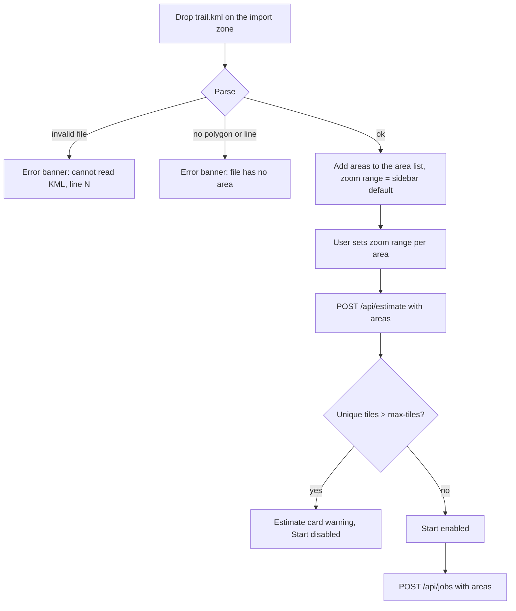
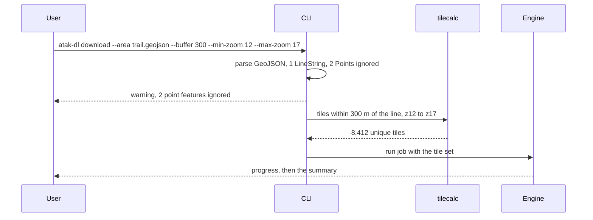

## Purpose

Today a job covers one rectangle of bounds (`cmd/atak-dl/commands/download.go:24-33`, `web/static/js/app.js:69-98`). A trail, a river or a county boundary needs a much larger rectangle than the region the user cares about, so the job downloads many tiles that the user does not need. ATAK's own Map Manager can select by polygon, by lasso and by route buffer (ATAK 4.6 User Guide, p. 21).

This feature adds polygons, GeoJSON and KML import, and route buffers. It also lets one job hold several areas, each with its own zoom range. A job downloads only the tiles that intersect an area.

## User stories

- As a SAR team preparer, I want a route buffer along a trail at high zoom and the county at low zoom in one output file, so that the team has detail where it searches.
- As a solo operator, I want to import a KML from Google Earth or CalTopo, so that I do not redraw my area.
- As any user, I want a polygon, so that the job does not download tiles outside my region.

## Functional requirements

### Area kinds

- FR-area-selection-1 — An area is one of `bounds`, `polygon` or `route_buffer`.
- FR-area-selection-2 — A `polygon` area is a GeoJSON Polygon or MultiPolygon in WGS 84.
- FR-area-selection-3 — A `route_buffer` area is a GeoJSON LineString or MultiLineString plus `buffer_m`, from 10 to 50,000.
- FR-area-selection-4 — Each area has its own zoom range.
- FR-area-selection-5 — A job holds 1 to 20 areas.

### Tile selection

- FR-area-selection-6 — For a `polygon` area, `tilecalc` selects every tile whose square intersects the polygon at each zoom level of the area.
- FR-area-selection-7 — For a `route_buffer` area, `tilecalc` selects every tile whose square is within `buffer_m` of the line at each zoom level of the area.
- FR-area-selection-8 — A tile selected by more than one area is downloaded once.
- FR-area-selection-9 — The estimate for a job is the count of unique tiles over all areas.
- FR-area-selection-10 — The estimate returns a count per area and the unique total.

### CLI

- FR-area-selection-11 — `atak-dl download --area <file>` reads the areas from a GeoJSON or KML file.
- FR-area-selection-12 — The CLI detects the file type from the extension: `.geojson` and `.json` are GeoJSON, `.kml` is KML and `.kmz` is zipped KML.
- FR-area-selection-13 — For a GeoJSON Feature, the properties `min_zoom`, `max_zoom` and `buffer_m` set the area's values when they are present.
- FR-area-selection-14 — For a feature with no zoom properties, the CLI uses `--min-zoom` and `--max-zoom`.
- FR-area-selection-15 — `--buffer <metres>` sets `buffer_m` for every line feature that has no `buffer_m` property.
- FR-area-selection-16 — `--area` and `--bbox` cannot be used together. The CLI exits with code 1 if both are present.
- FR-area-selection-17 — The `estimate` command accepts `--area` with the same rules.
- FR-area-selection-18 — The CLI ignores Point features and prints a warning with their count.

### Web UI

- FR-area-selection-19 — The area toolbar offers Rectangle, Polygon, Route and Import.
- FR-area-selection-20 — The Route tool draws a line and asks for the buffer in metres. The default is 500.
- FR-area-selection-21 — Import accepts a `.geojson`, `.json`, `.kml` or `.kmz` file by file picker or by drop.
- FR-area-selection-22 — The area list shows each area with its kind, name, zoom range and tile count, and a **Remove** button.
- FR-area-selection-23 — The user edits an area's zoom range in the area list.
- FR-area-selection-24 — The map shades the selected tiles of the selected area at its maximum zoom level when the shading draws fewer than 5,000 squares. Above that, the map shows the outline only.
- FR-area-selection-25 — `POST /api/estimate` and `POST /api/jobs` accept `areas: [{kind, geometry, min_zoom, max_zoom, buffer_m?, name?}]`.
- FR-area-selection-26 — The old `bounds`, `min_zoom` and `max_zoom` fields of `POST /api/jobs` stay valid and mean one `bounds` area.

### Output metadata

- FR-area-selection-27 — The output file metadata `bounds` is the bounding rectangle of all areas.
- FR-area-selection-28 — The output file metadata `minzoom` and `maxzoom` are the lowest and highest zoom levels over all areas.
- FR-area-selection-29 — The output file metadata `atakdl_areas` holds the job's areas as GeoJSON, so that `--resume` rebuilds the same tile set.

## User flows

### Flow 1 — Import a KML and download

1. The user drops a KML file on the import zone.
2. If the file is invalid, the web UI shows the parse error.
3. If the file has no polygon and no line, the web UI says that the file has no area.
4. The web UI adds one area per feature to the area list.
5. The user sets the zoom range of each area.
6. The web UI requests an estimate.
7. If the unique tile count is above the tile cap, the web UI disables **Start**.
8. The user selects **Start**, and the web UI sends the job with the areas.

### Flow 2 — A route buffer from the CLI

1. The user runs `download` with `--area` and `--buffer`.
2. The CLI parses the file and warns about ignored Point features.
3. `tilecalc` selects the tiles within the buffer at each zoom level.
4. The engine runs the job on that tile set.

## Screens & states

**Area tools** — [mockups/02-area-tools.html](../mockups/02-area-tools.html). They sit in the workspace from feature 08, above the zoom range.

Regions: the area toolbar, the import drop zone, the area list and the shaded tiles on the map.

| State | What the user sees |
|---|---|
| empty | The area list says "Draw or import an area". |
| drawing | The active tool is highlighted. Esc cancels. |
| populated | One row per area with its tile count. The unique total is under the list. |
| import error | An inline banner with the parse error. The area list is unchanged. |
| over cap | The total is red, and the banner says "Reduce the areas or the zoom range". |

## Behaviour rules

- `tilecalc` tests a tile against the polygon with Web Mercator coordinates at each zoom level.
- The buffer uses metres on the ground at the line's latitude. Accuracy within 5% is enough.
- Areas are processed in list order. Each tile is downloaded once, at the first area that selects it.
- A KML `Placemark` with a `Polygon` becomes a `polygon` area, and one with a `LineString` becomes a `route_buffer` area. The Placemark `name` becomes the area name.
- An imported file is at most 5 MiB.

## Data touched

- AREA gains `kind`, `geometry` (GeoJSON), `buffer_m` and `name`, with a zoom range per area.
- METADATA_ENTRY gains `atakdl_areas`.

## Interfaces

- GeoJSON: RFC 7946, https://datatracker.ietf.org/doc/html/rfc7946.
- KML 2.2: https://www.ogc.org/standards/kml. Only `Placemark` with `Polygon`, `LineString` and `MultiGeometry` is in scope.
- Geometry library: pick a maintained Go library for GeoJSON decoding (for example `github.com/paulmach/orb`). Read its current docs and license before you add it, and record the choice in an ADR.
- Leaflet-Geoman draw modes `Polygon` and `Line`: https://github.com/geoman-io/leaflet-geoman (vendored in feature 08).
- `POST /api/estimate` response adds `areas: [{name, tiles}]` and `unique_tiles`.

## Edge cases & failures

- If a polygon crosses the antimeridian, the CLI rejects it with "areas that cross 180° are not supported".
- If a polygon is self-intersecting, the CLI rejects it with "invalid polygon: self-intersection".
- If a KMZ holds more than one KML, the CLI reads `doc.kml`, or else the first `.kml` in the zip.
- A route buffer of 50 km at zoom level 18 can select millions of tiles. The tile cap from feature 07 stops it before any request.

## Acceptance criteria

- A triangle polygon at zoom level 10 selects fewer tiles than its bounding rectangle, and every selected tile intersects the triangle.
- Two overlapping areas produce a unique count lower than the sum of their counts, and the engine requests each shared tile once.
- `atak-dl download --area trail.kml --buffer 300` downloads only tiles within about 300 m of the line. The test checks a tile 1 km away, which is not requested.
- `--area` together with `--bbox` exits with code 1.
- A GeoJSON Feature with `"max_zoom": 16` uses zoom level 16 for that area, whatever `--max-zoom` is.
- In the web UI, dropping a KML with two Placemarks adds two rows to the area list.
- `--resume` on a polygon job requests only the missing tiles of the same polygon.

## Out of scope

- Drawing a freehand lasso.
- Areas that cross the antimeridian.
- Routing along roads. The user supplies the line.

## Open questions
