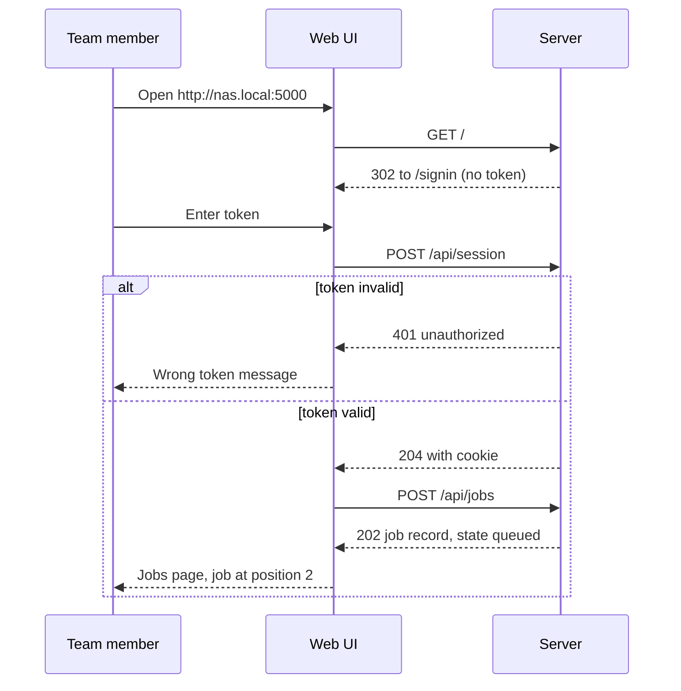
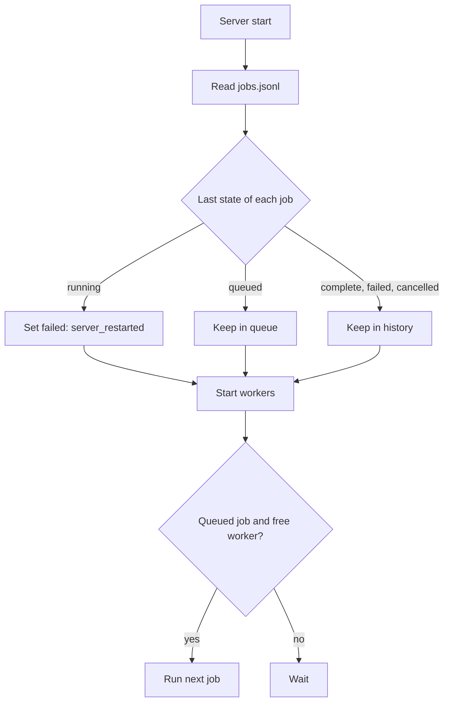
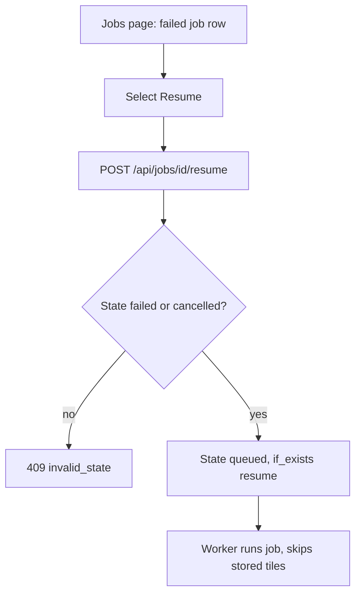

## Purpose

Today the server holds one job in memory, and it rejects a second job with "Download already in progress" (`cmd/atak-dl/commands/web.go:479-484`). A job is lost when the server restarts. The server has no authentication, so binding it to a LAN address exposes it to every device on the network.

The user wants the project to serve small teams from one LAN machine or a container. This feature adds a job queue, a persistent job store, a jobs page and a shared token for every address that is not loopback.

## User stories

- As a server operator, I want to run the project in Docker on a LAN box, so that the team shares one downloader.
- As a team member, I want to queue my job behind another member's job, so that I do not wait at the screen.
- As a team member, I want to see past jobs and download their output files, so that I reuse work.
- As a server operator, I want a token, so that only my team can start jobs.

## Functional requirements

### Queue

- FR-team-server-1 — `POST /api/jobs` adds the job to the queue with state `queued` and returns 202.
- FR-team-server-2 — The server runs at most `--workers` jobs at the same time. The default is 1.
- FR-team-server-3 — The server starts queued jobs in creation order.
- FR-team-server-4 — `DELETE /api/jobs/{id}` on a queued job sets the state to `cancelled` and removes it from the queue.
- FR-team-server-5 — `POST /api/jobs/{id}/resume` adds a `failed` or `cancelled` job to the queue again, and the job resumes its output file.
- FR-team-server-6 — The queue holds at most 50 queued jobs. Above that, `POST /api/jobs` returns 429 with error code `queue_full`.

### Job store

- FR-team-server-7 — The server stores every job record in `<data dir>/jobs.jsonl`, one JSON object per line, appended on each state change.
- FR-team-server-8 — At start, the server reads `jobs.jsonl` and keeps the last record of each job id.
- FR-team-server-9 — At start, the server sets every job that was `running` to `failed` with reason `server_restarted`.
- FR-team-server-10 — At start, the server keeps every `queued` job in the queue.
- FR-team-server-11 — `GET /api/jobs` returns the jobs, newest first, 50 per page, with `?page=N`.
- FR-team-server-12 — The server rewrites `jobs.jsonl` with one line per job when the file has more than 10 times as many lines as jobs.
- FR-team-server-13 — A job may carry a `label`, 1 to 80 characters, set by the submitter.

### Data directory

- FR-team-server-14 — `serve --data-dir <dir>` and `ATAKDL_DATA_DIR` set the directory for output files and `jobs.jsonl`. The default is `./downloads`.
- FR-team-server-15 — The CLI `download` writes to `--data-dir` when the command has no `--output`.

### Token

- FR-team-server-16 — If `--addr` is a loopback address, the server needs no token.
- FR-team-server-17 — If `--addr` is not a loopback address, every route needs the token, apart from `GET /healthz`.
- FR-team-server-18 — The token comes from `--token` or `ATAKDL_TOKEN`.
- FR-team-server-19 — If the server is not on loopback and no token is set, the server generates a 32-character random token and prints it once to stderr at start.
- FR-team-server-20 — A client sends the token as `Authorization: Bearer <token>`, or as the `atakdl_token` cookie that the sign-in page sets.
- FR-team-server-21 — `POST /api/session` with `{"token": "<token>"}` sets the `atakdl_token` cookie with `HttpOnly`, `SameSite=Strict` and `Path=/`.
- FR-team-server-22 — The server compares tokens in constant time.
- FR-team-server-23 — A request with no valid token returns 401 with error code `unauthorized`. A browser page request redirects to `/signin`.
- FR-team-server-24 — The server allows at most 10 failed token attempts per minute from one IP address. Above that, it returns 429.

### Web UI and operations

- FR-team-server-25 — The web UI adds a Jobs page at `/jobs`. It shows the queue and the history.
- FR-team-server-26 — Each job row shows the short id, map source, area name or label, zoom range, state, progress and created time.
- FR-team-server-27 — Each job row offers the actions that its state allows: Cancel, Download, Resume.
- FR-team-server-28 — The job detail drawer shows the job record and the live event log from `/api/jobs/{id}/events`.
- FR-team-server-29 — `GET /healthz` returns 200 with `{"status":"ok","version":"<version>"}`.
- FR-team-server-30 — The Docker image from Epic 0 runs `serve --addr 0.0.0.0:5000 --data-dir /data`, with `/data` as a volume.
- FR-team-server-31 — `docs/server.md` documents the Docker run command, a `compose.yaml` example, the token and the data volume.

## User flows

### Flow 1 — A team member signs in and queues a job

1. A team member opens the server address.
2. The server redirects to the sign-in page.
3. The member enters the token.
4. If the token is invalid, the web UI shows "Wrong token".
5. If the token is valid, the server sets the cookie.
6. The member submits a job, and the server adds it to the queue.
7. The web UI shows the Jobs page with the queue position.

### Flow 2 — The server restarts with queued jobs

1. The server reads `jobs.jsonl`.
2. For each job that was running, the server sets the state to `failed` with reason `server_restarted`.
3. The server keeps each queued job in the queue.
4. The server keeps the other jobs in the history.
5. The server starts the workers, and each free worker takes the next queued job.

### Flow 3 — Resume a failed job

1. The member selects **Resume** on a failed job.
2. If the job is not `failed` or `cancelled`, the server returns 409.
3. The server sets the job to `queued` with `if_exists` `resume`.
4. A worker runs the job and skips the stored tiles.

## Screens & states

[mockups/05-jobs.html](../mockups/05-jobs.html)

- **Sign-in page** (`/signin`). Regions: the title, the token field, **Sign in**, and the help text "Find the token in the server log or in ATAKDL_TOKEN". States: empty, wrong token, too many attempts.
- **Jobs page** (`/jobs`). Regions: the queue table, the history table, the job detail drawer and the server footer (version, bind address, data directory, workers). States:
  - empty: "No jobs yet". It links to the workspace.
  - populated.
  - loading: skeleton rows.
  - error: banner with Retry.

## Behaviour rules

- The token is never written to `jobs.jsonl` or to a log after the start message.
- Every queued and running job keeps its event stream. A client can watch any job.
- Any client with the token can cancel any job. The project has no per-user ownership.
- The rate limits from feature 06 apply per host across all workers, so two jobs on the same map source share one limit.

## Data touched

- JOB becomes persistent in `jobs.jsonl` and gains `queued` state, `label`, `started_at`, `finished_at` and `reason`.
- New file `<data dir>/jobs.jsonl`.

## Interfaces

| Method | Path | Request | Success | Errors |
|---|---|---|---|---|
| GET | `/api/jobs` | `?page=N` | 200 `{jobs:[...], page, pages}` | 401 |
| POST | `/api/jobs` | job request + `label?` | 202 job record | 400, 401, 403, 409, 429 `queue_full` |
| POST | `/api/jobs/{id}/resume` | — | 202 job record | 401, 404, 409 `invalid_state` |
| POST | `/api/session` | `{token}` | 204 + cookie | 401, 429 |
| DELETE | `/api/session` | — | 204, cookie cleared | — |
| GET | `/healthz` | — | 200 `{status, version}` | — |

- CLI: `serve --workers <n>` (1 to 8), `--data-dir <dir>` and `--token <token>`.
- `GET /api/config` adds `addr`, `data_dir` and `workers`. The server footer of the Jobs page shows them (#59).
- `crypto/subtle.ConstantTimeCompare`: https://pkg.go.dev/crypto/subtle.
- GoReleaser `dockers_v2` image from Epic 0: https://goreleaser.com/customization/docker/.

## Edge cases & failures

- If `jobs.jsonl` has a corrupt line, the server skips it, logs the line number, and starts.
- If the data directory is not writable, `serve` exits with code 1 and the message "data directory is not writable: <dir>".
- If a client sends the token in a query string, the server ignores it. Tokens in URLs end up in logs.
- If two members submit jobs for the same output file name, the second job gets a `-2` suffix on its file name.

## Acceptance criteria

- Two jobs submitted 1 second apart with `--workers 1` run one after the other, in that order.
- After a restart, a job that was `queued` runs, and a job that was `running` shows `failed` with reason `server_restarted`.
- `serve --addr 0.0.0.0:5000` with no token prints a generated token. A request without it returns 401.
- `serve --addr 127.0.0.1:5000` accepts requests with no token.
- A wrong token 11 times in one minute returns 429 on the 11th attempt.
- `GET /healthz` returns 200 with no token.
- **Resume** on a failed job requests only the missing tiles.
- `docker run -v ./data:/data -e ATAKDL_TOKEN=abc -p 5000:5000 ghcr.io/crank-git/atak-map-downloader` serves the sign-in page, and a job writes its output file to `./data`.
- No line of `jobs.jsonl` and no log line after start contains the token.

## Out of scope

- User accounts and per-user history.
- TLS termination in the server.
- Job priorities.
- Pushing output files to TAK Server.

## Open questions
