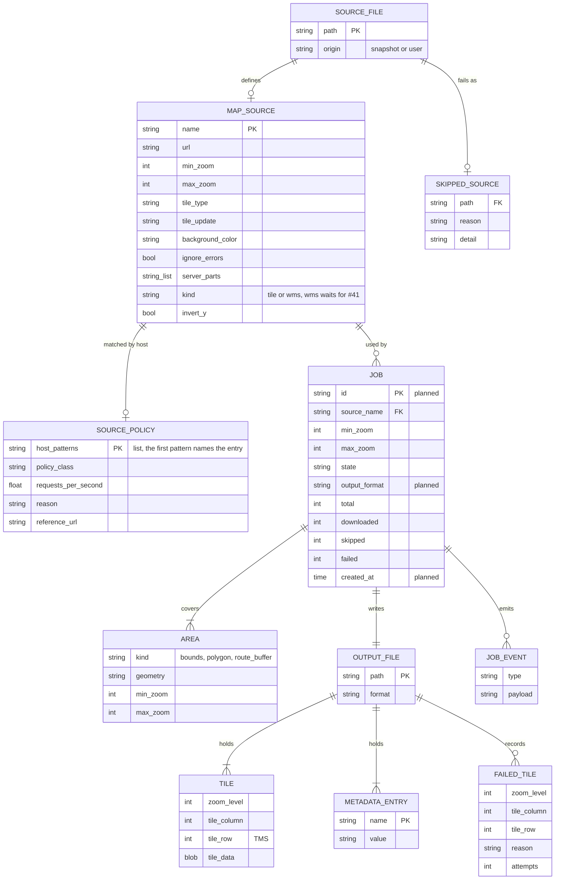
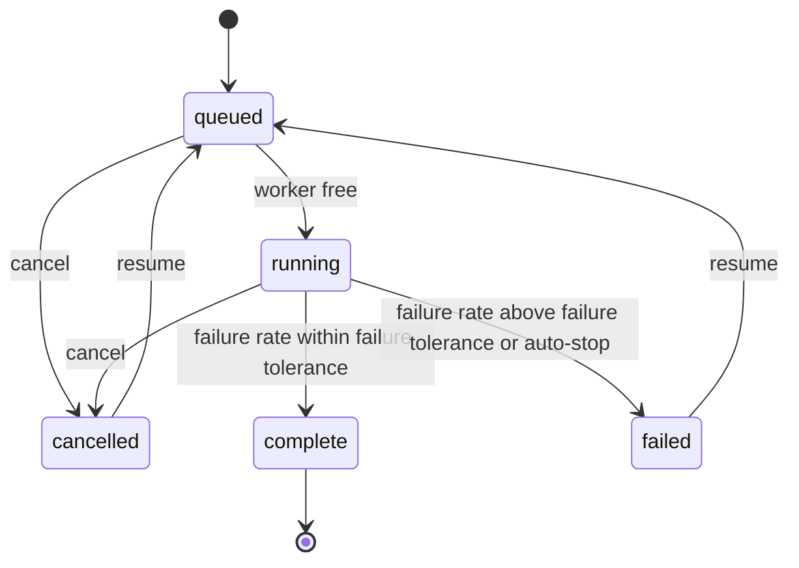

# ATAK Map Downloader

## Overview

ATAK Map Downloader is a single Go binary, `atak-dl`. It reads MOBAC source files and downloads the tiles of one map source over an area and a zoom range. It writes the tiles to an SQLite output file that ATAK imports for offline use. The project has a CLI for scripts and a web UI for interactive area selection.

The project was written in February 2026 and received one outside fix in August 2026 (PR #3). This spec was reconstructed from the code on 2026-11-21. Features 01–04 describe what is built. Features 00 and 05–12 are the roadmap that issue-flow builds.

The project exists because ATAK users often work with no network. Examples are search and rescue teams, wildland fire crews and outdoor users. ATAK can stream tiles and download small areas on the device. This project moves that work to a desktop or a server: more bandwidth, larger areas, repeatable jobs, and one output file that many devices can use.

## Terms

| Term | Part of speech | Meaning in this project | Do not use |
|---|---|---|---|
| project | noun | ATAK Map Downloader as a whole, built as the `atak-dl` binary. | app, system, tool (in requirements) |
| ATAK | noun | Android Team Awareness Kit. Also covers iTAK and WinTAK when this spec says "TAK clients". | — |
| MOBAC | noun | Mobile Atlas Creator. Its XML format defines map sources. | — |
| map source | noun | One tile provider definition: name, URL template, zoom range, tile type. Code: `xmlparser.MapSource`. | provider, layer, map |
| source file | noun | One MOBAC XML file that defines one map source. | config, definition |
| source catalog | noun | The set of map sources that the project loaded. | library, source list |
| snapshot | noun | The pinned copy of ATAK-Maps source files embedded in the binary (feature 09). | bundle, vendor copy |
| user source directory | noun | The directory that `--mapsources-dir` names. Its map sources replace snapshot map sources with the same name (feature 09). | override folder, mapsources folder |
| overlay | noun | A map source with transparent tiles, drawn on top of another map source. | layer |
| policy class | noun | The terms-of-use class of a map source: `open`, `conditional` or `restricted` (planned, feature 06). | license, tier |
| rate limit | noun | The maximum number of requests per second that the project sends to one host. | throttle |
| tile | noun | One square raster image at one zoom level, column and row. | image, chunk |
| zoom level | noun | An integer from 0 to 25 that selects the tile grid. | level, z (in prose) |
| zoom range | noun | A minimum and a maximum zoom level, both included. | levels |
| bounds | noun | A geographic rectangle: minimum and maximum latitude and longitude. The `--bbox` flag name stays as it is. | bbox (in prose), extent, box |
| area | noun | The region that a job covers: bounds, a polygon or a route buffer (feature 11). | AOI, region, selection |
| route buffer | noun | An area made from a line and a distance in metres on each side of it (feature 11). | corridor |
| vertex | noun | One position of a polygon ring or of a line. An area holds at most 20,000 (feature 11). | node, corner |
| estimate | noun | A prediction of the tile count, file size and time for an area and a zoom range. The `estimate` command name stays as it is. | quote, calculation |
| preview | noun | A grid of sample tiles from a map source, shown on the map over the area. | thumbnail |
| download | verb | To get tiles from a map source over HTTP and write them to an output file. Never a noun in this spec. | fetch, grab, scrape, pull |
| job | noun | One run of a download: map source, area, zoom range, settings, output file and state. | download (noun), task, run |
| output file | noun | The SQLite or zip file that a job writes. | tileset, database, map file, archive |
| output format | noun | The schema of the output file: `mbtiles`, `osmdroid` or `gpkg` (planned, feature 10). | file type |
| data package | noun | An ATAK zip file with a `MANIFEST/manifest.xml` (planned, feature 10). | mission package (except in ATAK quotes) |
| retry | verb | To send a tile request again after it fails. | re-fetch |
| resume | verb | To continue a job into an existing output file and skip the tiles it already holds (feature 07). | restart, continue |
| failure rate | noun | Failed tiles divided by processed tiles in one job. | error rate |
| failure tolerance | noun | The highest failure rate at which a job still succeeds. Code: `MaxFailureRate`. | error budget |
| failure reason | noun | The word that names why one tile failed, for example `not_image` or `http_404`. Code: `download.Reason`. | error code, cause |
| URL placeholder | noun | A `{$…}` string in the `url` of a source file that the engine replaces for each tile, for example `{$x}` (feature 09). | variable, template field |
| server part | noun | One value of `serverParts` that the engine puts in `{$serverpart}`. The tile column plus the tile row selects it (feature 09). | subdomain, mirror |
| placeholder image | noun | One image that a map source sends for many tiles in place of real map data. | dummy tile, filler |
| server | noun | The HTTP process that `atak-dl serve` starts. | backend, daemon |
| web UI | noun | The browser page that the server sends from the binary. | frontend, dashboard, web app |
| CLI | noun | Command-line interface: the `atak-dl` subcommands. | terminal mode |
| base map | noun | The background map that the web UI draws under the area. | basemap layer |
| geocode | verb | To find coordinates for a place name through Nominatim. | search (as a verb for this) |
| token | noun | The shared secret that a client sends to a server that is not bound to loopback (planned, feature 12). | password, API key |
| TMS | noun | Tile Map Service row order: row 0 is at the south edge. | — |
| XYZ | noun | Slippy-map row order: row 0 is at the north edge. | — |
| WMS | noun | OGC Web Map Service. A map source that the project requests with bounds instead of a tile column and row. | — |
| SSE | noun | Server-Sent Events: a one-way HTTP event stream. The job API sends job events over it (#76). | — |

## Goals

1. A user prepares an offline output file for an area with one command or one web UI session.
2. Every output file that the project writes imports into ATAK with no manual change.
3. The binary builds for Linux, macOS and Windows on amd64 and arm64 with no C toolchain (`CGO_ENABLED=0`).
4. The web UI works with no internet connection, apart from the tile requests and the online base map.
5. The project sends no request that breaks a published usage policy by default: identifying User-Agent, rate limits, backoff, and a warning for restricted map sources.
6. A cancelled or failed job keeps every tile that it downloaded, and the user can resume it.
7. A team runs the server on one LAN machine and submits jobs from a browser, with a token.

## Non-goals

- The project does not host or proxy tiles to ATAK devices for live streaming.
- The project does not create vector tiles or render OpenStreetMap data.
- The project does not change the projection of raster tiles. Every map source is Web Mercator or a WMS that supports EPSG:3857.
- The project does not re-encode tiles to JPEG or WebP in v1.
- The project does not have user accounts. One shared token protects the server.
- The project does not keep a Python-version compatibility promise. The README claim is retired.
- The project does not ship a desktop wrapper (Wails or similar).

## Users & personas

| Persona | What they need | What they may do |
|---|---|---|
| Solo operator | Prepares offline maps for their own ATAK device before a trip. Uses the web UI or the CLI on a laptop. | Every action. The server is on loopback, so no token is needed. |
| Team preparer | Prepares output files for a SAR unit, a fire crew or a club, and gives them to members as files or data packages. | Every action. Often scripts the CLI. |
| Server operator | Runs `atak-dl serve` on a LAN machine or in Docker for a team. | Sets the bind address, the token, the data directory and the worker count. |
| Team member | Opens the server's web UI from a browser on the LAN. | With the token: submits jobs, cancels jobs and downloads output files. Without the token: nothing. |
| OSS user | Finds the project on GitHub. Installs it from a release archive or Docker. | Same as the solo operator. |

## Feature map

| Feature set | Spec file | Epic | Status | Mockups |
|---|---|---|---|---|
| Foundation | [features/00-foundation.md](features/00-foundation.md) | Epic 0: Foundation | built | — |
| Map source catalog | [features/01-map-sources.md](features/01-map-sources.md) | Existing (built) | built | — |
| Area estimate and tile info | [features/02-area-estimate.md](features/02-area-estimate.md) | Existing (built) | built | — |
| Tile download and output file | [features/03-tile-download.md](features/03-tile-download.md) | Existing (built) | built | — |
| Web UI and server | [features/04-web-ui.md](features/04-web-ui.md) | Existing (built) | built | — |
| Security hardening | [features/05-security-hardening.md](features/05-security-hardening.md) | Epic 1: Security hardening | built | — |
| Polite downloading | [features/06-polite-downloading.md](features/06-polite-downloading.md) | Epic 2: Polite downloading | built | 04-source-policy-warning |
| Robust downloads | [features/07-robust-downloads.md](features/07-robust-downloads.md) | Epic 3: Robust downloads | built | — |
| Offline web UI | [features/08-offline-web-ui.md](features/08-offline-web-ui.md) | Epic 4: Offline web UI | built | 01-workspace |
| Source sync and WMS | [features/09-source-sync.md](features/09-source-sync.md) | Epic 5: Source sync and WMS | built, except WMS (#41) | — |
| Output formats | [features/10-output-formats.md](features/10-output-formats.md) | Epic 6: Output formats | planned | 03-export-options |
| Area selection | [features/11-area-selection.md](features/11-area-selection.md) | Epic 7: Area selection | planned | 02-area-tools |
| Team server | [features/12-team-server.md](features/12-team-server.md) | Epic 8: Team server | planned | 05-jobs |

## Architecture & stack

The diagram shows the target architecture after Epic 8. Components that exist today are marked "built".


Per component:

- **Language and runtime: Go.** `go.mod` declares `go 1.26.0` and `toolchain go1.27.4` (#63). Go 1.27.4 is the current stable release (https://go.dev/doc/devel/release, retrieved 2026-11-21). Go beat the alternatives because it gives one static binary and has a cross-compile story that a solo maintainer can keep. See [ADR 0001](../adr/0001-go-single-binary-cli.md).
- **CLI: spf13/cobra.** Built. Cobra is kept because it already defines every command.
- **SQLite driver: modernc.org/sqlite.** Built (#63). It replaced `mattn/go-sqlite3`, which needs CGO. modernc is at v1.62.0 (https://pkg.go.dev/modernc.org/sqlite?tab=versions, retrieved 2026-11-21). It is about 1.6 times slower than mattn at bulk inserts (https://github.com/cvilsmeier/go-sqlite-bench). The network is the bottleneck, so the difference is small. ncruces/go-sqlite3 is pre-1.0 and is the fallback. See [ADR 0005](../adr/0005-pure-go-sqlite.md).
- **Server: net/http.** The job routes use the Go 1.22 method-and-path patterns (`cmd/atak-dl/commands/jobs.go:244-258`, #76). The other routes still use the hand-written router in `cmd/atak-dl/commands/web.go:87-100`. `http.CrossOriginProtection` (Go 1.25, https://go.dev/doc/go1.25) blocks requests from other web pages (#77). Planned: `os.Root` (Go 1.24) limits file serving to the output directory.
- **Progress channel: SSE.** Built (#76, #78). SSE replaced `gorilla/websocket`, which has had no release since v1.5.3 in June 2024 (https://pkg.go.dev/github.com/gorilla/websocket?tab=versions). Progress goes from the server to the browser only, and browser commands are `POST` and `DELETE` requests. See [ADR 0006](../adr/0006-sse-job-api.md).
- **Web UI: vanilla JavaScript + Leaflet 1.9.4 + Leaflet-Geoman 2.20.8, embedded with `embed.FS`.** Leaflet 2.0 is still in beta (https://github.com/Leaflet/Leaflet/releases). Leaflet.draw has had no release since 2018, and Leaflet-Geoman v2.20.8 is active (https://github.com/geoman-io/leaflet-geoman/releases). Bootstrap and Font Awesome are removed. All assets are vendored, so the page works offline.
- **Map sources: MOBAC XML from joshuafuller/ATAK-Maps (MIT).** Built (Epic 5). The binary embeds a snapshot of ATAK-Maps v2.3.1 with 53 source files (https://github.com/joshuafuller/ATAK-Maps/releases). `atak-dl sources sync` writes a newer release to `<user source directory>/atak-maps/`. See [ADR 0004](../adr/0004-mobac-xml-sources.md) and [ADR 0008](../adr/0008-embedded-source-snapshot.md).
- **Release: GoReleaser v2 on GitHub Actions.** Built (#65, #70, #73). Release targets are GitHub Releases and a GHCR image. GoReleaser v2.20.3 is current (https://github.com/goreleaser/goreleaser/releases). The project publishes no Homebrew tap, to keep the release surface small.
- **Lint: golangci-lint v2.** Built (#64). Version v2.15.0, pinned with a `tool` directive in `go.mod`, with the complexity linters enabled (https://github.com/golangci/golangci-lint/releases).

Repository layout (current, plus planned additions in italics):

```
cmd/atak-dl/            CLI entry point and one file per command
internal/xmlparser/     source file parser (built)
internal/tilecalc/      Web Mercator tile math (built)
internal/download/      download engine (built)
internal/mbtiles/       MBTiles writer (built)
internal/output/        planned: one writer per output format
internal/policy/        planned: source policy table and rate limits
internal/jobs/          planned: job queue and job store
internal/server/        planned: HTTP handlers moved out of commands/web.go
web/                    embedded web UI
internal/snapshot/      embedded ATAK-Maps source files, VERSION and name aliases (built)
internal/sourcesync/    the sources sync command (built)
docs/specs/ docs/adr/   this spec and the decision records
```

## Data model



Per entity:

- **MAP_SOURCE** (built, `internal/xmlparser/xmlparser.go:16-26`). The parser loads it from a `<customMapSource>` source file. `name` is the key. A map source of a later layer replaces one of the same name: the snapshot, then `atak-maps/`, then the user's own files (FR-source-sync-5). Defaults: if both zooms are 0, `max_zoom` is 18. `tile_type` is `png`, `tile_update` is `None` and `background_color` is `#000000`. It has `kind` (`tile`, and `wms` when #41 lands) and `invert_y` (feature 09).
- **SOURCE_FILE** (built). A MOBAC XML file in the snapshot or in the user source directory. `origin` is `snapshot` or `user` (feature 09).
- **SKIPPED_SOURCE** (built, feature 09). An in-memory record of a source file that did not load, with its path, reason and detail (#38).
- **SOURCE_POLICY** (planned, feature 06). A table embedded in the binary, keyed by a host pattern such as `*.google.com`. `policy_class` is `open`, `conditional` or `restricted`. `requests_per_second` is the rate limit for that host.
- **JOB** (built as one in-memory record, `cmd/atak-dl/commands/jobs.go:62-78`, #76). It has an `id`, and its state is `running`, `complete`, `failed` or `cancelled`. The server keeps only the last job (`web.go:29-35`). Planned (feature 12): the `queued` state and a persistent record in the data directory.
- **AREA** (built, feature 11). Its kind is `bounds`, `polygon` or `route_buffer`, with GeoJSON geometry and a zoom range for each area. A job holds 1 to 20 areas, and the output file metadata `atakdl_areas` stores them.
- **OUTPUT_FILE** (built). Path: `./downloads/<name>_z<min>-<max>.sqlite`. An existing file at that path stops the job unless the user asks to resume or overwrite it, and a cancelled job keeps its file (feature 07). The metadata row `atakdl_source` names the map source. Planned: an extension per output format (feature 10).
- **TILE** (built, `internal/mbtiles/mbtiles.go:31-33`). `UNIQUE (zoom_level, tile_column, tile_row)`. `tile_row` is TMS: `(1<<z)-1-y`. `tile_data` holds the bytes the server returned. The engine stores only a body whose signature is PNG, JPEG, GIF or WebP (feature 07, #27).
- **METADATA_ENTRY** (built). Keys: `name`, `type`, `version`, `description`, `format`, `bounds`, `minzoom`, `maxzoom`, `atakdl_source` and `atakdl_areas`. The `--resume` check reads `atakdl_source` (feature 07, #26), and it rebuilds the tile set from `atakdl_areas` (feature 11). Planned: `center` and `attribution` (feature 10).
- **FAILED_TILE** (built, feature 07, #28). A table `atakdl_failed_tiles` in the output file. The retry pass and `--resume` request each tile in it again, except a `not_found` tile. ATAK reads only the `tiles` and `metadata` tables, so an extra table is safe. This is inferred from ATAK-CIV `TilesetInfo.java` and is a risk item.
- **JOB_EVENT** (built in memory, #76). An SSE message: `progress`, `state` or `log`. The server does not store it.

Job lifecycle (planned, features 05, 07 and 12):



## Cross-cutting concerns

- **Authentication and authorization.** Today there is none, and that is acceptable only on loopback. If the host in `--addr` is not a loopback address, `serve` prints a warning to stderr that the server has no authentication (`serve.go:49-54`, #81). Planned (feature 12): if the server binds to an address that is not loopback, every request must carry the token. The token comes from `--token` or `ATAKDL_TOKEN`. If neither is set, the server generates one and prints it once at start.
- **Cross-origin requests.** The server sends no CORS header (#77). `newServerHandler` wraps every route with `http.CrossOriginProtection` (`cmd/atak-dl/commands/web.go:56-62`). A cross-origin browser request that is not `GET`, `HEAD` or `OPTIONS` gets 403 `cross_origin`. The websocket and `/ws` are removed (#78).
- **TLS.** The engine verifies TLS certificates by default (`internal/download/download.go:43`, #75). `download --insecure` turns verification off for one job and prints a warning to stderr. The web UI shows **Verify TLS** checked by default (#78).
- **Error handling.** Every error response is `application/json` with the shape `{"error": {"code": "<snake_case>", "message": "<text>"}}` (`writeError`, `web.go:443-447`, #74). Every JSON success response sets `Content-Type: application/json`. The error codes are in `05-security-hardening.md`. The CLI prints a limit error as `Error: <code>: <message>`. It exits with code 4 for `too_many_tiles` and with code 1 for the other limit errors (#81, #29).
- **Validation and limits.** Built (#81):
  - The zoom range is within the map source's zoom range (`zoom_out_of_range`). The CLI and `POST /api/jobs` share `checkJobLimits` (`jobs.go:320-337`).
  - Concurrency is from 1 to 32 (`invalid_concurrency`).
  - A request body is at most 1 MiB (`body_too_large`, status 413, `limitBody` in `web.go`). A route that carries areas reads 5 MiB plus 64 KiB (FR-security-hardening-17).
  - The server sets `ReadHeaderTimeout` 10 s, `ReadTimeout` 30 s and `IdleTimeout` 120 s, and no `WriteTimeout`, because an SSE stream stays open (`serve.go:91-99`).
  - A geocode result with a coordinate that is not a number gives 500 `internal`.

  - The tile count is at most `--max-tiles`, with a default of 500,000 (`too_many_tiles`, feature 07, #29).
- **Logging.** `log/slog` with the text handler today. Planned: every job log line carries `job_id`, and every failed tile is logged at debug level with its URL and reason.
- **Politeness.** Planned (feature 06):
  - The User-Agent is `atak-map-downloader/<version> (+https://github.com/Crank-Git/ATAKMapDownloader)`.
  - Each host has a rate limit.
  - The project backs off on 429 and 503 and honours `Retry-After`.
  - Geocoding is limited to 1 request per second across the whole server, as the Nominatim policy requires (https://operations.osmfoundation.org/policies/nominatim/).
- **Accessibility.** Planned (feature 08):
  - Every control has a label.
  - Icon buttons have `aria-label`.
  - The job status region is `aria-live="polite"`.
  - The progress bar sets `aria-valuenow`.
  - The theme follows `prefers-color-scheme`.
- **Performance targets.** The tile writer stores at least 500 tiles per second on a laptop SSD (one writer goroutine, one transaction per 500 tiles). The server starts in less than 1 second with the embedded snapshot.
- **Internationalization.** English only. No i18n is planned.

## Environments & config

- **Environments.** One environment: the user's machine, or a LAN server or container. The project has no hosted deployment. Releases are the deploy target: GitHub Releases and `ghcr.io/crank-git/atak-map-downloader`.
- **Configuration.** Configuration is through flags today, and no code reads an environment variable. Planned environment variables:

| Name | Feature | Meaning |
|---|---|---|
| `ATAKDL_TOKEN` | 12 | The token for a server that is not on loopback. It has the same meaning as `--token`. |
| `ATAKDL_DATA_DIR` | 12 | The directory for output files and the job store. It has the same meaning as `--data-dir`. The default is `./downloads`. |

- **CI secrets** (names only; see [docs/external.md](../external.md)): `GITHUB_TOKEN` (provided by Actions). No other secret is needed.
- **Seed and demo data.** Epic 0 added `testdata/` with three fixture source files (tile, quadkey and WMS) and a fake tile server for tests (`internal/testtiles`). The demo is `atak-dl download --source "OpenTopo - Opentopomap" --bbox 45.30,-121.80,45.45,-121.60 --min-zoom 8 --max-zoom 12`, Mount Hood with about 60 tiles.

## Testing strategy

- **Unit tests.** `go test -race ./...`. Every package in `internal/` and `cmd/atak-dl/` has tests (#66, #74–#78, #81).
- **Integration tests.** The download engine and every output writer run against `internal/testtiles`, an `httptest` tile server. The test server can return 200, 404, 429 with `Retry-After`, 503, HTML bodies and slow responses. No test calls a real tile server.
- **Conformance tests.** Each output format has a test that opens the output file and applies ATAK's format-detection rules from ATAK-CIV `TilesetInfo.java`: the `tiles` column set, the row order and the metadata keys. A device check is a manual, optional step, because the maintainer has no TAK client installed.
- **HTTP tests.** The server handlers run under `httptest`. SSE and timeouts use `testing/synctest`.
- **Smoke test.** `scripts/smoke.sh` builds the binary and starts `serve` on a free port. It checks that `GET /` returns 200 and that `GET /api/sources` returns a non-empty list, then stops the server.
- **Lint.** `golangci-lint run` with the config from Epic 0. `gofmt -l .` prints nothing.
- **What "done" means for a change:** `go test -race ./...`, `golangci-lint run` and `scripts/smoke.sh` pass in CI on the PR. A change to an output format also passes its conformance test.

## Epics

1. **Epic 0: Foundation.** Goal: a fresh clone tests, lints, builds and releases with no C toolchain. Covers [00-foundation](features/00-foundation.md). Depends on: nothing. Exit: CI is green on `develop`, and a `v0.2.0-rc` tag produces signed release artifacts.
2. **Epic 1: Security hardening.** Goal: no web page and no network attacker can drive or tamper with a job. Covers [05-security-hardening](features/05-security-hardening.md). Depends on: Epic 0. Exit: the cross-origin, TLS and limit tests pass, and the websocket is gone.
3. **Epic 2: Polite downloading.** Goal: default behavior meets the published tile and Nominatim policies. Covers [06-polite-downloading](features/06-polite-downloading.md). Depends on: Epic 1 (the job API). Exit: rate-limit and backoff tests pass, and restricted map sources need confirmation.
4. **Epic 3: Robust downloads.** Goal: no job loses a downloaded tile, and no output file holds a bad tile. Covers [07-robust-downloads](features/07-robust-downloads.md). Depends on: Epic 2 (the host rate limiter that the engine waits on). Exit: resume, validation and tile-cap tests pass under `-race`.
5. **Epic 4: Offline web UI.** Goal: the web UI works air-gapped and returns output files to the browser. Covers [08-offline-web-ui](features/08-offline-web-ui.md). Depends on: Epics 1 and 3 (the job panel shows `skipped` and sends `if_exists`). Exit: the page loads with the network off, and no request leaves for a CDN.
6. **Epic 5: Source sync and WMS.** Goal: the binary carries a current source catalog, and every source file in it loads or reports why not. Covers [09-source-sync](features/09-source-sync.md). Depends on: Epic 2 (policy table keys). Exit: 53 snapshot source files load or are listed as skipped with a reason.
7. **Epic 6: Output formats.** Goal: the user chooses MBTiles, OSMDroid or GeoPackage, optionally inside a data package. Covers [10-output-formats](features/10-output-formats.md). Depends on: Epic 3 (the single writer). Exit: the conformance tests pass for all three output formats.
8. **Epic 7: Area selection.** Goal: a job covers polygons, imported files and route buffers, with a zoom range for each area. Covers [11-area-selection](features/11-area-selection.md). Depends on: Epic 4 (Geoman). Exit: a polygon job downloads only intersecting tiles.
9. **Epic 8: Team server.** Goal: a team shares one server with a token, a job queue and job history. Covers [12-team-server](features/12-team-server.md). Depends on: Epics 1 and 4. Exit: the Docker image runs headless and two queued jobs complete in order.

## Milestones

| Milestone | Epics | What "shippable" means |
|---|---|---|
| v0.2.0: Modern build | 0 | Signed CGO-free binaries for 6 platforms, and a GHCR image. Behavior is unchanged. |
| v0.3.0: Safe by default | 1, 2 | The local server cannot be driven by other web pages. TLS is verified. Requests follow the tile and Nominatim policies. |
| v0.4.0: Reliable jobs | 3, 4 | Resume, tile validation and tile caps. The web UI works offline and returns output files. |
| v0.5.0: Current catalog | 5, 6 | The ATAK-Maps v2.3.1 snapshot with WMS support. Three output formats and data packages. |
| v1.0.0: Teams | 7, 8 | Polygon and route areas. A token-protected team server with a queue. |

After Epic 3, issue-flow may build Epics 4, 5 and 6 in parallel.

## Assumptions

1. The default output format stays MBTiles, and the default extension changes from `.sqlite` to `.mbtiles` in Epic 6. ATAK detects the format by the schema, not by the extension (ATAK-CIV `TilesetInfo.java`), so the change is safe for import.
2. The tile cap default is 500,000 tiles per job. That is about 7.5 GB at the CLI's 15 KB per tile estimate.
3. The default rate limit for a host that is not in the policy table is 4 requests per second, with concurrency at most 4 for that host.
4. Restricted map sources stay in the snapshot. They are labeled, rate-limited to 1 request per second, and need explicit confirmation (`--accept-terms` in the CLI, a checkbox in the web UI). This is the user's "Tag + warn" choice.
5. The team server runs jobs one at a time by default (`--workers 1`), because tile servers rate-limit by client IP.
6. The job store is a JSON-lines file in the data directory, not an SQLite database. Job volume is small.
7. Release versions start at v0.2.0. The current code is v0.1.0 for history, and no tag exists today.
8. Device verification on ATAK is optional and manual. Conformance tests carry the acceptance criteria.

## Risks & open questions

Reconciliation of the existing documentation against the code (Phase 1):

- **Resolved — README cross-compile.** The README told users to cross-compile with `GOOS`/`GOARCH`, and the `mattn/go-sqlite3` driver needed CGO. #63 replaced the driver, and the README now shows `CGO_ENABLED=0` builds (`README.md:65-77`).
- **Resolved — "1:1 functionality matching the Python version".** No Python code is in this repo, and behavior differs: WMS is skipped, and the defaults for failure tolerance and size per tile are different. The user retired the claim, and Epic 0 removed it from the README (#71).
- **Resolved — "30+ map sources".** The snapshot holds 53 source files, and 47 load. `list-sources --skipped` reports the other 6 with reason `parse_error`: 5 WMS files, which wait for #41, and 1 multi-layer file (#37, #38).
- **Contradicted — "MBTiles output".** The output file has a `.sqlite` extension and lacks the `center` key that the MBTiles 1.3 spec recommends (https://github.com/mapbox/mbtiles-spec/blob/master/1.3/spec.md). ATAK loads it through its "momap" path, not its "mbtiles" path.
- **Resolved — "Batch Delay".** The web UI offered a batch delay that the engine never read. #78 removed the control and `DelayBetweenBatches`.
- **Resolved — the build failed on this machine.** On 2026-11-21, `go run ./cmd/atak-dl` failed at the CGO link step on macOS 27 (`ld: … tapi error: malformed file … unknown architecture`). #63 removed CGO (ADR 0005), and `CGO_ENABLED=0` builds pass in CI (#69).
- **Risk — a late cancel is lost.** The engine checks the context only while it starts tile requests (`internal/download/download.go:160-165`). A SIGINT after the last request starts ends as a normal job, and the CLI can print "Download complete". Feature 07 fixes this (FR-robust-downloads-30).
- **Risk — preview tiles can fail to show.** The preview overlays set `crossOrigin: 'anonymous'` (`web/static/js/app.js:621`), so a tile server that sends no CORS header blocks the image. Feature 08 owns the preview rendering.
- **Risk — ATAK format handling is inferred, not tested.** The public ATAK-CIV source is archived at 4.6.0.5 (October 2024). No public source exists for ATAK 5.x, iTAK, WinTAK or TAK Aware. Each output format can fail on a newer client. Mitigation: conformance tests, plus an optional device check before v0.5.0.
- **Risk — restricted map sources.** Google and Esri terms prohibit bulk download and offline caching. Google: https://developers.google.com/maps/documentation/tile/policies. Esri: https://www.esri.com/content/dam/arcgisonline/docs/tou_summary.pdf. The OSM tile policy says "Offline use is not permitted" (https://operations.osmfoundation.org/policies/tiles/). Microsoft says direct Bing tile URLs are "not allowed" (https://learn.microsoft.com/en-us/bingmaps/rest-services/directly-accessing-the-bing-maps-tiles). The project warns and rate-limits, and the user decides. Bing tile endpoints can stop working at any time.
- **Risk — the ATAK-Maps v2 rename.** ATAK-Maps v2.0.0 renamed every map source (https://github.com/joshuafuller/ATAK-Maps/blob/master/CHANGELOG.md). Scripts that pass `--source "Google - Satellite Only"` break after Epic 5. Mitigation: an alias table from old names to new names for one release.
- **Resolved — Leaflet-Geoman license.** The `LICENSE` file in the npm tarball of the free edition 2.20.8 is MIT. #31 vendors it (ADR 0010).
- **Open question — WebP support in ATAK.** Not verified. Re-encoding is a non-goal for v1.
- **Open question — the OSMDroid `ATAK_metadata` table.** The exact schema must be read from ATAK-CIV `OSMDroidTileContainer.java` before Epic 6 builds the writer.
- **Undocumented behavior found in the code** (no document mentions it):
  - the `/api/preview` route and its tile grid
  - the `/api/geocode` Nominatim proxy
  - the `/api/tile-info` and `/api/validate-source` routes, which the web UI never calls
  - the auto-zoom rule in `estimate`
  - the mtime-based source cache
  - deletion of an existing output file before a job
  - deletion of the output file on cancel
  - the single global job lock
  - dark mode that inverts map tiles

## Issue map

Created by spec-to-issues on 2026-11-21. Features 01–04 are `built` and have no issues.

| Epic | Epic issue | Sub-issues |
|---|---|---|
| Foundation | #4 | #5, #6, #7, #8, #9, #10, #68 |
| Security hardening | #11 | #12, #13, #14, #15, #16, #17, #80 |
| Polite downloading | #18 | #19, #20, #21, #22, #23 |
| Robust downloads | #24 | #25, #26, #27, #28, #29 |
| Offline web UI | #30 | #31, #32, #33, #34, #35 |
| Source sync and WMS | #36 | #37, #38, #39, #40, #41, #42 |
| Output formats | #43 | #44, #45, #46, #47, #48, #49 |
| Area selection | #50 | #51, #52, #53, #54 |
| Team server | #55 | #56, #57, #58, #59, #60 |

FR coverage (each sub-issue and the requirements it quotes):

| Sub-issue | Issue | Requirements |
|---|---|---|
| Replace the CGO SQLite driver with modernc.org/sqlite | #5 | FR-foundation-1, FR-foundation-2, FR-foundation-3, FR-foundation-4 |
| Format the code and add golangci-lint v2 config | #6 | FR-foundation-5, FR-foundation-6, FR-foundation-7, FR-foundation-8 |
| Add the test tile server, fixtures and engine integration tests | #7 | FR-foundation-9, FR-foundation-10, FR-foundation-11, FR-foundation-12 |
| Add the smoke script and the CI workflow | #8 | FR-foundation-13, FR-foundation-14, FR-foundation-15, FR-foundation-16 |
| Add GoReleaser releases, the GHCR image and --version | #9 | FR-foundation-19, FR-foundation-20, FR-foundation-21, FR-foundation-22 |
| Create the develop branch and update the README build section | #10 | FR-foundation-17, FR-foundation-18, FR-foundation-23, FR-foundation-24 |
| Return JSON errors with one error shape | #12 | FR-security-hardening-21, FR-security-hardening-22, FR-security-hardening-23, FR-security-hardening-24 |
| Remove CORS headers and add cross-origin protection | #13 | FR-security-hardening-1, FR-security-hardening-2, FR-security-hardening-3 |
| Verify TLS by default and add the --insecure flag | #14 | FR-security-hardening-4, FR-security-hardening-5, FR-security-hardening-6 |
| Add the job API with an SSE event stream | #15 | FR-security-hardening-8, FR-security-hardening-9, FR-security-hardening-10, FR-security-hardening-11, FR-security-hardening-12, FR-security-hardening-13, FR-security-hardening-14, FR-security-hardening-15 |
| Move the web UI to the job API and remove the websocket | #16 | FR-security-hardening-7, FR-security-hardening-16 |
| Add request limits, server timeouts and input validation | #17 | FR-security-hardening-17, FR-security-hardening-18, FR-security-hardening-19, FR-security-hardening-20, FR-security-hardening-25 |
| Add the embedded policy table and match map sources to it | #19 | FR-polite-downloading-1, FR-polite-downloading-2, FR-polite-downloading-3, FR-polite-downloading-4, FR-polite-downloading-5, FR-polite-downloading-6, FR-polite-downloading-15, FR-polite-downloading-16 |
| Add per-host rate limits, backoff and the project User-Agent | #20 | FR-polite-downloading-7, FR-polite-downloading-8, FR-polite-downloading-9, FR-polite-downloading-10, FR-polite-downloading-11, FR-polite-downloading-12, FR-polite-downloading-13, FR-polite-downloading-14 |
| Require accepted terms for restricted map sources | #21 | FR-polite-downloading-17, FR-polite-downloading-18, FR-polite-downloading-19 |
| Add the policy warning dialog and source badges to the web UI | #22 | FR-polite-downloading-20, FR-polite-downloading-21 |
| Rate-limit and cache geocode requests to Nominatim | #23 | FR-polite-downloading-22, FR-polite-downloading-23, FR-polite-downloading-24, FR-polite-downloading-25, FR-polite-downloading-26 |
| Write tiles through one writer goroutine with batched transactions | #25 | FR-robust-downloads-1, FR-robust-downloads-2, FR-robust-downloads-3, FR-robust-downloads-4, FR-robust-downloads-5 |
| Refuse to overwrite output files and add resume | #26 | FR-robust-downloads-6, FR-robust-downloads-7, FR-robust-downloads-8, FR-robust-downloads-9, FR-robust-downloads-10, FR-robust-downloads-11, FR-robust-downloads-12, FR-robust-downloads-13, FR-robust-downloads-14 |
| Reject tiles that are not valid images | #27 | FR-robust-downloads-15, FR-robust-downloads-16, FR-robust-downloads-17, FR-robust-downloads-18, FR-robust-downloads-19, FR-robust-downloads-20 |
| Record failed tiles and run a retry pass | #28 | FR-robust-downloads-21, FR-robust-downloads-22, FR-robust-downloads-23, FR-robust-downloads-24, FR-robust-downloads-25 |
| Add the tile cap, processed-tile progress and fast cancel | #29 | FR-robust-downloads-26, FR-robust-downloads-27, FR-robust-downloads-28, FR-robust-downloads-29, FR-robust-downloads-30, FR-robust-downloads-31 |
| Vendor Leaflet and Geoman and remove every CDN asset | #31 | FR-offline-web-ui-1, FR-offline-web-ui-2, FR-offline-web-ui-3, FR-offline-web-ui-4, FR-offline-web-ui-5, FR-offline-web-ui-6 |
| Add the output file list and file download routes | #32 | FR-offline-web-ui-7, FR-offline-web-ui-8, FR-offline-web-ui-9, FR-offline-web-ui-10, FR-offline-web-ui-11, FR-offline-web-ui-12 |
| Add a local base map from an output file | #33 | FR-offline-web-ui-13, FR-offline-web-ui-14, FR-offline-web-ui-15, FR-offline-web-ui-16 |
| Add connection, loading and error states to the workspace | #34 | FR-offline-web-ui-17, FR-offline-web-ui-18, FR-offline-web-ui-19, FR-offline-web-ui-20, FR-offline-web-ui-21, FR-offline-web-ui-22, FR-offline-web-ui-23, FR-offline-web-ui-24 |
| Fix accessibility and theme behavior in the web UI | #35 | FR-offline-web-ui-25, FR-offline-web-ui-26, FR-offline-web-ui-27, FR-offline-web-ui-28, FR-offline-web-ui-29, FR-offline-web-ui-30, FR-offline-web-ui-31 |
| Embed the ATAK-Maps v2.3.1 snapshot with a user override | #37 | FR-source-sync-1, FR-source-sync-2, FR-source-sync-3, FR-source-sync-4, FR-source-sync-5, FR-source-sync-6, FR-source-sync-7, FR-source-sync-8, FR-source-sync-9 |
| Report skipped source files in the CLI, API and web UI | #38 | FR-source-sync-26, FR-source-sync-27, FR-source-sync-28, FR-source-sync-29, FR-source-sync-30, FR-source-sync-31 |
| Add the sources sync command | #39 | FR-source-sync-10, FR-source-sync-11, FR-source-sync-12, FR-source-sync-13, FR-source-sync-14 |
| Map old map source names to their ATAK-Maps v2 names | #40 | FR-source-sync-15, FR-source-sync-16, FR-source-sync-17 |
| Support WMS map sources | #41 | FR-source-sync-18, FR-source-sync-19, FR-source-sync-20 |
| Read invertYCoordinate, comma server parts and every placeholder | #42 | FR-source-sync-21, FR-source-sync-22, FR-source-sync-23, FR-source-sync-24, FR-source-sync-25 |
| Add the output writer interface and the --format flag | #44 | FR-output-formats-1, FR-output-formats-2, FR-output-formats-3, FR-output-formats-4, FR-output-formats-5 |
| Complete the MBTiles metadata and add its conformance test | #45 | FR-output-formats-6, FR-output-formats-7, FR-output-formats-8, FR-output-formats-9, FR-output-formats-10, FR-output-formats-25, FR-output-formats-26 |
| Add the OSMDroid writer | #46 | FR-output-formats-11, FR-output-formats-12, FR-output-formats-13, FR-output-formats-14, FR-output-formats-25 |
| Add the GeoPackage writer | #47 | FR-output-formats-15, FR-output-formats-16, FR-output-formats-17, FR-output-formats-18, FR-output-formats-25, FR-output-formats-27 |
| Export an output file as an ATAK data package | #48 | FR-output-formats-19, FR-output-formats-20, FR-output-formats-21, FR-output-formats-22, FR-output-formats-23 |
| Add the export panel to the web UI | #49 | FR-output-formats-24 |
| Select tiles that intersect a polygon or a route buffer | #51 | FR-area-selection-1, FR-area-selection-2, FR-area-selection-3, FR-area-selection-6, FR-area-selection-7 |
| Run jobs with several areas and a zoom range per area | #52 | FR-area-selection-4, FR-area-selection-5, FR-area-selection-8, FR-area-selection-9, FR-area-selection-10, FR-area-selection-25, FR-area-selection-26, FR-area-selection-27, FR-area-selection-28, FR-area-selection-29 |
| Read GeoJSON and KML areas in the CLI | #53 | FR-area-selection-11, FR-area-selection-12, FR-area-selection-13, FR-area-selection-14, FR-area-selection-15, FR-area-selection-16, FR-area-selection-17, FR-area-selection-18 |
| Add polygon, route and import tools to the web UI | #54 | FR-area-selection-19, FR-area-selection-20, FR-area-selection-21, FR-area-selection-22, FR-area-selection-23, FR-area-selection-24 |
| Queue jobs and run them on a worker pool | #56 | FR-team-server-1, FR-team-server-2, FR-team-server-3, FR-team-server-4, FR-team-server-5, FR-team-server-6 |
| Persist jobs in jobs.jsonl and add the data directory | #57 | FR-team-server-7, FR-team-server-8, FR-team-server-9, FR-team-server-10, FR-team-server-11, FR-team-server-12, FR-team-server-13, FR-team-server-14, FR-team-server-15 |
| Require a token for a server that is not on loopback | #58 | FR-team-server-16, FR-team-server-17, FR-team-server-18, FR-team-server-19, FR-team-server-20, FR-team-server-21, FR-team-server-22, FR-team-server-23, FR-team-server-24 |
| Add the Jobs page and the sign-in page | #59 | FR-team-server-25, FR-team-server-26, FR-team-server-27, FR-team-server-28 |
| Add the health route and the Docker server guide | #60 | FR-team-server-29, FR-team-server-30, FR-team-server-31 |

## Changelog

- 2026-11-21: Created by project-inherit. Features 01–04 are built and documented from the code. Features 00 and 05–12 are planned from the roadmap interview.
- 2026-11-21: Approved by the maintainer after review round 1. Mockups 02, 03 and 04 were adjusted for heading sizes and borders.
- 2026-11-21: Removed the Homebrew tap from the release targets, at the maintainer's request, to make releases simpler.
- 2026-11-21: Issued by spec-to-issues: 9 epics (#4, #11, #18, #24, #30, #36, #43, #50, #55) and 48 sub-issues. Epic 4 now depends on Epic 3.
- 2026-11-21: Epic 0 merged into `develop` (#71). Decisions at its gates:
  - The PM added #68, so release archives include `mapsources/` until Epic 5 embeds the source files.
  - The PM ruled that a function extracted to meet the lint complexity limits may have a single caller (`.claude/rules/quality.md`).
  - The engine tests run with one download slot until #25 fixes the Progress data race.
- 2026-11-21: Updated the built features 01–04, the cross-cutting concerns, the architecture and the risks to match Epics 0 and 1 (#80). FR-foundation-1 now says `go 1.26.0` (#62). The PM accepted the error codes `invalid_query`, `not_found` and `method_not_allowed` at the #74 gate.
- 2026-11-21: Epic 1 merged into `develop` (#83). Decisions at its gates:
  - The PM accepted the error codes `invalid_query`, `not_found` and `method_not_allowed` (#74).
  - Every 404, not only `/api/` errors, uses the JSON error shape (#74, FR-security-hardening-22).
  - The PM added #80 to bring the built feature specs up to date, and it closed #62.
  - A batch-gate fix keeps a stalled SSE client from blocking a job (3bd39f2).
  - The `tls` failure reason waits for the Epic 3 failure-reason field.
- 2026-11-21: Hotfix #72 pinned `sigstore/cosign-installer` to `v4.1.3` (#73). Pre-release `v0.2.0-rc.1` was published and verified.
- 2026-11-21: Epic 2 merged into `develop` (#89). Decisions at its gates:
  - The policy table follows the real host patterns of the bundled source files, and one entry covers every pattern of one operator (#84 and the batch fix).
  - `GET /api/config` was added so that the web UI can hide the search box (#88).
  - `rate_limit` of 0 or below returns 400 `invalid_rate_limit` in the API. The CLI keeps the policy rate for 0 (#87).
  - `/api/preview` is viewing in the browser and needs no terms acceptance.
  - The failed-job exit code goes to #29.
- 2026-11-21: Epic 3 merged into `develop` (#95). Decisions at its gates:
  - Output files close in rollback-journal mode, as one file with no `-wal` or `-shm`, so that ATAK can open them read-only (batch fix).
  - The retry pass makes 1 attempt per tile, as feature 07 says (batch fix).
  - An API resume accepts a v0.1 file without force. The code `invalid_if_exists` is new (#91).
  - The progress percent clamps at 100 (#94).
  - Until #34 adds the overwrite/resume choice, a repeated web UI job for the same area returns 409 `output_exists`.
- 2026-11-21: Epic 4 merged into `develop` (#109). Decisions at its gates:
  - The vendored-asset budget is 520 KB instead of 400 KB, so that Leaflet-Geoman (MIT, needed by Epic 7) stays (#31 ruling).
  - The web UI treats the browser as offline only when `navigator.onLine` is false or the first OSM tile fails. The connection indicator tracks the server, not the internet (batch fix, which corrects the #33 gate ruling).
  - A running job makes the settings, Estimate and Start read-only (batch fix).
  - FR-offline-web-ui-28 now also requires an accessible name on the progress bar.
  - The PM checked the web UI with Playwright and axe-core: 0 critical violations (#30).
- 2026-11-21: Epic 5 merged into `develop` (#111) **without WMS (#41)**. #41 waits on a maintainer question about the CRS of the FEMA source, and the PM shipped the rest because it stands alone. Decisions at its gates:
  - Source precedence is the snapshot, then the synced `atak-maps/`, then the user's own files. The user's own file always wins (batch fix, FR-source-sync-5).
  - `sources sync` changes only `<user source directory>/atak-maps/` (cross-check amendment, #105).
  - OpenRailwayMap (#101) and CyclOSM (batch fix) are `restricted`, because their terms ban bulk use. Waymarked Trails only discourages bulk use, so it stays conditional.
  - Commas also split `serverParts`. This is a superset of ATAK's whitespace split (#42).
  - Pending repair: `/api/estimate` does not resolve old map source names yet.
