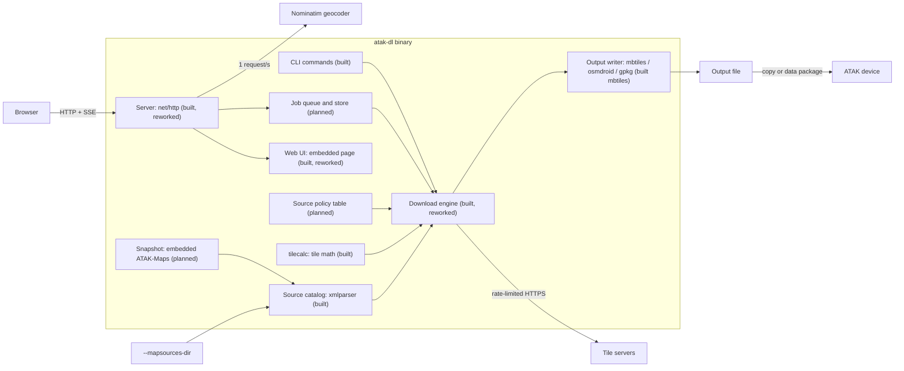
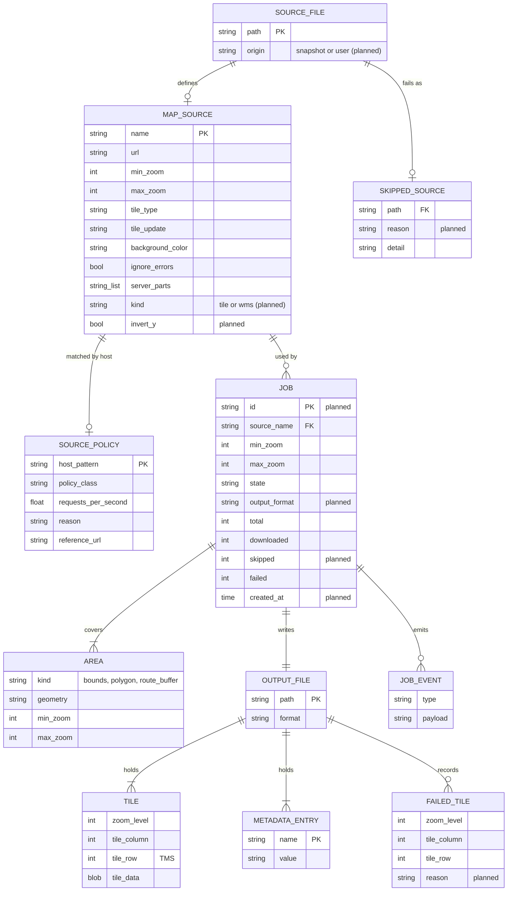
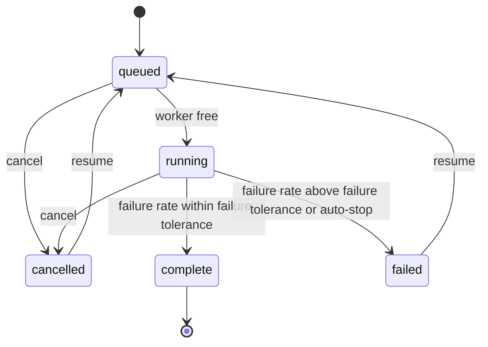

# ATAK Map Downloader

## Overview

ATAK Map Downloader is a single Go binary, `atak-dl`. It reads MOBAC source files and downloads the tiles of one map source over an area and a zoom range. It writes the tiles to an SQLite output file that ATAK imports for offline use. The project has a CLI for scripts and a web UI for interactive area selection.

The project was written in February 2026 and received one outside fix in August 2026 (PR #3). This spec was reconstructed from the code on 2026-11-21. Features 01–04 describe what is built. Features 00 and 05–12 are the roadmap that issue-flow builds.

The project exists because ATAK users often work with no network. Examples are search and rescue teams, wildland fire crews and outdoor users. ATAK can stream tiles and download small areas on the device. This project moves that work to a desktop or a server: more bandwidth, larger areas, repeatable jobs, and one output file that many devices can use.

## Terms

| Term | Part of speech | Meaning in this project | Do not use |
|---|---|---|---|
| project | noun | ATAK Map Downloader as a whole, built as the `atak-dl` binary. | app, system, tool (in requirements) |
| ATAK | noun | Android Team Awareness Kit. Also covers iTAK and WinTAK when this spec says "TAK clients". | — |
| MOBAC | noun | Mobile Atlas Creator. Its XML format defines map sources. | — |
| map source | noun | One tile provider definition: name, URL template, zoom range, tile type. Code: `xmlparser.MapSource`. | provider, layer, map |
| source file | noun | One MOBAC XML file that defines one map source. | config, definition |
| source catalog | noun | The set of map sources that the project loaded. | library, source list |
| snapshot | noun | The pinned copy of ATAK-Maps source files embedded in the binary (planned, feature 09). | bundle, vendor copy |
| overlay | noun | A map source with transparent tiles, drawn on top of another map source. | layer |
| policy class | noun | The terms-of-use class of a map source: `open`, `conditional` or `restricted` (planned, feature 06). | license, tier |
| rate limit | noun | The maximum number of requests per second that the project sends to one host. | throttle |
| tile | noun | One square raster image at one zoom level, column and row. | image, chunk |
| zoom level | noun | An integer from 0 to 25 that selects the tile grid. | level, z (in prose) |
| zoom range | noun | A minimum and a maximum zoom level, both included. | levels |
| bounds | noun | A geographic rectangle: minimum and maximum latitude and longitude. The `--bbox` flag name stays as it is. | bbox (in prose), extent, box |
| area | noun | The region that a job covers: bounds, a polygon or a route buffer (polygon and route buffer are planned, feature 11). | AOI, region, selection |
| route buffer | noun | An area made from a line and a distance in metres on each side of it (planned). | corridor |
| estimate | noun | A prediction of the tile count, file size and time for an area and a zoom range. The `estimate` command name stays as it is. | quote, calculation |
| preview | noun | A grid of sample tiles from a map source, shown on the map over the area. | thumbnail |
| download | verb | To get tiles from a map source over HTTP and write them to an output file. Never a noun in this spec. | fetch, grab, scrape, pull |
| job | noun | One run of a download: map source, area, zoom range, settings, output file and state. | download (noun), task, run |
| output file | noun | The SQLite or zip file that a job writes. | tileset, database, map file, archive |
| output format | noun | The schema of the output file: `mbtiles`, `osmdroid` or `gpkg` (planned, feature 10). | file type |
| data package | noun | An ATAK zip file with a `MANIFEST/manifest.xml` (planned, feature 10). | mission package (except in ATAK quotes) |
| retry | verb | To send a tile request again after it fails. | re-fetch |
| resume | verb | To continue a job into an existing output file and skip the tiles it already holds (planned, feature 07). | restart, continue |
| failure rate | noun | Failed tiles divided by processed tiles in one job. | error rate |
| failure tolerance | noun | The highest failure rate at which a job still succeeds. Code: `MaxFailureRate`. | error budget |
| server | noun | The HTTP process that `atak-dl serve` starts. | backend, daemon |
| web UI | noun | The browser page that the server sends from the binary. | frontend, dashboard, web app |
| CLI | noun | Command-line interface: the `atak-dl` subcommands. | terminal mode |
| base map | noun | The background map that the web UI draws under the area. | basemap layer |
| geocode | verb | To find coordinates for a place name through Nominatim. | search (as a verb for this) |
| token | noun | The shared secret that a client sends to a server that is not bound to loopback (planned, feature 12). | password, API key |
| TMS | noun | Tile Map Service row order: row 0 is at the south edge. | — |
| XYZ | noun | Slippy-map row order: row 0 is at the north edge. | — |
| WMS | noun | OGC Web Map Service. A map source that the project requests with bounds instead of a tile column and row. | — |
| SSE | noun | Server-Sent Events: a one-way HTTP event stream (planned, feature 05). | — |

## Goals

1. A user prepares an offline output file for an area with one command or one web UI session.
2. Every output file that the project writes imports into ATAK with no manual change.
3. The binary builds for Linux, macOS and Windows on amd64 and arm64 with no C toolchain (`CGO_ENABLED=0`).
4. The web UI works with no internet connection, apart from the tile requests and the online base map.
5. The project sends no request that breaks a published usage policy by default: identifying User-Agent, rate limits, backoff, and a warning for restricted map sources.
6. A cancelled or failed job keeps every tile that it downloaded, and the user can resume it.
7. A team runs the server on one LAN machine and submits jobs from a browser, with a token.

## Non-goals

- The project does not host or proxy tiles to ATAK devices for live streaming.
- The project does not create vector tiles or render OpenStreetMap data.
- The project does not change the projection of raster tiles. Every map source is Web Mercator or a WMS that supports EPSG:3857.
- The project does not re-encode tiles to JPEG or WebP in v1.
- The project does not have user accounts. One shared token protects the server.
- The project does not keep a Python-version compatibility promise. The README claim is retired.
- The project does not ship a desktop wrapper (Wails or similar).

## Users & personas

| Persona | What they need | What they may do |
|---|---|---|
| Solo operator | Prepares offline maps for their own ATAK device before a trip. Uses the web UI or the CLI on a laptop. | Every action. The server is on loopback, so no token is needed. |
| Team preparer | Prepares output files for a SAR unit, a fire crew or a club, and gives them to members as files or data packages. | Every action. Often scripts the CLI. |
| Server operator | Runs `atak-dl serve` on a LAN machine or in Docker for a team. | Sets the bind address, the token, the data directory and the worker count. |
| Team member | Opens the server's web UI from a browser on the LAN. | With the token: submits jobs, cancels jobs and downloads output files. Without the token: nothing. |
| OSS user | Finds the project on GitHub. Installs it from a release, Homebrew or Docker. | Same as the solo operator. |

## Feature map

| Feature set | Spec file | Epic | Status | Mockups |
|---|---|---|---|---|
| Foundation | [features/00-foundation.md](features/00-foundation.md) | Epic 0: Foundation | planned | — |
| Map source catalog | [features/01-map-sources.md](features/01-map-sources.md) | Existing (built) | built | — |
| Area estimate and tile info | [features/02-area-estimate.md](features/02-area-estimate.md) | Existing (built) | built | — |
| Tile download and output file | [features/03-tile-download.md](features/03-tile-download.md) | Existing (built) | built | — |
| Web UI and server | [features/04-web-ui.md](features/04-web-ui.md) | Existing (built) | built | — |
| Security hardening | [features/05-security-hardening.md](features/05-security-hardening.md) | Epic 1: Security hardening | planned | — |
| Polite downloading | [features/06-polite-downloading.md](features/06-polite-downloading.md) | Epic 2: Polite downloading | planned | 04-source-policy-warning |
| Robust downloads | [features/07-robust-downloads.md](features/07-robust-downloads.md) | Epic 3: Robust downloads | planned | — |
| Offline web UI | [features/08-offline-web-ui.md](features/08-offline-web-ui.md) | Epic 4: Offline web UI | planned | 01-workspace |
| Source sync and WMS | [features/09-source-sync.md](features/09-source-sync.md) | Epic 5: Source sync and WMS | planned | — |
| Output formats | [features/10-output-formats.md](features/10-output-formats.md) | Epic 6: Output formats | planned | 03-export-options |
| Area selection | [features/11-area-selection.md](features/11-area-selection.md) | Epic 7: Area selection | planned | 02-area-tools |
| Team server | [features/12-team-server.md](features/12-team-server.md) | Epic 8: Team server | planned | 05-jobs |

## Architecture & stack

The diagram shows the target architecture after Epic 8. Components that exist today are marked "built".



Per component:

- **Language and runtime: Go.** Today `go.mod` says `go 1.21`, and the installed toolchain is 1.27.3. Epic 0 sets `go 1.26` with `toolchain go1.27.4`. Go 1.27.4 is the current stable release (https://go.dev/doc/devel/release, retrieved 2026-11-21). Go beat the alternatives because it gives one static binary and has a cross-compile story that a solo maintainer can keep. See [ADR 0001](../adr/0001-go-single-binary-cli.md).
- **CLI: spf13/cobra.** Built. Cobra is kept because it already defines every command.
- **SQLite driver: modernc.org/sqlite (planned).** It replaces `mattn/go-sqlite3`, which needs CGO. modernc is at v1.62.0 (https://pkg.go.dev/modernc.org/sqlite?tab=versions, retrieved 2026-11-21). It is about 1.6 times slower than mattn at bulk inserts (https://github.com/cvilsmeier/go-sqlite-bench). The network is the bottleneck, so the difference is small. ncruces/go-sqlite3 is pre-1.0 and is the fallback. See [ADR 0005](../adr/0005-pure-go-sqlite.md).
- **Server: net/http.** The Go 1.22 method-and-path patterns replace the hand-written router in `cmd/atak-dl/commands/web.go:52-75`. `http.CrossOriginProtection` (Go 1.25, https://go.dev/doc/go1.25) blocks requests from other web pages. `os.Root` (Go 1.24) limits file serving to the output directory.
- **Progress channel: SSE (planned).** SSE replaces `gorilla/websocket`, which has had no release since v1.5.3 in June 2024 (https://pkg.go.dev/github.com/gorilla/websocket?tab=versions). Progress goes from the server to the browser only, and browser commands become POST requests. See [ADR 0006](../adr/0006-sse-job-api.md).
- **Web UI: vanilla JavaScript + Leaflet 1.9.4 + Leaflet-Geoman (planned), embedded with `embed.FS`.** Leaflet 2.0 is still in beta (https://github.com/Leaflet/Leaflet/releases). Leaflet.draw has had no release since 2018, and Leaflet-Geoman v2.20.8 is active (https://github.com/geoman-io/leaflet-geoman/releases). Bootstrap and Font Awesome are removed. All assets are vendored, so the page works offline.
- **Map sources: MOBAC XML from joshuafuller/ATAK-Maps (MIT).** Today there is a copied folder of 34 files. Planned: an embedded snapshot of ATAK-Maps v2.3.1 with 53 source files (https://github.com/joshuafuller/ATAK-Maps/releases). See [ADR 0004](../adr/0004-mobac-xml-sources.md) and [ADR 0008](../adr/0008-embedded-source-snapshot.md).
- **Release: GoReleaser v2 on GitHub Actions (planned).** Release targets are GitHub Releases, a GHCR image and a Homebrew cask in `Crank-Git/homebrew-tap`. GoReleaser v2.20.3 is current (https://github.com/goreleaser/goreleaser/releases). `brews` is deprecated in favour of `homebrew_casks` (https://goreleaser.com/deprecations/).
- **Lint: golangci-lint v2 (planned).** Version v2.15.0, with the complexity linters enabled (https://github.com/golangci/golangci-lint/releases).

Repository layout (current, plus planned additions in italics):

```
cmd/atak-dl/            CLI entry point and one file per command
internal/xmlparser/     source file parser (built)
internal/tilecalc/      Web Mercator tile math (built)
internal/download/      download engine (built)
internal/mbtiles/       MBTiles writer (built)
internal/output/        planned: one writer per output format
internal/policy/        planned: source policy table and rate limits
internal/jobs/          planned: job queue and job store
internal/server/        planned: HTTP handlers moved out of commands/web.go
web/                    embedded web UI
mapsources/             source files (replaced by the embedded snapshot in Epic 5)
docs/specs/ docs/adr/   this spec and the decision records
```

## Data model



Per entity:

- **MAP_SOURCE** (built, `internal/xmlparser/xmlparser.go:16-26`). The parser loads it from a `<customMapSource>` source file. `name` is the key. If two source files have the same name, the last file loaded wins with no warning. Defaults: if both zooms are 0, `max_zoom` is 18. `tile_type` is `png`, `tile_update` is `None` and `background_color` is `#000000`. Planned: `kind` (`tile` or `wms`) and `invert_y` (feature 09).
- **SOURCE_FILE** (built). A MOBAC XML file in the source directory. Planned: `origin` is `snapshot` or `user` (feature 09).
- **SKIPPED_SOURCE** (planned, feature 09). An in-memory record of a source file that did not load, with its reason. Today the parser drops these with no record.
- **SOURCE_POLICY** (planned, feature 06). A table embedded in the binary, keyed by a host pattern such as `*.google.com`. `policy_class` is `open`, `conditional` or `restricted`. `requests_per_second` is the rate limit for that host.
- **JOB** (built as one in-memory record, `cmd/atak-dl/commands/web.go:30-34`). The state is `idle` or `downloading`. Planned (features 05 and 12): an `id`, the states in the state diagram below, and a persistent record in the data directory.
- **AREA** (built as bounds only). Planned: polygon and route buffer geometry as GeoJSON, with a zoom range for each area (feature 11).
- **OUTPUT_FILE** (built). Path: `./downloads/<name>_z<min>-<max>.sqlite`. An existing file at that path is deleted first, and the file is deleted again on cancel. Planned: an extension per output format, no silent delete, and resume (features 07 and 10).
- **TILE** (built, `internal/mbtiles/mbtiles.go:29-34`). `UNIQUE (zoom_level, tile_column, tile_row)`. `tile_row` is TMS: `(1<<z)-1-y`. `tile_data` holds the bytes the server returned, with no check.
- **METADATA_ENTRY** (built). Keys: `name`, `type`, `version`, `description`, `format`, `bounds`, `minzoom`, `maxzoom`. Planned: `center` and `attribution` (feature 10).
- **FAILED_TILE** (planned, feature 07). A table `atakdl_failed_tiles` in the output file. ATAK reads only the `tiles` and `metadata` tables, so an extra table is safe. This is inferred from ATAK-CIV `TilesetInfo.java` and is a risk item.
- **JOB_EVENT** (planned). An SSE message: `progress`, `state` or `log`.

Job lifecycle (planned, features 05, 07 and 12):



## Cross-cutting concerns

- **Authentication and authorization.** Today there is none, and that is acceptable only on loopback. Planned (feature 12): if the server binds to an address that is not loopback, every request must carry the token. The token comes from `--token` or `ATAKDL_TOKEN`. If neither is set, the server generates one and prints it once at start.
- **Cross-origin requests.** Today the server sends `Access-Control-Allow-Origin: *`, and the websocket accepts any origin (`web.go:44,54`). Any web page that the user visits can start a job. Planned (feature 05): no CORS headers, and `http.CrossOriginProtection` on every state-changing route.
- **TLS.** Today `InsecureSkipVerify` is true by default (`internal/download/download.go:42,100`). Planned (feature 05): verification is on by default, and `--insecure` turns it off for one job.
- **Error handling.** Today handlers write hand-built JSON strings as `text/plain` (`web.go:179,352`). Planned (feature 05): every error response is `application/json` with the shape `{"error": {"code": "<snake_case>", "message": "<text>"}}`.
- **Validation.** Planned limits:
  - The zoom range is within the map source's zoom range.
  - The tile count is at most `--max-tiles`, with a default of 500,000 (feature 07).
  - A request body is at most 1 MiB.
  - Concurrency is from 1 to 32.
- **Logging.** `log/slog` with the text handler today. Planned: every job log line carries `job_id`, and every failed tile is logged at debug level with its URL and reason.
- **Politeness.** Planned (feature 06):
  - The User-Agent is `atak-map-downloader/<version> (+https://github.com/Crank-Git/ATAKMapDownloader)`.
  - Each host has a rate limit.
  - The project backs off on 429 and 503 and honours `Retry-After`.
  - Geocoding is limited to 1 request per second across the whole server, as the Nominatim policy requires (https://operations.osmfoundation.org/policies/nominatim/).
- **Accessibility.** Planned (feature 08):
  - Every control has a label.
  - Icon buttons have `aria-label`.
  - The job status region is `aria-live="polite"`.
  - The progress bar sets `aria-valuenow`.
  - The theme follows `prefers-color-scheme`.
- **Performance targets.** The tile writer stores at least 500 tiles per second on a laptop SSD (one writer goroutine, one transaction per 500 tiles). The server starts in less than 1 second with the embedded snapshot.
- **Internationalization.** English only. No i18n is planned.

## Environments & config

- **Environments.** One environment: the user's machine, or a LAN server or container. The project has no hosted deployment. Releases are the deploy target: GitHub Releases, `ghcr.io/crank-git/atak-map-downloader` and the Homebrew cask.
- **Configuration.** Configuration is through flags today, and no code reads an environment variable. Planned environment variables:

| Name | Feature | Meaning |
|---|---|---|
| `ATAKDL_TOKEN` | 12 | The token for a server that is not on loopback. It has the same meaning as `--token`. |
| `ATAKDL_DATA_DIR` | 12 | The directory for output files and the job store. It has the same meaning as `--data-dir`. The default is `./downloads`. |

- **CI secrets** (names only; see [docs/external.md](../external.md)): `GITHUB_TOKEN` (provided by Actions) and `HOMEBREW_TAP_GITHUB_TOKEN` (a fine-grained token with write access to `Crank-Git/homebrew-tap`).
- **Seed and demo data.** Epic 0 adds `testdata/` with three fixture source files (tile, quadkey and WMS) and a fake tile server for tests (`internal/testtiles`). The demo is `atak-dl download --source "OpenTopo - Opentopomap" --bbox 45.30,-121.80,45.45,-121.60 --min-zoom 8 --max-zoom 12`, Mount Hood with about 60 tiles.

## Testing strategy

- **Unit tests.** `go test -race ./...`. Every package in `internal/` has table-driven tests. Today only `tilecalc` and `xmlparser` have tests (12 tests, all pass).
- **Integration tests.** The download engine and every output writer run against `internal/testtiles`, an `httptest` tile server. The test server can return 200, 404, 429 with `Retry-After`, 503, HTML bodies and slow responses. No test calls a real tile server.
- **Conformance tests.** Each output format has a test that opens the output file and applies ATAK's format-detection rules from ATAK-CIV `TilesetInfo.java`: the `tiles` column set, the row order and the metadata keys. A device check is a manual, optional step, because the maintainer has no TAK client installed.
- **HTTP tests.** The server handlers run under `httptest`. SSE and timeouts use `testing/synctest`.
- **Smoke test.** `scripts/smoke.sh` builds the binary and starts `serve` on a free port. It checks that `GET /` returns 200 and that `GET /api/sources` returns a non-empty list, then stops the server.
- **Lint.** `golangci-lint run` with the config from Epic 0. `gofmt -l .` prints nothing.
- **What "done" means for a change:** `go test -race ./...`, `golangci-lint run` and `scripts/smoke.sh` pass in CI on the PR. A change to an output format also passes its conformance test.

## Epics

1. **Epic 0: Foundation.** Goal: a fresh clone tests, lints, builds and releases with no C toolchain. Covers [00-foundation](features/00-foundation.md). Depends on: nothing. Exit: CI is green on `develop`, and a `v0.2.0-rc` tag produces signed release artifacts.
2. **Epic 1: Security hardening.** Goal: no web page and no network attacker can drive or tamper with a job. Covers [05-security-hardening](features/05-security-hardening.md). Depends on: Epic 0. Exit: the cross-origin, TLS and limit tests pass, and the websocket is gone.
3. **Epic 2: Polite downloading.** Goal: default behavior meets the published tile and Nominatim policies. Covers [06-polite-downloading](features/06-polite-downloading.md). Depends on: Epic 1 (the job API). Exit: rate-limit and backoff tests pass, and restricted map sources need confirmation.
4. **Epic 3: Robust downloads.** Goal: no job loses a downloaded tile, and no output file holds a bad tile. Covers [07-robust-downloads](features/07-robust-downloads.md). Depends on: Epic 2 (the host rate limiter that the engine waits on). Exit: resume, validation and tile-cap tests pass under `-race`.
5. **Epic 4: Offline web UI.** Goal: the web UI works air-gapped and returns output files to the browser. Covers [08-offline-web-ui](features/08-offline-web-ui.md). Depends on: Epic 1. Exit: the page loads with the network off, and no request leaves for a CDN.
6. **Epic 5: Source sync and WMS.** Goal: the binary carries a current source catalog, and every source file in it loads or reports why not. Covers [09-source-sync](features/09-source-sync.md). Depends on: Epic 2 (policy table keys). Exit: 53 snapshot source files load or are listed as skipped with a reason.
7. **Epic 6: Output formats.** Goal: the user chooses MBTiles, OSMDroid or GeoPackage, optionally inside a data package. Covers [10-output-formats](features/10-output-formats.md). Depends on: Epic 3 (the single writer). Exit: the conformance tests pass for all three output formats.
8. **Epic 7: Area selection.** Goal: a job covers polygons, imported files and route buffers, with a zoom range for each area. Covers [11-area-selection](features/11-area-selection.md). Depends on: Epic 4 (Geoman). Exit: a polygon job downloads only intersecting tiles.
9. **Epic 8: Team server.** Goal: a team shares one server with a token, a job queue and job history. Covers [12-team-server](features/12-team-server.md). Depends on: Epics 1 and 4. Exit: the Docker image runs headless and two queued jobs complete in order.

## Milestones

| Milestone | Epics | What "shippable" means |
|---|---|---|
| v0.2.0: Modern build | 0 | Signed CGO-free binaries for 6 platforms, a GHCR image and a Homebrew cask. Behavior is unchanged. |
| v0.3.0: Safe by default | 1, 2 | The local server cannot be driven by other web pages. TLS is verified. Requests follow the tile and Nominatim policies. |
| v0.4.0: Reliable jobs | 3, 4 | Resume, tile validation and tile caps. The web UI works offline and returns output files. |
| v0.5.0: Current catalog | 5, 6 | The ATAK-Maps v2.3.1 snapshot with WMS support. Three output formats and data packages. |
| v1.0.0: Teams | 7, 8 | Polygon and route areas. A token-protected team server with a queue. |

Epic 4 needs only Epic 1, so issue-flow may build it in parallel with Epics 2 and 3.

## Assumptions

1. The default output format stays MBTiles, and the default extension changes from `.sqlite` to `.mbtiles` in Epic 6. ATAK detects the format by the schema, not by the extension (ATAK-CIV `TilesetInfo.java`), so the change is safe for import.
2. The tile cap default is 500,000 tiles per job. That is about 7.5 GB at the CLI's 15 KB per tile estimate.
3. The default rate limit for a host that is not in the policy table is 4 requests per second, with concurrency at most 4 for that host.
4. Restricted map sources stay in the snapshot. They are labeled, rate-limited to 1 request per second, and need explicit confirmation (`--accept-terms` in the CLI, a checkbox in the web UI). This is the user's "Tag + warn" choice.
5. The team server runs jobs one at a time by default (`--workers 1`), because tile servers rate-limit by client IP.
6. The job store is a JSON-lines file in the data directory, not an SQLite database. Job volume is small.
7. Release versions start at v0.2.0. The current code is v0.1.0 for history, and no tag exists today.
8. Device verification on ATAK is optional and manual. Conformance tests carry the acceptance criteria.

## Risks & open questions

Reconciliation of the existing documentation against the code (Phase 1):

- **Contradicted — README cross-compile.** `README.md:37-46` tells users to cross-compile with `GOOS`/`GOARCH`. The `mattn/go-sqlite3` driver needs CGO, so those commands fail with no C cross-compiler. The code wins. Epic 0 fixes the driver and the README.
- **Contradicted — "1:1 functionality matching the Python version".** `README.md:5`. No Python code is in this repo, and behavior differs: WMS is skipped, and the defaults for failure tolerance and size per tile are different. The user retired the claim. Epic 0 removes it.
- **Contradicted — "30+ map sources".** 34 files ship. 30 load. Three WMS source files are skipped with no log (`internal/xmlparser/xmlparser.go:129-132`), and one file is not a source file.
- **Contradicted — "MBTiles output".** The output file has a `.sqlite` extension and lacks the `center` key that the MBTiles 1.3 spec recommends (https://github.com/mapbox/mbtiles-spec/blob/master/1.3/spec.md). ATAK loads it through its "momap" path, not its "mbtiles" path.
- **Contradicted — "Batch Delay".** The web UI offers a batch delay (`web/index.html:127`). The engine never reads `DelayBetweenBatches` (`internal/download/download.go:28`).
- **Risk — the build fails on this machine today.** On 2026-11-21, `go run ./cmd/atak-dl` failed at the CGO link step on macOS 27 (`ld: … tapi error: malformed file … unknown architecture`). The prebuilt `./atak-dl` from February still runs. Epic 0 removes CGO (ADR 0005), so this is the first sub-issue to build.
- **Risk — a late cancel is lost.** The engine checks the context only while it starts tile requests (`internal/download/download.go:171-184`). A SIGINT after the last request starts ends as a normal job, and the CLI can print "Download complete". Feature 07 fixes this (FR-robust-downloads-30).
- **Risk — preview tiles can fail to show.** The preview overlays set `crossOrigin: 'anonymous'` (`web/static/js/app.js`), so a tile server that sends no CORS header blocks the image. Feature 08 owns the preview rendering.
- **Risk — ATAK format handling is inferred, not tested.** The public ATAK-CIV source is archived at 4.6.0.5 (October 2024). No public source exists for ATAK 5.x, iTAK, WinTAK or TAK Aware. Each output format can fail on a newer client. Mitigation: conformance tests, plus an optional device check before v0.5.0.
- **Risk — restricted map sources.** Google and Esri terms prohibit bulk download and offline caching. Google: https://developers.google.com/maps/documentation/tile/policies. Esri: https://www.esri.com/content/dam/arcgisonline/docs/tou_summary.pdf. The OSM tile policy says "Offline use is not permitted" (https://operations.osmfoundation.org/policies/tiles/). Microsoft says direct Bing tile URLs are "not allowed" (https://learn.microsoft.com/en-us/bingmaps/rest-services/directly-accessing-the-bing-maps-tiles). The project warns and rate-limits, and the user decides. Bing tile endpoints can stop working at any time.
- **Risk — the ATAK-Maps v2 rename.** ATAK-Maps v2.0.0 renamed every map source (https://github.com/joshuafuller/ATAK-Maps/blob/master/CHANGELOG.md). Scripts that pass `--source "Google - Satellite Only"` break after Epic 5. Mitigation: an alias table from old names to new names for one release.
- **Open question — Leaflet-Geoman license.** The free edition is believed to be MIT, but the research spike did not confirm it. Epic 4 confirms the license before it vendors the library.
- **Open question — WebP support in ATAK.** Not verified. Re-encoding is a non-goal for v1.
- **Open question — the OSMDroid `ATAK_metadata` table.** The exact schema must be read from ATAK-CIV `OSMDroidTileContainer.java` before Epic 6 builds the writer.
- **Undocumented behavior found in the code** (no document mentions it):
  - the `/api/preview` route and its tile grid
  - the `/api/geocode` Nominatim proxy
  - the `/api/tile-info` and `/api/validate-source` routes, which the web UI never calls
  - the auto-zoom rule in `estimate`
  - the mtime-based source cache
  - deletion of an existing output file before a job
  - deletion of the output file on cancel
  - the single global job lock
  - dark mode that inverts map tiles

## Changelog

- 2026-11-21: Created by project-inherit. Features 01–04 are built and documented from the code. Features 00 and 05–12 are planned from the roadmap interview.
- 2026-11-21: Approved by the maintainer after review round 1. Mockups 02, 03 and 04 were adjusted for heading sizes and borders.
